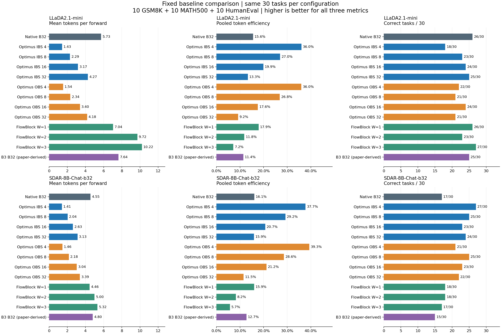

# 固定配置基线

2 模型 × 13 配置 × 30 题。按模型看[完整指标表](../../docs/results.md)；[汇总 CSV](summary.csv)还列出各数据集分数、实际 Q、失败、截断和仅成功请求的指标。汇总主指标始终用全部 30 题。[逐题 CSV](requests.csv)可按 `(model, policy, index)` 定位。

| 系列 | 配置 | 执行口径 |
|---|---|---|
| Native | `native32` | 原生串行块，B=32 |
| FlowBlock | `flow_w1/w2/w3` | packed 窗口，接受比例门控；SDAR 不把不可变 prompt 中的 EOS 算成生成结束 |
| Optimus | `optimus_ibs_c*`、`optimus_obs_c*` | 每次运行固定名义 chunk 为 4、8、16 或 32，不切换、不强制裁剪 Q |
| B3 | `b3_native32` | 仅测试一个 B32 配置，每次计算当前块或当前块加一个 future 块。不是作者代码或官方复现 |

LLaDA 保留两次非收敛。IBS4 的 MATH‑500 请求（index 10）在扩展诊断中仍出现两个 token 交替，无法冻结缓存前缀；OBS32 的 GSM8K 请求（index 5）重复编辑并停滞，但未记录足以证明同一种两 token 循环的轨迹。不修改特例、不补题；这两次仍计入各自 30 题分母并计入已消耗的 F/Q。

FlowBlock W4 的原 packed 对照在[后续配对实验](../flowblock-prefix/)，不必从 W3 外推。基线与后续实验保留各次真实观测，重复测得的同名策略不会被合并成一个平均值。
