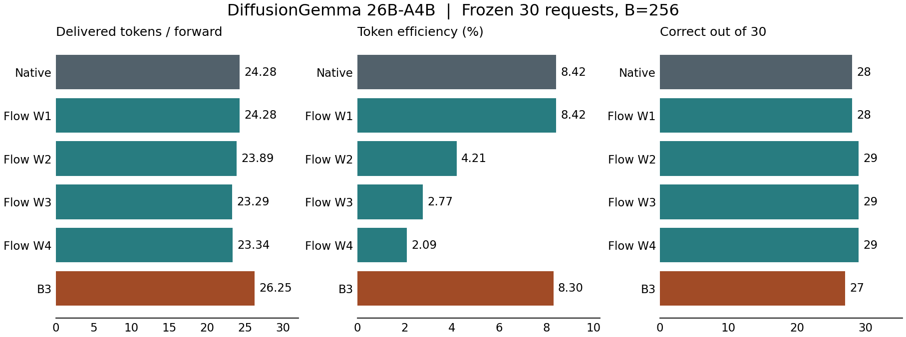

# DiffusionGemma 26B-A4B

Same frozen30, B=256, 2,048-token cap, native entropy-bound sampler and request seeds.

| Study | Source and configuration | Results |
|---|---|---|
| Native | [Checkpoint and sampler](../diffusiongemma-native/) | [30 requests](../diffusiongemma-native/requests.csv) |
| Native, FlowBlock W=1/2/3/4, B3 | [Adapters and execution logic](../diffusiongemma-wave/) | [Summary](../diffusiongemma-wave/summary.csv) · [180 paired observations](../diffusiongemma-wave/requests.csv) |

The six rows correspond to six actual runs. FlowBlock W=1 matches the native
token IDs and all encoder/decoder event shapes on 30/30 prompts. Increasing W
adds physical decoder work, even on unopened slots; it does not improve TPF on
this set. B3 has the highest mean TPF and 27 correct versus native's 28. One
answer represents 3.33 percentage points; these are paired observations on this
set, not population rankings.

Run `python tools/gemma_wave_archive.py` to rebuild the summary and figure from
public numeric data. Pass `--native DIR --wave DIR` to verify both private raw
runs and regenerate the export. Native's separately reported decoder-only TPF
is not used in this figure.
