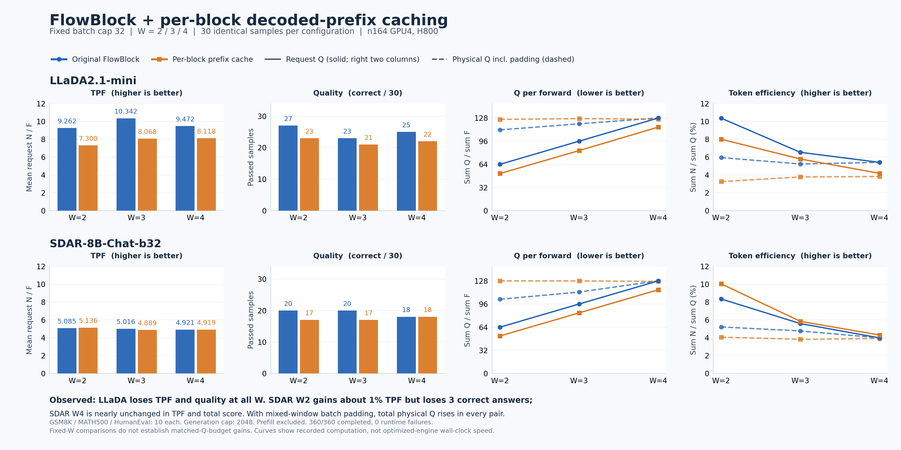

# FlowBlock 块内前缀缓存

唯一策略干预：每个原生 B32 块分别记录连续已解码前缀；token 以当前值参加一次 forward、其后未再被编辑，才可以退休。退休位置及其窗口尾端副本在进入 Transformer 前从 Q 中移除；K/V 保留原位置，冻结前缀不再接受 T2T。块间掩码、窗口推进和启动门槛不变。[执行代码](../../bdlm_serving/methods/flowblock/prefix_cache.py)。

2 模型 × 原 packed / PrefixCache × W=2/3/4 × 30 题。全部 360 次完成；逐题及配对差值见 [requests.csv](requests.csv)、[paired_requests.csv](paired_requests.csv)。[汇总](summary.csv)区分请求 Q、padding Q、实际物理 Q、移除的 Q。比较干预效果时可直接在同一 W 内读取原版和缓存版。

LLaDA 每个 W 的请求 Q/F 都下降，但三个 W 的 TPF、质量和请求 token efficiency 均下降。SDAR 的请求 token efficiency 三档都提高，但 W2/W3 的正确数均从 20 降至 17，W4 保持 18/30。请求 Q 减少也不保证批内 padding 后的物理 Q 减少；可对照[权衡图](figures/tradeoff.png)。

**Commit 审计更正。** 此实验是 packed 路径：按序推进提交指针和 KV 写回仍执行，**没有独立的 commit forward**。但退休行在提交时不重新计算，搬回缓存的可能是旧 KV；不能称为保留完整的 commit-refresh。随机三层小模型诊断里，W2/3/4 各观察到 3 次提交，dense 与缓存版均为 99 个生成 forward；提交时当前块实际计算行数却为 32 对 1。对同 token、同 mask 的 dense 刷新，最大 KV 绝对差为 0 对 2.5625。该误差是机制反例，不是正式模型上的误差估计。正式 LLaDA W2 的 F 从 1,942 增至 3,387，是普通生成调用增加，不是多算了提交步骤。
