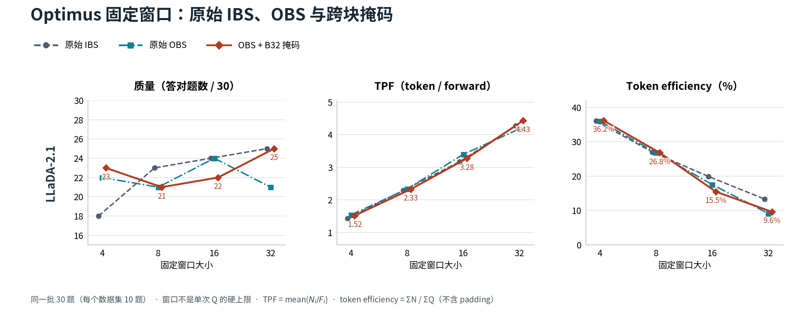
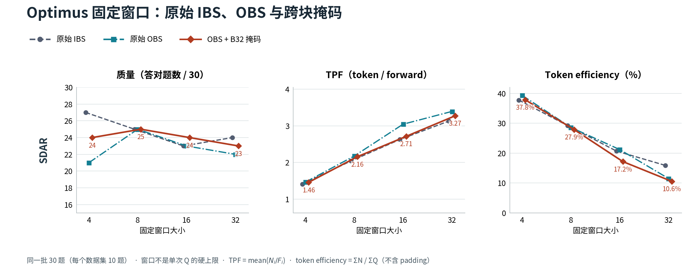

# Optimus：IBS、OBS 与 OBS+B32

只对原 OBS 的注意力做交集：`visible(q,k) = original_visible(q,k) && floor(q/32) >= floor(k/32)`。q、k 都是**包含 prompt 在内的绝对位置**。同块双向、早块不能读后块，晚块可以读早块。保留 OBS 的选位、窗口移动、缓存写回、采样、T2T、EOS 与进度上限。**不裁剪**超出名义窗口的 Q。[掩码实现](../../bdlm_serving/methods/optimus/boundary.py)只有这一项干预。

2 模型 × 4 个固定 chunk（4/8/16/32）× 30 题 = 240 条新增请求。表内 `ibs`/`obs` 为复用的原基线（480 条），`bobs` 为新增。历史 CSV 的 `cap` 列表示名义 chunk，**不是硬上限**；`maxQ` 是实测峰值。`affected_F` 在新方法表示真实删掉可见 QK 对的生成轮数，在原 OBS 表示若应用该掩码会受影响的轮数。两者不能解释成删掉了 Q 行。

[总对比图](figures/comparison.png) · [逐请求数据](requests.csv) · [汇总](summary.csv) · [逐题得失](paired_quality.csv)

LLaDA 窗口 32 的质量由原 OBS 的 21/30 变为 25/30，TPF 从 4.179 变为 4.430；配对看是 5 题由错变对、1 题由对变错。SDAR 同窗口从 22/30 到 23/30，但 TPF 从 3.393 到 3.273，token efficiency 从 11.52% 到 10.58%。不要把质量净增解释为每题都改善，也不要把 OBS 与 IBS 的全部差异归因于注意力掩码。
