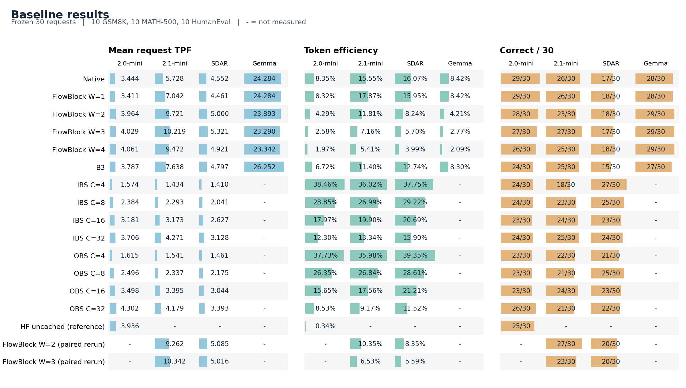

# 全部基线

四个模型的 Native、FlowBlock W=1/2/3/4、B3，以及已测的 Optimus IBS/OBS 固定窗口 4/8/16/32。Gemma 用 B=256，其他三个模型用 B=32。Gemma 未测 Optimus。B3 为仓库适配，不是官方实现。

每个数值来自同一组 30 题（GSM8K、MATH-500、HumanEval 各 10）。TPF = 逐题 N/F 的均值；token efficiency = ΣN/ΣQ；质量 = 正确数/30。Q 是实际计算的请求行；纯 prompt prefill 单列，不计入 F/Q。失败及触及长度上限的请求均保留。

[逐题数值](requests.csv) · [全体与各数据集汇总](summary.csv) · [矢量图](figures/comparison.svg)

## LLaDA 2.0-mini

| 策略 | 实测 Q/F | TPF | Token efficiency | 质量 | 运行来源 |
|---|---:|---:|---:|---:|---|
| Native B32（已完成块缓存 KV） | 32.00 | 3.444 | 8.35% | 29/30 | [llada20-cached-b32](../../archive/llada20-cached-b32/) |
| FlowBlock W=1 | 32.00 | 3.411 | 8.32% | 29/30 | [llada20-frozen30](../../archive/llada20-frozen30/) |
| FlowBlock W=2 | 64.00 | 3.964 | 4.29% | 28/30 | [llada20-frozen30](../../archive/llada20-frozen30/) |
| FlowBlock W=3 | 96.00 | 4.029 | 2.58% | 27/30 | [llada20-frozen30](../../archive/llada20-frozen30/) |
| FlowBlock W=4 | 128.00 | 4.061 | 1.97% | 26/30 | [llada20-frozen30](../../archive/llada20-frozen30/) |
| B3 | 41.68 | 3.787 | 6.72% | 24/30 | [llada20-frozen30](../../archive/llada20-frozen30/) |
| IBS C=4 | 3.95 | 1.574 | 38.46% | 24/30 | [llada20-frozen30](../../archive/llada20-frozen30/) |
| IBS C=8 | 7.42 | 2.384 | 28.85% | 24/30 | [llada20-frozen30](../../archive/llada20-frozen30/) |
| IBS C=16 | 13.13 | 3.181 | 17.97% | 23/30 | [llada20-frozen30](../../archive/llada20-frozen30/) |
| IBS C=32 | 19.84 | 3.706 | 12.30% | 24/30 | [llada20-frozen30](../../archive/llada20-frozen30/) |
| OBS C=4 | 4.09 | 1.615 | 37.73% | 23/30 | [llada20-frozen30](../../archive/llada20-frozen30/) |
| OBS C=8 | 8.08 | 2.496 | 26.35% | 23/30 | [llada20-frozen30](../../archive/llada20-frozen30/) |
| OBS C=16 | 16.01 | 3.498 | 15.65% | 23/30 | [llada20-frozen30](../../archive/llada20-frozen30/) |
| OBS C=32 | 31.95 | 4.302 | 8.53% | 26/30 | [llada20-frozen30](../../archive/llada20-frozen30/) |
| HF uncached (reference) | 765.11 | 3.936 | 0.34% | 25/30 | [llada20-frozen30](../../archive/llada20-frozen30/) |

## LLaDA 2.1-mini

| 策略 | 实测 Q/F | TPF | Token efficiency | 质量 | 运行来源 |
|---|---:|---:|---:|---:|---|
| Native B32（已完成块缓存 KV） | 32.00 | 5.728 | 15.55% | 26/30 | [baselines](../../archive/baselines/) |
| FlowBlock W=1 | 32.00 | 7.042 | 17.87% | 26/30 | [baselines](../../archive/baselines/) |
| FlowBlock W=2 | 64.00 | 9.721 | 11.81% | 23/30 | [baselines](../../archive/baselines/) |
| FlowBlock W=2（配对实验重测） | 64.00 | 9.262 | 10.35% | 27/30 | [flowblock-prefix](../../archive/flowblock-prefix/) |
| FlowBlock W=3 | 96.00 | 10.219 | 7.16% | 27/30 | [baselines](../../archive/baselines/) |
| FlowBlock W=3（配对实验重测） | 96.00 | 10.342 | 6.53% | 23/30 | [flowblock-prefix](../../archive/flowblock-prefix/) |
| FlowBlock W=4 | 128.00 | 9.472 | 5.41% | 25/30 | [flowblock-prefix](../../archive/flowblock-prefix/) |
| B3 | 49.50 | 7.638 | 11.40% | 25/30 | [baselines](../../archive/baselines/) |
| IBS C=4 | 3.94 | 1.434 | 36.02% | 18/30 | [baselines](../../archive/baselines/) |
| IBS C=8 | 7.38 | 2.293 | 26.99% | 23/30 | [baselines](../../archive/baselines/) |
| IBS C=16 | 13.17 | 3.173 | 19.90% | 24/30 | [baselines](../../archive/baselines/) |
| IBS C=32 | 20.84 | 4.271 | 13.34% | 25/30 | [baselines](../../archive/baselines/) |
| OBS C=4 | 4.09 | 1.541 | 35.98% | 22/30 | [baselines](../../archive/baselines/) |
| OBS C=8 | 8.09 | 2.337 | 26.84% | 21/30 | [baselines](../../archive/baselines/) |
| OBS C=16 | 16.05 | 3.395 | 17.56% | 24/30 | [baselines](../../archive/baselines/) |
| OBS C=32 | 32.05 | 4.179 | 9.17% | 21/30 | [baselines](../../archive/baselines/) |

## SDAR-8B

| 策略 | 实测 Q/F | TPF | Token efficiency | 质量 | 运行来源 |
|---|---:|---:|---:|---:|---|
| Native B32（已完成块缓存 KV） | 32.00 | 4.552 | 16.07% | 17/30 | [baselines](../../archive/baselines/) |
| FlowBlock W=1 | 32.00 | 4.461 | 15.95% | 18/30 | [baselines](../../archive/baselines/) |
| FlowBlock W=2 | 64.00 | 5.000 | 8.24% | 18/30 | [baselines](../../archive/baselines/) |
| FlowBlock W=2（配对实验重测） | 64.00 | 5.085 | 8.35% | 20/30 | [flowblock-prefix](../../archive/flowblock-prefix/) |
| FlowBlock W=3 | 96.00 | 5.321 | 5.70% | 17/30 | [baselines](../../archive/baselines/) |
| FlowBlock W=3（配对实验重测） | 96.00 | 5.016 | 5.59% | 20/30 | [flowblock-prefix](../../archive/flowblock-prefix/) |
| FlowBlock W=4 | 128.00 | 4.921 | 3.99% | 18/30 | [flowblock-prefix](../../archive/flowblock-prefix/) |
| B3 | 40.32 | 4.797 | 12.74% | 15/30 | [baselines](../../archive/baselines/) |
| IBS C=4 | 3.98 | 1.410 | 37.75% | 27/30 | [baselines](../../archive/baselines/) |
| IBS C=8 | 7.40 | 2.041 | 29.22% | 25/30 | [baselines](../../archive/baselines/) |
| IBS C=16 | 13.27 | 2.627 | 20.69% | 23/30 | [baselines](../../archive/baselines/) |
| IBS C=32 | 20.83 | 3.128 | 15.90% | 24/30 | [baselines](../../archive/baselines/) |
| OBS C=4 | 4.11 | 1.461 | 39.35% | 21/30 | [baselines](../../archive/baselines/) |
| OBS C=8 | 8.15 | 2.175 | 28.61% | 25/30 | [baselines](../../archive/baselines/) |
| OBS C=16 | 16.08 | 3.044 | 21.21% | 23/30 | [baselines](../../archive/baselines/) |
| OBS C=32 | 32.02 | 3.393 | 11.52% | 22/30 | [baselines](../../archive/baselines/) |

## DiffusionGemma 26B-A4B

| 策略 | 实测 Q/F | TPF | Token efficiency | 质量 | 运行来源 |
|---|---:|---:|---:|---:|---|
| Native B256 | 256.00 | 24.284 | 8.42% | 28/30 | [diffusiongemma-native](../../archive/diffusiongemma-native/) |
| FlowBlock W=1 | 256.00 | 24.284 | 8.42% | 28/30 | [diffusiongemma-wave](../../archive/diffusiongemma-wave/) |
| FlowBlock W=2 | 498.22 | 23.893 | 4.21% | 29/30 | [diffusiongemma-wave](../../archive/diffusiongemma-wave/) |
| FlowBlock W=3 | 741.16 | 23.290 | 2.77% | 29/30 | [diffusiongemma-wave](../../archive/diffusiongemma-wave/) |
| FlowBlock W=4 | 983.58 | 23.342 | 2.09% | 29/30 | [diffusiongemma-wave](../../archive/diffusiongemma-wave/) |
| B3 | 291.16 | 26.252 | 8.30% | 27/30 | [diffusiongemma-wave](../../archive/diffusiongemma-wave/) |

两次真实测得的 W2/W3 不合并，配对重测单独标记。W4 若只在配对实验测过，即引用那一次。LLaDA 2.0 缓存 Native 的末块 commit 亦计入；HF uncached 是独立参考，不作为 Native 基线。[缓存版逐阶段计数](../../archive/llada20-cached-b32/requests.csv)。
