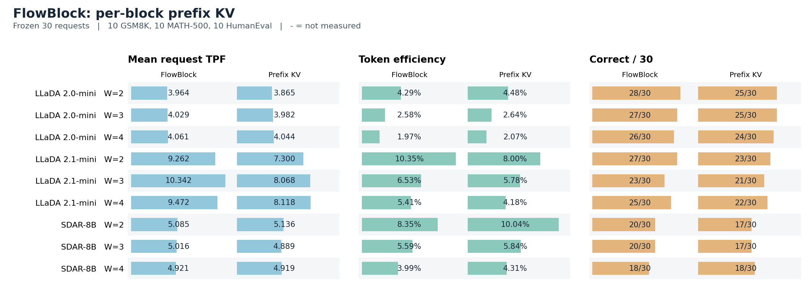

# FlowBlock：块内前缀 KV 缓存

在原版 packed FlowBlock 的每个块内，已编码且未再修改的连续前缀保留 KV、不再算 Q；块间掩码和窗口推进不变。直接对照为**同模型、同 W、同批实验的原版 FlowBlock**。Gemma 未测此前缀缓存。

每个数值来自同一组 30 题（GSM8K、MATH-500、HumanEval 各 10）。TPF = 逐题 N/F 的均值；token efficiency = ΣN/ΣQ；质量 = 正确数/30。Q 是实际计算的请求行；纯 prompt prefill 单列，不计入 F/Q。失败及触及长度上限的请求均保留。

[逐题数值](requests.csv) · [全体与各数据集汇总](summary.csv) · [矢量图](figures/comparison.svg) · [配对差值、逐题得失](comparisons.csv)

## LLaDA 2.0-mini

每格依次为 **TPF · token efficiency · 质量**。差值均为改进版减直接对照；效率差以百分点计。

| W | 原版 FlowBlock | 前缀 KV | Δ TPF | Δ 效率 | Δ 正确题 |
|---:|---|---|---:|---:|---:|
| 2 | 3.964 · 4.29% · 28/30 | 3.865 · 4.48% · 25/30 | -0.099 | +0.19 pp | -3 |
| 3 | 4.029 · 2.58% · 27/30 | 3.982 · 2.64% · 25/30 | -0.047 | +0.06 pp | -2 |
| 4 | 4.061 · 1.97% · 26/30 | 4.044 · 2.07% · 24/30 | -0.017 | +0.10 pp | -2 |

## LLaDA 2.1-mini

每格依次为 **TPF · token efficiency · 质量**。差值均为改进版减直接对照；效率差以百分点计。

| W | 原版 FlowBlock | 前缀 KV | Δ TPF | Δ 效率 | Δ 正确题 |
|---:|---|---|---:|---:|---:|
| 2 | 9.262 · 10.35% · 27/30 | 7.300 · 8.00% · 23/30 | -1.961 | -2.36 pp | -4 |
| 3 | 10.342 · 6.53% · 23/30 | 8.068 · 5.78% · 21/30 | -2.274 | -0.75 pp | -2 |
| 4 | 9.472 · 5.41% · 25/30 | 8.118 · 4.18% · 22/30 | -1.354 | -1.23 pp | -3 |

## SDAR-8B

每格依次为 **TPF · token efficiency · 质量**。差值均为改进版减直接对照；效率差以百分点计。

| W | 原版 FlowBlock | 前缀 KV | Δ TPF | Δ 效率 | Δ 正确题 |
|---:|---|---|---:|---:|---:|
| 2 | 5.085 · 8.35% · 20/30 | 5.136 · 10.04% · 17/30 | +0.051 | +1.69 pp | -3 |
| 3 | 5.016 · 5.59% · 20/30 | 4.889 · 5.84% · 17/30 | -0.126 | +0.25 pp | -3 |
| 4 | 4.921 · 3.99% · 18/30 | 4.919 · 4.31% · 18/30 | -0.003 | +0.32 pp | +0 |

[实现](../../bdlm_serving/methods/flowblock/prefix_cache.py) · [原始 commit/KV 审计](../../archive/flowblock-prefix/README.md) · [LLaDA 2.0 W2/3/4 成本分解](../../archive/llada20-frozen30/flowblock-pairs.md)。退休后减少请求 Q 不代表含 padding 的物理 Q 或 forward 次数一定减少；两者均列在 CSV。
