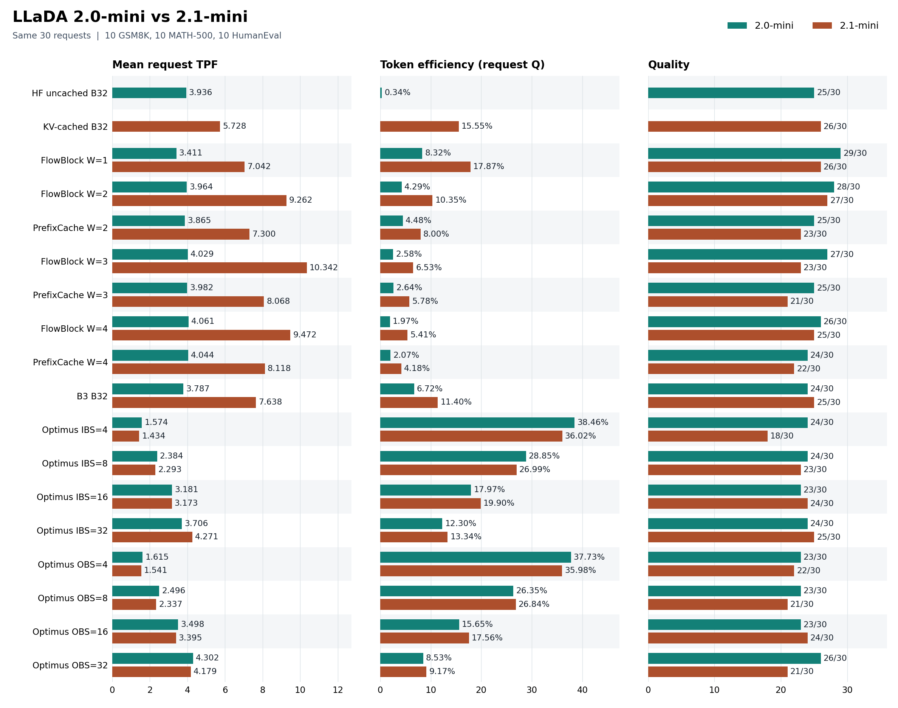
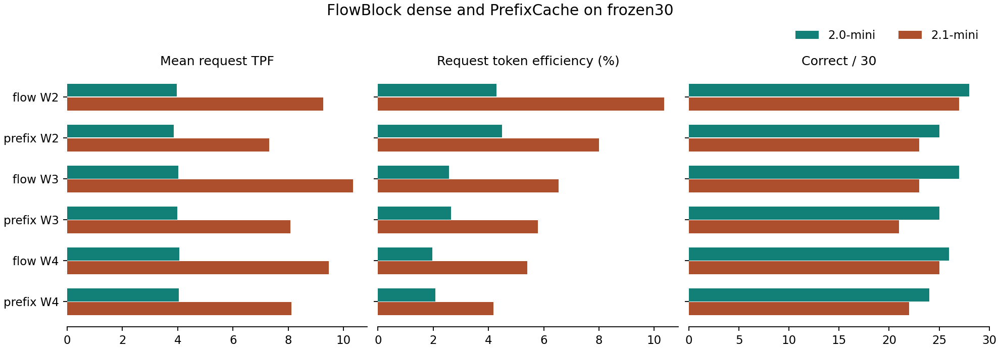

# Frozen30 results: LLaDA 2.0-mini and 2.1-mini

Each entry is **2.0 / 2.1** for the same 30 requests. TPF is a mean across requests; pooled TPF weights by forwards. Efficiency is delivered tokens divided by request Q, or physical Q when indicated. The two B32 reference implementations are listed separately; a dash means not measured.

| Policy | Quality / 30 | Mean TPF | Pooled TPF | Request efficiency | Physical efficiency |
|---|---:|---:|---:|---:|---:|
| HF generate B32 (uncached) | 25 / - | 3.936 / - | 2.606 / - | 0.34% / - | 0.34% / - |
| Committed-prefix KV B32 | - / 26 | - / 5.728 | - / 4.976 | - / 15.55% | - / 15.55% |
| `flow_w1` | 29 / 26 | 3.411 / 7.042 | 2.663 / 5.717 | 8.32% / 17.87% | 8.32% / 17.87% |
| `flow_w2` | 28 / 27 | 3.964 / 9.262 | 2.745 / 6.626 | 4.29% / 10.35% | 4.29% / 5.94% |
| `prefix_w2` | 25 / 23 | 3.865 / 7.300 | 2.280 / 4.102 | 4.48% / 8.00% | 3.71% / 3.25% |
| `flow_w3` | 27 / 23 | 4.029 / 10.342 | 2.474 / 6.269 | 2.58% / 6.53% | 2.58% / 5.23% |
| `prefix_w3` | 25 / 21 | 3.982 / 8.068 | 2.195 / 4.799 | 2.64% / 5.78% | 2.34% / 3.78% |
| `flow_w4` | 26 / 25 | 4.061 / 9.472 | 2.522 / 6.921 | 1.97% / 5.41% | 1.97% / 5.41% |
| `prefix_w4` | 24 / 22 | 4.044 / 8.118 | 2.376 / 4.824 | 2.07% / 4.18% | 1.90% / 3.82% |
| `b3_native32` | 24 / 25 | 3.787 / 7.638 | 2.802 / 5.641 | 6.72% / 11.40% | 4.78% / 11.40% |
| `optimus_ibs_c4` | 24 / 18 | 1.574 / 1.434 | 1.520 / 1.418 | 38.46% / 36.02% | 32.85% / 36.02% |
| `optimus_ibs_c8` | 24 / 23 | 2.384 / 2.293 | 2.141 / 1.992 | 28.85% / 26.99% | 25.02% / 26.99% |
| `optimus_ibs_c16` | 23 / 24 | 3.181 / 3.173 | 2.359 / 2.622 | 17.97% / 19.90% | 14.61% / 19.90% |
| `optimus_ibs_c32` | 24 / 25 | 3.706 / 4.271 | 2.439 / 2.780 | 12.30% / 13.34% | 8.09% / 13.34% |
| `optimus_obs_c4` | 23 / 22 | 1.615 / 1.541 | 1.542 / 1.471 | 37.73% / 35.98% | 34.09% / 35.98% |
| `optimus_obs_c8` | 23 / 21 | 2.496 / 2.337 | 2.129 / 2.173 | 26.35% / 26.84% | 25.17% / 26.84% |
| `optimus_obs_c16` | 23 / 24 | 3.498 / 3.395 | 2.506 / 2.819 | 15.65% / 17.56% | 15.38% / 17.56% |
| `optimus_obs_c32` | 26 / 21 | 4.302 / 4.179 | 2.725 / 2.938 | 8.53% / 9.17% | 8.49% / 9.17% |

## FlowBlock on 2.0: cost per request and per batch

| W | Policy | Delivered N | Forwards | Request Q | Physical Q | Q/forward | Quality / 30 |
|---:|---|---:|---:|---:|---:|---:|---:|
| 2 | flow | 13,959 | 5,086 | 325,504 | 325,504 | 64.00 | 28 |
| 2 | prefix | 16,732 | 7,337 | 373,278 | 451,349 | 50.88 | 25 |
| 3 | flow | 14,195 | 5,738 | 550,848 | 550,848 | 96.00 | 27 |
| 3 | prefix | 17,276 | 7,870 | 655,576 | 736,761 | 83.30 | 25 |
| 4 | flow | 15,867 | 6,291 | 805,248 | 805,248 | 128.00 | 26 |
| 4 | prefix | 16,152 | 6,799 | 781,041 | 848,386 | 114.88 | 24 |

Includes truncated and failed requests, with their actual costs. These are request-level decoding metrics, not measurements of wall-clock throughput. Native 2.0 recomputes its prefix; Native 2.1 uses a committed-prefix KV cache. Padding depends on the archived batch schedule.

