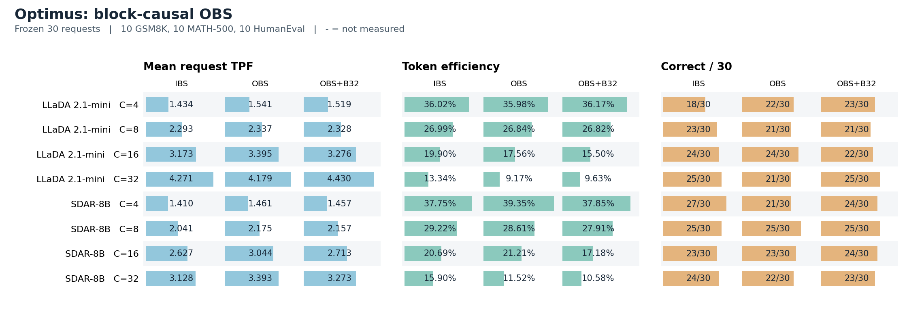

# Optimus：OBS 跨块注意力掩码

只在原 OBS 可见性上叠加原生 B32 的块间自回归掩码，不裁剪超窗 Q。**原 OBS 是直接对照**，原 IBS 是另一种执行模式的参考。窗口全程固定。仅 LLaDA 2.1 和 SDAR 测过此改动；LLaDA 2.0、Gemma 未测。

每个数值来自同一组 30 题（GSM8K、MATH-500、HumanEval 各 10）。TPF = 逐题 N/F 的均值；token efficiency = ΣN/ΣQ；质量 = 正确数/30。Q 是实际计算的请求行；纯 prompt prefill 单列，不计入 F/Q。失败及触及长度上限的请求均保留。

[逐题数值](requests.csv) · [全体与各数据集汇总](summary.csv) · [矢量图](figures/comparison.svg) · [配对差值、逐题得失](comparisons.csv)

## LLaDA 2.1-mini

每格依次为 **TPF · token efficiency · 质量**。差值均为改进版减直接对照；效率差以百分点计。

| 窗口 | 原 IBS（参考） | 原 OBS（对照） | OBS+B32 | Δ TPF vs OBS | Δ 效率 vs OBS | Δ 正确题 vs OBS |
|---:|---|---|---|---:|---:|---:|
| 4 | 1.434 · 36.02% · 18/30 | 1.541 · 35.98% · 22/30 | 1.519 · 36.17% · 23/30 | -0.022 | +0.19 pp | +1 |
| 8 | 2.293 · 26.99% · 23/30 | 2.337 · 26.84% · 21/30 | 2.328 · 26.82% · 21/30 | -0.008 | -0.03 pp | +0 |
| 16 | 3.173 · 19.90% · 24/30 | 3.395 · 17.56% · 24/30 | 3.276 · 15.50% · 22/30 | -0.119 | -2.06 pp | -2 |
| 32 | 4.271 · 13.34% · 25/30 | 4.179 · 9.17% · 21/30 | 4.430 · 9.63% · 25/30 | +0.251 | +0.46 pp | +4 |

## SDAR-8B

每格依次为 **TPF · token efficiency · 质量**。差值均为改进版减直接对照；效率差以百分点计。

| 窗口 | 原 IBS（参考） | 原 OBS（对照） | OBS+B32 | Δ TPF vs OBS | Δ 效率 vs OBS | Δ 正确题 vs OBS |
|---:|---|---|---|---:|---:|---:|
| 4 | 1.410 · 37.75% · 27/30 | 1.461 · 39.35% · 21/30 | 1.457 · 37.85% · 24/30 | -0.004 | -1.50 pp | +3 |
| 8 | 2.041 · 29.22% · 25/30 | 2.175 · 28.61% · 25/30 | 2.157 · 27.91% · 25/30 | -0.019 | -0.70 pp | +0 |
| 16 | 2.627 · 20.69% · 23/30 | 3.044 · 21.21% · 23/30 | 2.713 · 17.18% · 24/30 | -0.331 | -4.03 pp | +1 |
| 32 | 3.128 · 15.90% · 24/30 | 3.393 · 11.52% · 22/30 | 3.273 · 10.58% · 23/30 | -0.120 | -0.94 pp | +1 |

[掩码实现](../../bdlm_serving/methods/optimus/boundary.py) · [逐题得失与掩码影响范围](../../archive/optimus-masked-obs/)。IBS/OBS 复用原始实测，并非本次额外运行；与 IBS 的差值也在 comparisons.csv。
