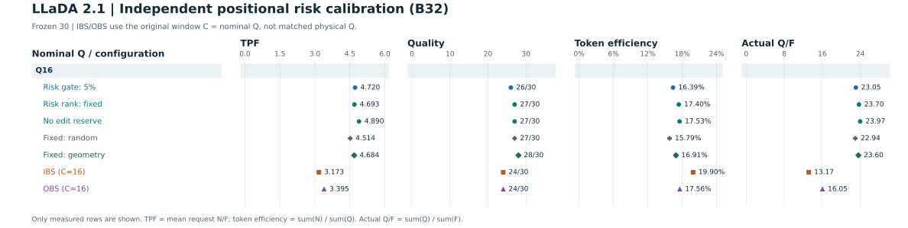

# 固定参数的 LLaDA Q16 预测器

在线测试保持原来 30 题不变，不按题号选择预测器。校准题来自同一份 GSM8K / MATH-500 / HumanEval 快照，属于**相同来源上的不同请求**，不是不同分布的外部盲测。先排除原清单里所有 `source_index` 和 prompt SHA-256，再按 `sha256("calibration-v1:{dataset}:{source_index}")` 的排序取不重复的 8 题/集。检查三个快照的字节摘要。未看这些题的生成输出、标签或测评分选择校准题。

在 24 题原生 B32 解码的 still-masked、非 fresh 旧位置上拟合一个 25 系数的 L2 逻辑回归。语义内容和 logits 不进模型，输入只来自已观测的位置、MASK、fresh、刚才的改写和时间。上线后每一道评测题共享同一份权重；无需在运行时训练，也不查询未计算位置的 logits。源数据保留在集群。原生采样器按原逻辑获取已算行的结果。

事先选定 Q16、最多 2 个旧位，同测两个策略：`hard_hazard_fixed` 不设风险门槛；`hard_hazard_gate` 仅在抢占 MASK 时使用 0.05 门槛，有现成空位不设门槛。其余沿用 mandatory fresh、首个 MASK、共享回填和全宽闭合。门槛来自已重复研究的 frozen30 原生留出回放，故虽然拟合请求不重叠，**不能**声称整个研究设计没有看过这 30 题。两种配置分别对照同预算零预留，同时报告正确数、TPF、token efficiency、实际 Q/F、实算 Q，及同状态本可进步的 MASK 被挤掉多少。

分别使用 `python -m tools.calibrate_hazard --raw SNAPSHOTS --samples FROZEN30 --checkpoint CHECKPOINT --output CALIBRATION`，以及 `python -m tools.run_t2t --model llada21 --hazard-weights CALIBRATION/weights.json --checkpoint CHECKPOINT --samples FROZEN30 --reference NATIVE --output RUN --arm 16:0:14:hard_hazard_fixed --arm 16:0:14:hard_hazard_gate`。前者会生成新的校准轨迹，没有 24 道旧的原生参考文件，不要将它说成 frozen30 输出资格验证。后者保留独立的 30/30 全宽复现门槛。

## 冻结参数与覆盖率

24 题提供 169 个可选旧编辑作为训练正例。[权重、校准题来源序号、种子与题面摘要](weights.json)可用于逐项重建；文件 SHA-256 为 `d4457807244a5941cc43dc7ed3b4ba665eba962b8730c73babf8705cf1476478`。在 frozen30 原生轨迹的 191 个可选旧编辑上，不限制实际配额的 top-4/8/16 分别命中 **88/145/190** 个，top-16 总共要列入 11,445 个位置（精度 1.66%）。[完整名单曲线](native-shortlist.csv)。

换成实际 Q16、最多两个旧席位，固定预留为 56 个预留命中、739 个 MASK 被挤占；5% 门槛为 **47 个预留命中、123 个 MASK 被挤占**。两组同状态总 selected Q 都是 19,800。门控保留了同预测器固定预留命中的 83.9%，少挤占 83.4% 的 MASK，但它对全体可选目标的额外召回是 47/191（24.6%），不是 83.9%。[同状态结果](native-replay.csv)。复算：`python -m tools.hazard_gate --weights WEIGHTS --raw NATIVE_LLADA --out OUT.csv --shortlist SHORTLIST.csv`；写入仍来自原生轨迹，不等于在线结果。

## 三十题在线结果

先按全宽复现原生参考，再跑两组真实稀疏选位；均为 30/30，无失败。下表是完整请求，不是只统计选位轮。N 是返还的输出 token，F 含初始化、选位、验证、提交，Q 是相应全部物理行。TPF 是逐题 N/F 的均值，效率是 ΣN/ΣQ，不截掉超长题。零预留指不专门选择预计会编辑的旧位，不是禁用自然 T2T。

| 名义 Q16 | 质量 | TPF | Token efficiency | 实际 Q/F | N | F | 物理 Q | 截断 |
|---|---:|---:|---:|---:|---:|---:|---:|---:|
| 零预留 | 27/30 | 4.890 | 17.53% | 23.97 | 12,154 | 2,892 | 69,322 | 1 |
| 固定预留最多 2 个旧位 | 27/30 | 4.693 | 17.40% | 23.70 | 13,027 | 3,158 | 74,860 | 1 |
| 仅挤占 MASK 时设 5% 门槛 | 26/30 | 4.720 | 16.39% | 23.05 | 15,027 | 3,977 | 91,682 | 2 |
| 原始 Optimus IBS16 | 24/30 | 3.173 | 19.90% | 13.17 | 14,548 | 5,549 | 73,098 | 2 |
| 原始 Optimus OBS16 | 24/30 | 3.395 | 17.56% | 16.05 | 14,742 | 5,229 | 83,929 | 2 |

两个新策略相对原始 Optimus 的 TPF 和答对数更高，但实际每次 forward 算得更多，这不是等物理工作比较。判断**加预测是否有用**，应与第一行比：固定组逐题无得失；门控组丢一道 MATH-500，无新增答对。门控的 GSM8K、MATH-500、HumanEval 正确数为 10、8、8，固定与零预留均为 10、9、8。各组均使用相同题目及种子，没有剔除截断或为个别题改策略。

| 选位轮分账（Q 行数） | 上轮写入必刷 | MASK | 专门预留旧位 | 普通旧位回填 | 小计 | 其中必刷超预算 | 被挤占 MASK | 预留位实际严格改写 |
|---|---:|---:|---:|---:|---:|---:|---:|---:|
| 固定 | 9,234 | 11,116 | 2,790 | 5,448 | 28,588 | 1,262 | 1,030 | 78 |
| 5% 门控 | 10,488 | 18,935 | 2,193 | 6,338 | 37,954 | 1,252 | 84 | 68 |

必刷超预算已在小计中，不重复加。固定组 F 分别为 438 次初始化、1,712 次选位、570 次验证、438 次提交；门控是 502、2,298、675、502。门控较固定少挤占 **91.8%** 的 MASK，预留席位在各自轨迹上命中 68 vs 78 次；由于生成轨迹不同，不能解释成保留了同一组目标的召回率。门控逐题平均 TPF 比固定高 0.028，但输出多 2,000 token，实际多 819 次 F、16,822 行 Q，少对一道题。相对零预留两组都没有取得联合收益，当前不建议在 Q16 默认开启。

[汇总与分数据集](llada21-online-summary.csv) · [逐题](llada21-online-requests.csv) · [选位配额与同预算配对](paired-cost.csv) · [按阶段拆分](llada21-online-phases.csv) · [十档的逐题配对区间](../budget-paired-intervals.csv)。同 Q 零预留来自[同一协议的参考结果](../hard/llada21-online-summary.csv)。计分使用 `python -m tools.t2t_results --samples FROZEN30 --run RUN --out experiments/t2t/calibrated`；再用 `python -m tools.selection_effect --model llada21 --scores experiments/t2t/calibrated/llada21-online-requests.csv --baseline experiments/t2t/hard/llada21-online-requests.csv --run RUN --out experiments/t2t/calibrated/paired-cost.csv`。从已发布 CSV 重画不需要 GPU：`python -m tools.render_hard_study --study calibrated --model llada21`。
