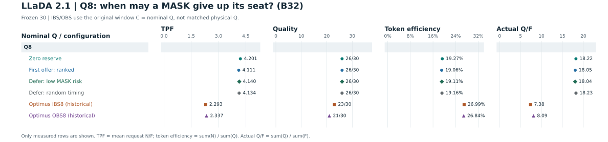

# LLaDA 2.1 · Q8：等一个不容易解码的 MASK 再换位，有没有用？

**未达到预先设定的「比零预留多答对，且 TPF 不降」。** 低风险组为 26/30、4.140 TPF、19.11% 物理效率。逐题事后选分支最多答对 **26/30**，相对零预留能救回 **0** 题。

## 同一批 30 题的完整生成

每个数据集各 10 题，保留截断题和不触发的题。TPF 是逐题 `输出 token 数 / 生成 forward 数` 再取均值；token efficiency 是 `总输出 token 数 / 总物理生成 Q`。纯 prompt prefill 不计入；bootstrap、verify 和 commit 计入。名义预算是同一选择约束，不是相同的实际 Q/F，也不是墙钟吞吐。

| 名义 Q=8 | 正确/30 | TPF | Token efficiency | 物理 Q/F | 输出 N | Forward | 物理 Q |
|---|---:|---:|---:|---:|---:|---:|---:|
| 零预留 | 26 | 4.201 | 19.27% | 18.22 | 12,816 | 3,650 | 66,515 |
| 首次即换（定向） | 26 | 4.111 | 19.06% | 18.05 | 12,807 | 3,722 | 67,176 |
| 低风险才换，可延后 | 26 | 4.140 | 19.11% | 18.04 | 12,822 | 3,719 | 67,101 |
| 随机时机，可延后 | 26 | 4.134 | 19.16% | 18.23 | 12,849 | 3,678 | 67,068 |
| 首次低风险才换，不再尝试（历史分支） | 26 | 4.137 | 19.10% | 18.05 | 12,822 | 3,720 | 67,133 |
| 历史 Optimus IBS8 | 23 | 2.293 | 26.99% | 7.38 | 16,528 | 8,298 | 61,239 |
| 历史 Optimus OBS8 | 21 | 2.337 | 26.84% | 8.09 | 16,322 | 7,512 | 60,808 |

**对照区别。** 零预留、首次即换与两种延后换位都是完整 GPU 路径。另列的「首次低风险才换，不再尝试」是选择此前实测的整条分支终点后重新汇总，不是新 GPU 运行。历史 IBS/OBS 仅用于对照名义窗口。此次的随机是随机**时机**，换入的旧行与定向组使用同一排名；不是从旧行里随机选一个。

低风险减零预留的配对 ΔTPF 为 -0.061，95% 区间 [-0.122, -0.009]；低风险减随机时机为 +0.006，95% 区间 [-0.094, +0.119]。相对零预留，低风险独自答对 0 题，反向丢 0 题。区间来自按数据集分层的整题配对重采样。

## 何时值得换？

先把上轮新接受及严格改写后的全部位置加入 Q 刷新 KV，不截断。剩余位置优先给 MASK，剩余空位再回填旧行。普通选位轮若没有回填空位、还有至少两个 MASK 席位，并且基础 Q 外排名第一的旧行通过冻结的 5% 分数线，才有换位机会。最多把最后一个 MASK 换成这一旧行。预测只用已知 token ID 的输入 embedding 投影、空间关系和写入历史，不读全位置 logits。

这次只改**何时准许换位**，不改换入旧行、换出 MASK、必刷集合或采样 RNG。低风险组只在被换 MASK 的当步接纳预测不高于 `0.385812` 时同意；随机时机组用独立散列按 `49/97` 的校准频率同意。拒绝后按零预留执行并继续找机会；一题一旦换过一次，后续所有块永久恢复零预留。被换行的打分只看它在 MASK 中的顺序、MASK/fresh 数量、局部 MASK 密度及距 MASK/fresh 的距离，不读取模型当前轮输出。

| 实际路径 | 检查机会 | 拒绝 | 首次即换 | 拒绝后再换 | 有机会但始终不换 | 无机会 | 直接命中严格 T2T | 本会接纳 / 不会 / 未知 |
|---|---:|---:|---:|---:|---:|---:|---:|---:|
| 低风险才换，可延后 | 28 | 11 | 15 | 2 | 6 | 7 | 1 | 8 / 9 / 0 |
| 随机时机，可延后 | 49 | 31 | 12 | 6 | 5 | 7 | 1 | 11 / 4 / 3 |

「本会接纳」是同题、同种子、此前不曾换位的零预留分支在**同一步**可识别的结果，不是从换位后未计算的 MASK 上读取 logits。先使用对照的行级写入记录；若该行没有记录，用接纳、撤销、严格编辑数、下一步实际 Q 和零预留选位规则约束可能的行级转移。仍有两种可能时记为未知。此列是当步机会成本，不代表最终少输出了这么多 token。两种时机的直接命中再按「本会接纳 / 不会 / 未知」拆分：低风险 1/0/0，随机 1/0/0。

| 全程物理 Q 分配 | 上轮硬刷新 | MASK | 普通旧回填 | 显式换入旧行 | 初始化、验证、提交 | 其中必刷溢出（已包含） |
|---|---:|---:|---:|---:|---:|---:|
| 零预留 | 9,204 | 9,166 | 2,065 | 0 | 46,080 | 2,767 |
| 首次即换（定向） | 9,137 | 9,656 | 2,120 | 23 | 46,240 | 2,732 |
| 低风险才换，可延后 | 9,160 | 9,641 | 2,107 | 17 | 46,176 | 2,729 |
| 随机时机，可延后 | 9,302 | 9,137 | 2,019 | 18 | 46,592 | 2,712 |

每张卡独立通过原生 30/30 全宽资格校验；逐选位轮核对全部 20 层的物理 Q 行数、fresh 保留、换位前共同路径，以及可比的历史整条路径。低风险和随机组各有 1、1 条截断，各有 0、0 条失败，全部按原题单计入。

## 把原生预测和稀疏执行分开

- **独立校准 24 题。** 拟合样本是 97 个候选换位机会，其中被换 MASK 本会当步接纳 40 次。中位阈值由校准决定；不根据测试 30 题改阈值。
- **固定原生前态，不是在线质量。** 30 题中 120 个拥挤机会，全部替换会命中 16 次旧位严格编辑，挤掉 45 次当步接纳。低风险只保留 59 次，分别为 **7 命中、9 次接纳损失**；同题同放行数的随机期望为 **8.70、19.66**。所以降成本成立，预定的「命中也超过随机」不成立。透视只取「命中且不损失当步接纳」能找出 9 次，不能当作在线可用信号。
- **只检查第一次，然后整题停止尝试。** 历史 23 个首次机会中，低风险接受 15 次；1 次直接命中，6 个被换 MASK 本会接纳。2 个既会命中又不损失当步接纳的机会均被拒绝。按数据集匹配放行次数的随机整路径期望为 2.01 命中、7.37 个接纳损失、26/30、TPF 4.149。事后只选那 2 个理想机会，仍为 26/30、TPF 4.205。这是既有真实分支的组合，只对这一次机会有效。
- **四条完整路径的事后上界。** 逐题事后选分支最多答对 **26/30**，相对零预留能救回 **0** 题；有 0 题在这四条路径间发生过判分翻转。在这个最高正确数下，同分按 TPF 选的假想组合为 4.214 TPF、19.29% 物理效率。 只能在本表四条已测的完整路径间逐题选，不允许拼接步骤。先最大化对题数，同分时最大化逐题 TPF，再选较少物理 Q；依赖真值和终点，所以不可部署，也不是所有可能时机、换入行或预算的上界。

## 数据与复算

[冻结协议](PROTOCOL.md) · [8 项风险系数](victim.json) · [原生同前态](native-summary.csv) · [历史首次分叉](fork-summary.csv) · [实测指标](admission-arms.csv) · [配对区间](admission-matched.csv) · [逐题审计](admission-rollout-requests.csv) · [四条路径上界](admission-envelope.csv) · [物理 Q](physical.csv) · [绘图脚本](../report.py) · [全预算对照](../../../hard/README.md)。

从仓库根目录用 `python -m experiments.t2t.calibrated.embedding_context.report --admission` 可仅用已归档的去内容统计表重绘 SVG 和配对区间。原生校准/回放用同目录 `admission_study fit`、`admission_study audit`；历史首次分叉用 `python -m tools.admission_forks`；直接稀疏运行共用 `tools.run_t2t`，组别为 `8:0:7:hard_admit_low` 和 `8:0:7:hard_admit_coin`，须传相同的输入向量排序器与 MASK 接纳参数；原始轨迹仅在集群。用 `python -m tools.admission_rollout_audit --run LOW --run COIN --fit FIT --out PRIVATE_DIR` 做不加载模型的逐步核验。
