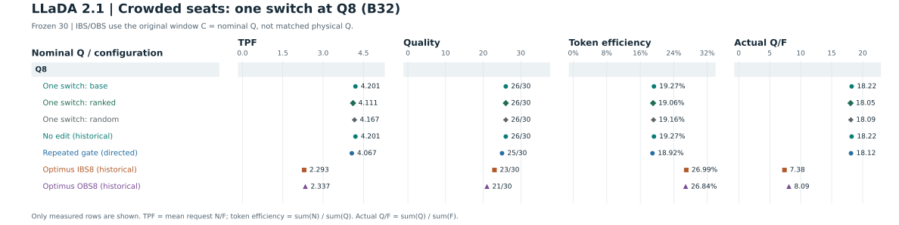

# LLaDA 2.1 Q8：一个预测的 T2T 值不值得占一个 MASK 席位？

**本次不值得。** 同一批 30 题，每题最多一次替换。定向、均匀随机和不替换三组答对的都是同样的 26 题。定向换入确实命中 3 个当步严格编辑，随机为 0；但定向比不替换多做 72 次 forward，宏平均 TPF 从 4.201 降到 4.111。暂不把这条门控作为 Q8 默认策略。

| 策略 | 正确/30 | 宏平均 TPF | Token efficiency | 实际 Q/F | 输出 N | 生成 F | 物理 Q |
|---|---:|---:|---:|---:|---:|---:|---:|
| 不换，逐题复现历史零预留 | 26 | 4.201 | 19.27% | 18.22 | 12,816 | 3,650 | 66,515 |
| 最多一次，定向换入 | 26 | 4.111 | 19.06% | 18.05 | 12,807 | 3,722 | 67,176 |
| 最多一次，随机换入 | 26 | 4.167 | 19.16% | 18.09 | 12,756 | 3,680 | 66,568 |
| 历史：每轮有机会都允许换，定向 5% 门槛 | 25 | 4.067 | 18.92% | 18.12 | 13,515 | 3,942 | 71,423 |
| 历史 Optimus IBS8 | 23 | 2.293 | 26.99% | 7.38 | 16,528 | 8,298 | 61,239 |
| 历史 Optimus OBS8 | 21 | 2.337 | 26.84% | 8.09 | 16,322 | 7,512 | 60,808 |



**物理执行。** 先算上轮全部 fresh（新接受或严格 T2T），剩余额度算 MASK，再用中性旧行回填。fresh 可使实际 Q 超过 8。只在第一次真的要换出一个 MASK、仍保留至少第一个 MASK、最高分旧行超出原集合且通过原 5% 阈值时干预。阈值来自独立 24 题拟合的排序器，不等于真实线上编辑概率。输入只有已知 token ID、16 维输入 embedding 投影和写入历史，不读上轮全位置 logits。随机对照保留同一前态、同一换出行，从所有原集合外旧行中均匀选一行。不论结果如何，当次之后都回到零预留策略。

两张卡分别做了独立 30/30 全宽复现；新 base 与历史 Q8 **逐题输出 IDs、阶段成本、实际选位和原有逐步字段**一致。三组各有 1 条截断，保留在全部指标中。23 题触发一次，7 题未触发；定向和随机有 2 题恰好选中同一行，照原样计入。此前见到的 114 次可换旧回填机会均未执行。逐层检查 20 个 Q 投影，三路在换位前的状态、缓存和 RNG 匹配。名义预算并不代表相同物理工作量，尤其不能用历史 Optimus 对照证明排名有效。

| 全程物理 Q 分账 | 硬刷新 | MASK | 普通旧回填 | 显式换入旧位 | 初始化、验证、提交 |
|---|---:|---:|---:|---:|---:|
| 不换 | 9,204 | 9,166 | 2,065 | 0 | 46,080 |
| 定向 | 9,137 | 9,656 | 2,120 | 23 | 46,240 |
| 随机 | 9,086 | 9,456 | 2,083 | 23 | 45,920 |

定向减不换的配对 ΔTPF 为 **−0.090**，分数据集整题重采样 95% 区间 `[−0.164, −0.025]`；定向减随机为 **−0.055**，区间 `[−0.116, −0.012]`。定向相对 base 多做 67 次选位轮和 7 次验证，少做 1 次初始化和 1 次提交，净增 72。表格是执行后各分支的总账，不是说单次干预直接消耗 72 个 forward。TPF 为 `mean(N/F)`，效率为 `ΣN/Σ物理Q`，均不是墙钟吞吐。

## MASK 的代价在哪里？

在 23 个同前态换位步骤中，共同保留 96 个 MASK，另有 23 个待换 MASK。三路当步在共同 MASK 中都接纳了 71 行。待换 MASK 在不换组有 11 行会当轮被接纳，两个换位组都为 0。定向换入直接严格改写 3 行：下一轮其中 2 行要占原可算 MASK 的刷新位，另 1 行用中性旧位余量。没有额外观察 forward。

把同一前态两路实际结果按题配起来（不是读取未算位置的 logits）：横轴是不换组的 MASK 会不会当轮被接纳，纵轴是定向组换入旧行是否真的改写。

| 23 个干预点 | MASK 本会接纳 | MASK 本不会接纳 |
|---|---:|---:|
| 换入行严格改写 | 1 | 2 |
| 换入行未严格改写 | 10 | 10 |

两项结果未必能在一次部署 forward 同时观察；此表来自配对诊断，不能把这两个标签作为无需代价的线上输入。重算：按 `index` 连接[三路逐题审计](context-crowded-requests.csv)，限 `anchors=1`，交叉计数 rank 的 `rank_direct_hits` 与 base 的 `victim_accepted`。

| 四个去噪步内的稳定等待，逐题等权，越低越好 | 不换 | 定向 | 随机 |
|---|---:|---:|---:|
| 共同 MASK，到达基线交付 ID（预先指定） | 0.707 | 1.068 | 0.853 |
| 被换 MASK，到达基线交付 ID | 1.217 | 1.913 | 1.913 |
| 共同 MASK，到达**各自**交付 ID（事后补充） | 0.707 | 0.712 | 0.701 |
| 被换 MASK，到达**各自**交付 ID（事后补充） | 1.217 | 1.783 | 1.783 |

0 为干预当轮即达到参考且维持到第四次观察；4 为窗口内未稳定。块提前结束时沿用最后状态，不虚增 forward。没有缺失交付偏移，三个分支的可比行完全相同。按预先指定的共同 MASK 指标，定向减不换为 +0.362 轮（1 题早、6 题晚、16 题持平），定向减随机 +0.215。按**位置 × 等待轮次**而非逐题平均，定向相对不换：共同 MASK +34、被换 MASK +16、合计 +50；随机为 +15、+16、合计 +31。

参考 ID 是一个合法分支的输出，不是标准答案。按各自交付 ID 再算，定向相对不换的共同等待仅 +0.005 轮，被换 MASK 仍为 +0.565 轮；位置等待合计为 +4 与 +13。**不能据此说共同 MASK 普遍变慢了**：相对基线的较大差异包含生成了不同 token。更清楚的代价是 11 个本可当步接纳的 MASK 没有计算，而换入少数实际编辑没有带来净质量收益。

| 同一基线交付 ID 的位置数 | 不换 | 定向 | 随机 |
|---|---|---|---|
| 共同 MASK，第一次整块验证前 → 验证后 → 提交时（/96） | 87 → 90 → 96 | 76 → 80 → 80 | 84 → 86 → 86 |
| 被换 MASK，验证前 → 验证后 → 提交时（/23） | 20 → 22 → 23 | 18 → 19 → 19 | 19 → 21 → 21 |

23 题均观测到各阶段；没有机会的 7 题不计入位置分母，但全部计入服务指标。提交快照是进入实际 commit 的最后去噪画布，不是重新采样。

## 对 kernel 设计的影响

保留硬刷新，不要给每一轮强行设定 T2T 比例。**Q8 暂用零预留**，判断能否挤走 MASK 时，要同时估计它本轮接纳的机会，以及多算旧行能否帮助生成，而不能只问旧行是否会改写。[名单及无 logits 二次排序](SHORTLIST.md)显示：同前态原生回放中，挤占 MASK 的 120 轮里 top-1 命中 16，前八名的单席透视上限 39；尝试按上轮邻居的输入向量变化重排只命中 14。此信号未通过上机门槛。上述数字不是这一轮真实稀疏实验的 3/23。

下一项有区分力的实验是**只改变换位时机**：固定旧行排名和换出规则，在独立校准题上拟合被换 MASK 本轮的接纳风险；到 frozen30 对照目前门控、同次数随机保留的门控及同前态透视。先看能否避开上表不划算的换位且不丢掉仅有的可用编辑，再决定是否上机。此处不据 30 题事后挑阈值，不宣称上界可部署。

[实验前协议](PROTOCOL.md) · [逐题服务指标](llada21-online-requests.csv) · [分账](physical.csv) · [配对区间](crowded-matched.csv) · [各阶段 F/Q](llada21-online-phases.csv) · [三路执行审计](context-crowded-summary.csv) · [四步主要终点](llada21-q8-crowded-beneficiary-summary.csv) · [各自交付参照](llada21-q8-crowded-beneficiary-own-final.csv) · [至验证与提交的跟踪](llada21-q8-crowded-beneficiary-secondary-summary.csv)。这项每题最多换一次的诊断不算作十档预算部署策略的候选。

```bash
# n164，仓库根目录；两个原始目录、历史 noedit、样本和原始生成文本均在集群。
python -m tools.t2t_results --samples "$SAMPLES" --run "$PAIR" --run "$RANDOM" --out "$OUT"
python -m tools.selection_effect --model llada21 --scores "$OUT/llada21-online-requests.csv" \
  --baseline experiments/t2t/hard/llada21-online-requests.csv --run "$PAIR" --run "$RANDOM" --out "$OUT/physical.csv"
python -m tools.context_gates_audit --crowded --run "$PAIR" --run "$RANDOM" --out "$OUT"
python -m tools.beneficiary_rows --crowded --run "$PAIR" --run "$RANDOM" --historical "$HIST" --out "$OUT"
# 可只用公开表格重画：
python -m experiments.t2t.calibrated.embedding_context.report --crowded \
  --out experiments/t2t/calibrated/embedding_context/crowded
```
