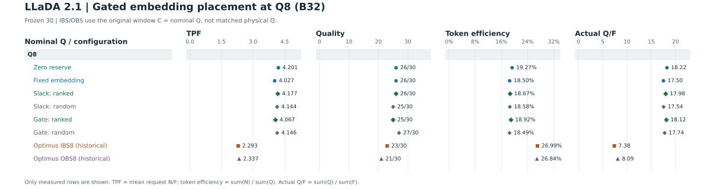

# LLaDA Q8：什么时候值得换入预测会 T2T 的旧位置？

**结论：在这批固定 30 题上，两个定向门控都没有同时提高正确数并保持 TPF。** 只用回填位置时，答对的是与零预留完全相同的题；允许高分旧位挤占第二个及以后的 MASK，少对一题。对照结果见下表。两张卡均先独立通过全宽 30/30 复现，才执行各自两组稀疏测试；失败、截断都不从分母中删除。

| 名义 Q8 策略 | 正确/30 | TPF | token efficiency | 物理 Q/F | 实测 F | 物理 Q |
|---|---|---|---|---|---|---|
| 内部基线：零预留 | 26 | 4.201 | 19.27% | 18.22 | 3,650 | 66,515 |
| 固定预留：同一排序器 | 26 | 4.027 | 18.50% | 17.50 | 3,942 | 68,995 |
| 只换旧位，定向 | 26 | 4.177 | 18.67% | 17.98 | 3,981 | 71,566 |
| 只换旧位，随机 | 25 | 4.144 | 18.58% | 17.54 | 4,307 | 75,545 |
| 5% 门槛，定向 | 25 | 4.067 | 18.92% | 18.12 | 3,942 | 71,423 |
| 5% 门槛，随机 | 27 | 4.146 | 18.49% | 17.74 | 4,147 | 73,559 |
| 历史 Optimus IBS8 | 23 | 2.293 | 26.99% | 7.38 | 8,298 | 61,239 |
| 历史 Optimus OBS8 | 21 | 2.337 | 26.84% | 8.09 | 7,512 | 60,808 |



**怎么分配 Q。** 本次使用单个 B32 块，Q8、最多一个显式旧位。先取上轮新解码或严格改写的全部 fresh，再按块内位置取 MASK，空位用旧行回填。只用回填的策略只允许换出最末一个旧行；5% 门槛在无回填时，要求有至少两个已选 MASK 且最高得分达到事先冻结的阈值，才允许换出最末一个 MASK。最高分旧位已经入选时不做替换。随机组沿用同一门控、同一换出规则，只在本来会实际改变 Q 的状态换入一个均匀随机旧位。首次选位分叉后，各自按自己的状态执行，不要求两条后续轨迹有相同的 F、Q 或输出。

**预测器能看到什么。** 只用步前可见的 token ID、过去实际写入的位置、MASK 分布和缓存的 16 维输入 embedding 投影；不是上一轮全位置 logits，不读当前 KV。阈值 5% 是拟合分数的操作点，不是已校准的线上编辑概率。选行发生在模型 embedding 和 QKV 之前，20 层逐层核对实际 Q。名义 Q8 允许 mandatory fresh 溢出；初始化、验证和提交全算、全计费，纯 prompt prefill 排除。TPF 为逐题 N/F 的均值，效率为 ΣN/Σ物理Q；两者均不是墙钟吞吐。

## 位置与席位

| 策略 | 必刷 Q | MASK Q | 中性旧回填 Q | 换入旧位 Q | 换出旧位 / MASK | 换入严格命中（旧换旧 / 旧换 MASK） | 其他阶段 Q |
|---|---|---|---|---|---|---|---|
| 只换旧位，定向 | 9812 | 10346 | 1564 | 564 | 564 / 0 | 16 / 0 | 49280 |
| 只换旧位，随机 | 10366 | 11478 | 1574 | 607 | 607 / 0 | 7 / 0 | 51520 |
| 5% 门槛，定向 | 9723 | 9967 | 1586 | 707 | 588 / 119 | 15 / 11 | 49440 |
| 5% 门槛，随机 | 9984 | 11004 | 1690 | 737 | 636 / 101 | 8 / 1 | 50144 |

换出的 MASK 当轮没有实算，**不能**从该稀疏轨迹判它原本是否会被接纳，更不能把线上命中率叫做召回率。[独立原生同前态回放](NATIVE_Q8E1.md)能回答两个局部问题：门槛相对固定预留保留了 30 次旧位命中的 24 次，同时减少 133 次当轮原本会解码的 MASK 损失；但这些原生正例并非稀疏解码必然发生的编辑。

下一轮成本：换入行若确实发生严格改写，四组都必须用新 ID 再算它一次。下表将每个命中归到唯一的下一轮情形。「原可选 MASK」只固定实际前态、在**零预留布局**中去掉该行的必刷身份作席位算术，不是假设运行能回到相同状态；「旧位余量」也可能仍会在回填中选中同一行。

| 策略 | 换入严格命中 | 全宽验证 | 原可选 MASK | 旧位余量 | 溢出多算一行 |
|---|---|---|---|---|---|
| 只换旧位，定向 | 16 | 10 | 0 | 6 | 0 |
| 只换旧位，随机 | 7 | 1 | 0 | 6 | 0 |
| 5% 门槛，定向 | 26 | 11 | 10 | 5 | 0 |
| 5% 门槛，随机 | 9 | 3 | 1 | 5 | 0 |

## 逐题对照

| 定向策略 | 对照 | 仅定向正确 / 仅对照正确 | ΔTPF [配对95%区间] | 长度项 | 次数项 |
|---|---|---|---|---|---|
| 只换旧位，定向 | 只换旧位，随机 | 1 / 0 | +0.033 [-0.081, +0.160] | -0.064 | +0.098 |
| 只换旧位，定向 | 内部基线：零预留 | 0 / 0 | -0.024 [-0.117, +0.068] | +0.042 | -0.066 |
| 5% 门槛，定向 | 5% 门槛，随机 | 0 / 2 | -0.079 [-0.295, +0.102] | -0.002 | -0.077 |
| 5% 门槛，定向 | 内部基线：零预留 | 0 / 1 | -0.135 [-0.268, -0.008] | +0.098 | -0.232 |

区间按数据集分层、整题配对重采样 10,000 次。表中的“长度项”和“次数项”是逐题 N/F 差的对称分解：前者为 `ΔN × mean(1/F)`，后者为 `mean(N) × Δ(1/F)`，两项之和等于实测 ΔTPF（表格显示有舍入）。它们是记账恒等式，不是因果效应。对相同门控随机组的比较只用于判断选位，不取代零预留的部署判据。

**解释与下一步。** 两种定向门控都比各自随机组多命中严格编辑，但只有不换 MASK 的定向组在对随机的准确数与 TPF 点估计上同时占优，且这一 TPF 配对区间跨零。两对定向／随机各有 29 题在某一步发生实际选位分叉，另 1 题从始至终未分叉。完整同名义预算结果均高于原始 Optimus IBS8/OBS8 的质量和 TPF，但每 forward 实算的 Q 更多，物理效率更低，不能归因于编辑预测。眼下保留零预留为 Q8 默认。下一步值得单独检验：在已有真实分叉前态，刷新是否让**其他共同 MASK**更早写入最终保留的 ID，以及收益是否持续到验证前；把换出行的接纳损失和命中后下一轮的必刷成本一起报告。这是后续假设，不把事后轨迹相关性当作因果。

## 数据和复算

[事先确定的协议](PROTOCOL.md) · [逐请求输出长度与 F/Q](llada21-online-requests.csv) · [每题各项差值](gated-request-deltas.csv) · [配对差值及区间](gated-matched.csv) · [完整 Q 分账](physical.csv) · [原始阶段记账](llada21-online-phases.csv) · [六对策略首次不同的 Q 及共享前态](context-gates-summary.csv) · [逐题审计](context-gates-requests.csv)。所有算过的行都纳入物理分母；原始轨迹与权重留在 n164。

从 n164 仓库根目录复算。两份原始目录在同一 `../t2t-native-1125/` 下，分别为 `context-slack-q8-v1` 和 `context-gate-q8-v1`。公开的计分表本身即可重画图，无需 GPU 或原始生成文本。

```bash
python -m tools.t2t_results --samples "$SAMPLES" --run "$SLACK" --run "$GATE" --out "$OUT"
python -m tools.selection_effect --model llada21 --scores "$OUT/llada21-online-requests.csv" \
  --baseline experiments/t2t/hard/llada21-online-requests.csv --run "$SLACK" --run "$GATE" --out "$OUT/physical.csv"
python -m tools.context_gates_audit --run "$SLACK" --run "$GATE" --out "$OUT"
python -m experiments.t2t.calibrated.embedding_context.report --gated --out "$OUT"
```
