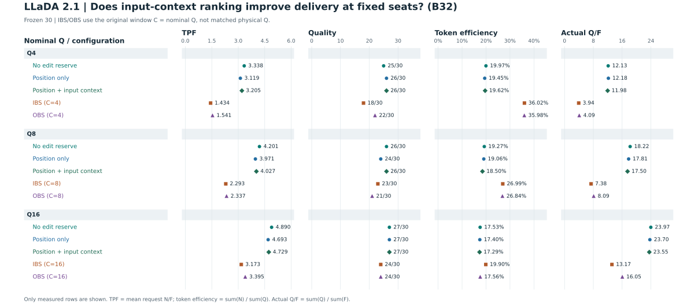

# 实际 Q 预算：输入 embedding 能选对更值得重算的旧位吗？

**值得用作候选排序信号，但固定预留 1/1/2 席没有通过部署判据。** 同 30 题、同预算、同预留政策，只换排序，Q8 从 24/30 到 26/30，TPF 从 3.971 到 4.027；Q4/Q16 正确题数不变。相对于同预算**不显式预留旧位**，三档的 TPF 都更低。Q4 多对一题；Q8、Q16 没有净增。只看 Q8 排序对照或原生轨迹的命中率，会得出不同的结论。

| 名义 Q / 最多旧位 | 策略 | 正确/30 | TPF | token efficiency | 实际 Q/F |
|---|---|---:|---:|---:|---:|
| 4 / 0 | 不预留 | 25 | 3.338 | 19.97% | 12.13 |
| 4 / 1 | 纯位置 | 26 | 3.119 | 19.45% | 12.18 |
| 4 / 1 | 位置 + embedding | 26 | 3.205 | 19.62% | 11.98 |
| 8 / 0 | 不预留 | 26 | 4.201 | 19.27% | 18.22 |
| 8 / 1 | 纯位置 | 24 | 3.971 | 19.06% | 17.81 |
| 8 / 1 | 位置 + embedding | 26 | 4.027 | 18.50% | 17.50 |
| 16 / 0 | 不预留 | 27 | 4.890 | 17.53% | 23.97 |
| 16 / 2 | 纯位置 | 27 | 4.693 | 17.40% | 23.70 |
| 16 / 2 | 位置 + embedding | 27 | 4.729 | 17.29% | 23.55 |



**执行逻辑。** 全选上一轮新接受或发生严格 T2T 的位置更新 KV。其数量超过名义预算则全部刷新并记账；若有剩余空间且有 MASK，先保护至少一个 MASK。两种预测组都在此后最多选 1/1/2 个非 fresh 旧位，剩余空间给 MASK，不足再用旧位回填。选位时只用当前已接受的 token ID 和实际观察到的写入：输入 embedding 固定投影到 16 维，在半径 8 取与上一轮写入的最大余弦，并加入近 MASK 交互和邻居存在标志。没有全位置 logits、草稿或额外预测 forward。CPU 上查询输入 embedding 不等价于对未选位置执行模型；稀疏轮实际只 forward 选中的 Q。密集初始化、验证和提交全部计入物理 Q 和 F。

**实际分账，embedding 组：**

| Q | 必刷 Q | MASK Q | 显式旧位 Q（严格改写） | 中性旧位回填 Q | 其他阶段 Q | 物理总 Q | 相对同前态零预留少选的 MASK 行次 |
|---:|---:|---:|---:|---:|---:|---:|---:|
| 4 | 10,009 | 6,490 | 3,721（48） | 175 | 48,032 | 68,427 | 3,347 |
| 8 | 9,077 | 9,569 | 2,133（45） | 1,624 | 46,592 | 68,995 | 1,473 |
| 16 | 10,369 | 12,619 | 3,116（88） | 5,820 | 50,208 | 82,132 | 1,226 |

少选一个 MASK 不代表当步必然少接纳一个 token。上表是各自在线轨迹的实际事件，不能给未选行算召回。相对于纯位置组，三档的 TPF 点估计分别 +0.086、+0.056、+0.037，但按数据集分层、按题配对的 95% 重采样区间都包含零；Q4 的正确题有 1 赢 1 输，Q8 是 2 赢 0 输，Q16 是 0 赢 0 输。[六个配对、实际物理 Q 和不确定性](matched.csv)。TPF 是逐题 N/F 的平均，效率是 ΣN/Σ物理Q，均不是墙钟吞吐。每组保留同一题单和所有截断。

**结论的范围。** [离线预测](../README.md)通过预注册的命中判据；这次实际解码只在 1/3 档满足相对纯位置“正确数严格增加且 TPF 不降”，相对零预留是 0/3。因此保留排序器作为实验选项，不把固定预留改为默认。下一轮值得单独控制“是否动用 MASK 席位”，保持当前排序不变，与中性回填、同分配的随机旧位比较。此结论限于单 B32 可改变旧位选择的三个预算；Q32/单块 Q64 是饱和对照，不把它们算成新的选位实验。

## 复算

[预注册及校准方式](../ROLLOUT.md)。两次分片各通过原生全宽 30/30 校验，本轮五组共 150 条完整稀疏请求。Q16 纯位置组复用此前同种子[已测结果](../../README.md)；三档零预留复用[硬刷新基线](../../../hard/README.md)。[逐题得分与 N/F/Q](llada21-online-requests.csv) · [分数据集](llada21-online-summary.csv) · [各执行阶段](llada21-online-phases.csv) · [实算席位与严格编辑](physical.csv)。从仓库根目录：

```sh
python -m tools.t2t_results --samples SAMPLES --run Q4Q8_RUN --run Q16_RUN --out TABLES
python -m tools.selection_effect --model llada21 --scores TABLES/llada21-online-requests.csv \
  --baseline experiments/t2t/hard/llada21-online-requests.csv \
  --run Q4Q8_RUN --run Q16_RUN --out TABLES/physical.csv
python -m experiments.t2t.calibrated.embedding_context.report --out TABLES
```
