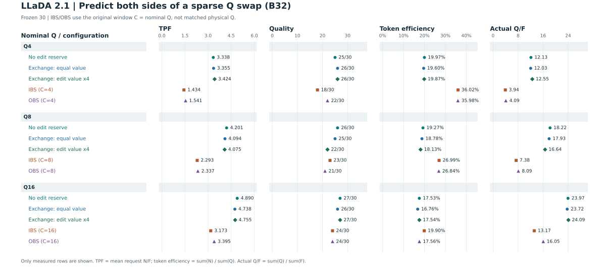

# LLaDA 2.1：预测旧位改写，也预测换走 MASK 的代价

Q4 两种交换规则的答对数和 TPF 点估计都超过同预算零预留；Q8 两者都变差，Q16 四倍规则保持判分但 TPF 下降。这不是跨预算优势。候选能否编辑、实际能否多答对、是否更省物理 Q 是三个不同问题。运行前确定的规则见[协议](PROTOCOL.md)。

## 端到端实测

两组分别通过相同 30 题全宽复现，之后实跑六个稀疏配置。冻结三个数据集各 10 题及种子。TPF 是逐题 N/F 均值，效率是 ΣN/Σ物理 Q；F/Q 含全宽初始化、选位、验证与提交，不含独立 prompt prefill。必刷超额不截断；表中的 Q4/8/16 不是完整请求的实际 Q/F。

| 名义 Q | 分配 | 答对/30 | TPF | token efficiency | 实际 Q/F | 总 F | 物理 Q | 赢/输¹ |
|---:|---|---:|---:|---:|---:|---:|---:|---|
| 4 | 零预留 | 25 | 3.338 | 19.97% | 12.13 | 5,993 | 72,667 | 参照 |
| 4 | 等权 | 26 | 3.355 | 19.60% | 12.03 | 6,240 | 75,091 | 1/0 |
| 4 | 编辑四倍 | 26 | 3.424 | 19.87% | 12.55 | 5,591 | 70,171 | 1/0 |
| 8 | 零预留 | 26 | 4.201 | 19.27% | 18.22 | 3,650 | 66,515 | 参照 |
| 8 | 等权 | 25 | 4.094 | 18.78% | 17.93 | 3,762 | 67,437 | 0/1 |
| 8 | 编辑四倍 | 22 | 4.075 | 18.13% | 16.64 | 5,185 | 86,265 | 0/4 |
| 16 | 零预留 | 27 | 4.890 | 17.53% | 23.97 | 2,892 | 69,322 | 参照 |
| 16 | 等权 | 26 | 4.738 | 16.76% | 23.72 | 3,361 | 79,709 | 0/1 |
| 16 | 编辑四倍 | 27 | 4.755 | 17.54% | 24.09 | 3,016 | 72,667 | 0/0 |

¹ 同预算逐题配对，只列本策略正确数 / 只列零预留正确数。这些是同一份反复用于研究的 30 题，不能作独立质量验证或延迟测试。

## 实际换位

预留只统计原零预留本来不算的行。先比较两个旧位；只有原选择没有旧回填时才拿候选与末个可换 MASK 比，始终保护首个可算 MASK。两表是位置和过去写入信息的查找表，不查询 logits 或未算的缓存。

| Q | 编辑价值 | 换入旧行 | 换入行严格改写 | 挤占 MASK | 全程必刷超额 Q² | ΔTPF（配对 95% 区间） |
|---:|---:|---:|---:|---:|---:|---|
| 4 | 4 | 343 | 9 | 40 | 3595 | +0.0865 [+0.0003, +0.1874] |
| 4 | 1 | 351 | 5 | 0 | 3679 | +0.0176 [-0.0413, +0.0819] |
| 8 | 4 | 967 | 13 | 175 | 2581 | -0.1257 [-0.2304, -0.0232] |
| 8 | 1 | 553 | 11 | 11 | 2457 | -0.1073 [-0.2251, +0.0022] |
| 16 | 4 | 1615 | 52 | 161 | 1117 | -0.1349 [-0.4132, +0.1404] |
| 16 | 1 | 1738 | 51 | 14 | 1327 | -0.1517 [-0.4028, +0.0957] |

² 必刷超额已计在总物理 Q，不是换位造成的额外行数。配对区间按数据集、请求重采样，不涵盖重复选策略或换种子的影响。

180 个策略/题目组合：第一次实际交换为旧换旧 154、旧换 MASK 18、整题未换 8。逐题核对了第一次交换前的全部记录事件、交换当轮的物理行数及新增行集合；没有交换的题还核对了输出 ID、F/Q 和完整事件。这里核对的是可观测事件，不是逐个比较所有层缓存张量。

## 为什么离线召回不足以判断质量

在同来源、与评测题不重叠的 24 道校准题，非 fresh 旧行改写 169/16,092，MASK 解码 5,487/18,108。在 frozen30 的 1,170 个原生选位状态回放，Q16 三种选择均只占 19,800 行：零预留、等权、编辑四倍分别覆盖 7、34、41 个可选旧编辑（共 191 个），同时保留 3,098、3,097、3,074 个当轮会解码的 MASK。这衡量同一原生历史的交换成本，不是真实稀疏分支的反事实。在线的 forced MASK 选择、未来的可计算集合和输出长度都可能改变。

n164 固定 CPU 核心的 Q16 单步选位中位耗时：零预留 9.28 微秒、等权 47.81、编辑四倍 47.83。不含 GPU 同步、数据搬运或请求延迟。

[逐题评分](llada21-online-requests.csv) · [Q 分账](paired-cost.csv) · [分阶段 F/Q](llada21-online-phases.csv) · [首次换位审计](first-swap-audit.csv) · [原生覆盖](native-coverage.csv) · [换入/换出事件交叉表](native-physical-swaps.csv) · [计时](selector-cpu.csv) · [冻结表](rates.json)

复算：`tools.exchange_study fit` 使用原校准目录；`replay` 使用原生评测轨迹。`python -m tools.run_t2t --model llada21` 带 `--exchange-rates` 和 `--arm Q:0:MASK:hard_exchange_equal` 或 `hard_exchange_edit4`，其中 `MASK` 分别是 3、7、14。用 `tools.t2t_results` 和 `tools.selection_effect` 分别合并评分与分账，`tools.exchange_study anchors` 检查第一处分叉。运行 `python -m tools.budget_index` 更新总表，`python -m tools.render_hard_study --study exchange --model llada21` 重画图。
