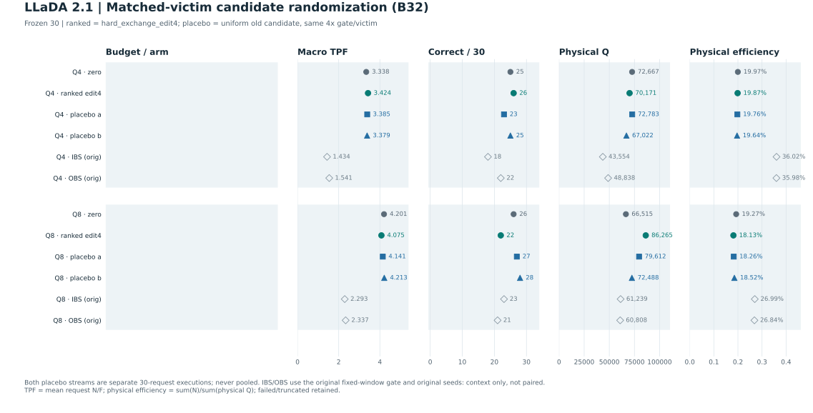

# 只随机化换入旧位：LLaDA 2.1 的固定预算对照

**Q4 的预测换入在 frozen30 上优于两个均匀随机流，Q8 则相反。** 这支持保留 Q4 作为研究配置，不支持把同一套候选排序推广到 Q8，也不能证明答题改善是由命中严格 T2T 引起的。每个配置都使用相同的 30 题（每个数据集 10 题），两条随机流不构成 60 道独立题。

| 名义 Q | 换入策略 | 正确/30 | 宏 TPF | token efficiency | 交付 N | 生成 F | 物理 Q |
|---:|---|---:|---:|---:|---:|---:|---:|
| 4 | 不预留旧位 | 25 | 3.338 | 19.97% | 14,508 | 5,993 | 72,667 |
| 4 | 预测（编辑四倍规则） | 26 | 3.424 | 19.87% | 13,942 | 5,591 | 70,171 |
| 4 | 均匀 A | 23 | 3.385 | 19.76% | 14,385 | 5,729 | 72,783 |
| 4 | 均匀 B | 25 | 3.379 | 19.64% | 13,160 | 5,406 | 67,022 |
| 8 | 不预留旧位 | 26 | 4.201 | 19.27% | 12,816 | 3,650 | 66,515 |
| 8 | 预测（编辑四倍规则） | 22 | 4.075 | 18.13% | 15,639 | 5,185 | 86,265 |
| 8 | 均匀 A | 27 | 4.141 | 18.26% | 14,538 | 4,639 | 79,612 |
| 8 | 均匀 B | 28 | 4.213 | 18.52% | 13,428 | 4,031 | 72,488 |

TPF 为逐题 N/F 的算术平均；效率为总 N / 总物理 Q。只免独立 prompt prefill，bootstrap、稀疏选位、全块验证和 KV 提交都收费。右三列是累计值；名义 Q 不限制 mandatory fresh 超额。**同一个前态**只改换入对象：门控、换出位、名额和物理宽度相同；分叉之后每个策略在自己的真实历史上执行。每个新预算分片都复现原生全宽输出及工作量 30/30。



两项历史基线使用相同名义窗口，但不是相同物理 Q/F；例如 Q4 原始 IBS/OBS 的效率是 36.02%/35.98%，不能仅看 TPF 得出加速结论。相同问题逐题配对：Q4 预测相对零预留、均匀 A、均匀 B 分别为 **赢/输 1/0、3/0、1/0**；Q8 分别为 **0/4、0/5、0/6**。[详细比较](exchange-placebo-report.md) · [逐题赢输与 F/Q 差值](exchange-placebo-paired-requests.csv) · [三项指标与原始基线](exchange-placebo-context.csv)。

## 选入的旧位真的改了吗？

独立[物理执行审计](trajectory-audit.csv)检查 120 条请求运行，其中 114 条发生实际 Q 分叉；6 条无分叉，最终输出和 F/Q 均一致。逐步校验每次换入、保护 fresh、各层 Q 宽度、候选碰撞及首次分叉的换出位置，没有违规。2,293 次均匀换入中，383 次挤掉 MASK，1,910 次换掉普通旧行；直接严格编辑 50 次。没有给未选位置标注真值。

| Q / 流 | 换入 | 其中挤掉 MASK | 与预测选中同一行 | 换入行直接严格编辑 | 首次分叉轮两臂真正接纳的 MASK 数之和（均匀/预测，跨题） |
|---|---:|---:|---:|---:|---:|
| 4 / A | 366 | 43 | 15 | 7 | 40 / 40 |
| 4 / B | 350 | 43 | 20 | 8 | 41 / 41 |
| 8 / A | 854 | 163 | 45 | 19 | 76 / 76 |
| 8 / B | 723 | 134 | 30 | 16 | 80 / 80 |

首次分叉轮按 `masked_before − masked_after + revocations` 计算真实 MASK 接纳，而不是直接照抄 `accepted`。总数相同不保证后续推理轨迹一致。已发布的预测臂在自己的 Q4/Q8 轨迹上分别为 9/343、13/967 次严格命中，与随机臂的分母不相同。

## 稀疏状态下，缓存年龄能提供信号吗？

只有随机实际算到的旧行才有观测值。基于已知均匀抽取概率估计：仍用同一门控和换出行，若改从最久未计算的一半或最新的一半中均匀抽取，当轮换入行会多常发生严格编辑？平局按名额分摊。时间戳只用本块先前真正执行的物理 Q；目标策略的单行重要性权重不超过 2。区间按数据集内整题重采样，不计入策略搜索、跨种子或跨题集误差。

| Q / 流 | 年龄可区分的状态 / 换位状态 | 均匀实测命中率 | 最旧一半估计 | 最新一半估计 | 差值（百分点，配对 95% 区间） |
|---|---:|---:|---:|---:|---|
| 4 / A | 312 / 366 | 1.91% | 2.42% | 1.40% | +1.02 [−0.81, +3.57] |
| 4 / B | 293 / 350 | 2.29% | 3.72% | 0.85% | +2.88 [+0.42, +5.84] |
| 8 / A | 749 / 854 | 2.22% | 3.03% | 1.43% | +1.60 [+0.41, +2.76] |
| 8 / B | 616 / 723 | 2.21% | 4.17% | 0.28% | +3.89 [+2.20, +6.61] |

四组点估计同向，Q4/A 区间跨零。这是**已访问状态上的单步估计**，不是端到端结果，不能由此推断真实部署的质量或 TPF。相比之下，单独估计“恰好抽到预测第一名”的证据很弱：四组候选相撞时仅直接命中 0/1/2/1 次；Q4 两条流对预测排序的相对效果给出不同符号。[汇总与有效支持量](candidate-propensity.csv) · [逐题数据](candidate-propensity-requests.csv) · [实验与后续直接执行规则](PROTOCOL.md)。

## 复现

在研究分支按冻结 30 题和相同种子运行 `tools.run_t2t --model llada21 --exchange-rates experiments/t2t/exchange/rates.json`。Q4、Q8 的 `--arm` 格式分别为 `4:0:3:hard_exchange_random_a`、`8:0:7:hard_exchange_random_a`；另一随机流后缀为 `b`。先用 `tools.t2t_results` 对两个完整分片评分，再运行：

```sh
python -m tools.exchange_placebo_report --measured "$SCORED" --ranked experiments/t2t/exchange --out "$OUT"
python -m tools.exchange_placebo_audit --ranked "$RANKED_RAW" --run "$Q4_RAW" --run "$Q8_RAW" --out "$OUT/trajectory-audit.csv"
python -m tools.exchange_study propensity --dir "$OUT" --run "$Q4_RAW" --run "$Q8_RAW"
```
