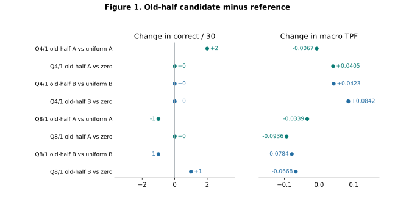

# 缓存年龄：从单步命中估计到真实请求

**直接执行后，Q4、Q8 都没有达到预先冻结的“质量更高且 TPF 不低”标准。** Q4 两条流都只答对 25 题，与零预留持平。Q8/B 比零预留多对一题，但 TPF 从 4.201 降到 4.134；Q8/A 两项都不优于零预留。不要把单步估计的编辑风险当成这个策略的端到端增益。

## 稀疏执行

选位不读 logits、KV 张量或未计算行的状态。每轮先硬性纳入所有刚解码和刚 T2T 的行，然后沿用编辑四倍规则的门控和 victim。只有当它真的要换入时，才从原 Q 外、已解码且非 fresh 的候选里，按**最后一次真正执行 Q 的时间**取最久的一半（向上取整），从中均匀选一行。只对边界并列随机；全部并列时精确复用原均匀流的 draw。不增加探针、Q 行或 forward。后续轨迹可以不同，因此全程 F/Q 不要求相等。A/B 是候选抽样用的两条随机流，不改变 30 道题及模型生成种子。

| Q / 流 | 同流均匀：正确、TPF、效率 | 旧半池：正确、TPF、效率 | 均匀直接编辑 / 换入 | 旧半池直接编辑 / 换入 | 旧半池 vs 均匀：逐题赢 / 输 |
|---|---|---|---:|---:|---:|
| 4 / A | 23 · 3.385 · 19.76% | 25 · 3.378 · 19.04% | 7 / 366 | 8 / 414 | 2 / 0 |
| 4 / B | 25 · 3.379 · 19.64% | 25 · 3.422 · 20.04% | 8 / 350 | 6 / 350 | 0 / 0 |
| 8 / A | 27 · 4.141 · 18.26% | 26 · 4.107 · 18.73% | 19 / 854 | 25 / 696 | 0 / 1 |
| 8 / B | 28 · 4.213 · 18.52% | 27 · 4.134 · 18.33% | 16 / 723 | 17 / 748 | 0 / 1 |

Q8/A 的主动换入编辑率从 2.22% 到 3.59%，但相同题单少对 1 题，TPF 也下降了 0.034；Q8/B 的命中率仅从 2.21% 到 2.27%。这些是在各自的稀疏轨迹上实测的事件率，**不是同一批未选位置的召回率**。Q4 两条流的旧半池/均匀命中率各为 1.93%/1.91%、1.71%/2.29%，并没有稳定提高。旧半池改善编辑预测与改善交付，两件事都要分别检验。



两份预算分片分别通过全宽 30/30 资格校验。4 个臂的 120 条完整请求均纳入，截断不剔除。对照中 109 条发生物理 Q 分叉，11 条始终不分叉；独立回放检查每个实际换位的时钟、并列候选、抽样、换出位、物理 Q 和首次分叉，无缺题、无违规。两次抽样仍只有 30 道不同的题。均匀源状态上“最旧 vs 最新”的重要性估计是之前的筛选依据；本次上线执行的对照是原均匀策略，没有把“最新一半”实际跑成另一个策略。

[含零预留、原预测、同流均匀的 12 行总表与工作量](exchange-age-report.md) · [逐题评分与 N/F/Q（附原生参照）](llada21-online-requests.csv) · [配对结果](exchange-age-paired.csv) · [实际 Q 分配、直接编辑](physical-split.csv) · [分阶段 F/Q](llada21-online-phases.csv) · [逐题物理审计](trajectory-audit.csv) · [冻结规则](../PROTOCOL.md)。

## 复算

沿用同一 `tools.run_t2t`，仅把候选策略替换为 `hard_exchange_oldhalf_a` 或 `hard_exchange_oldhalf_b`，Q4/Q8 分别使用 `4:0:3` 和 `8:0:7`；仍需 `--exchange-rates`。先用 `tools.t2t_results` 合并两个新分片，生成的逐题和阶段表即上面的对应 CSV。然后：

```sh
python -m tools.exchange_placebo_report --age-measured "$AGE_SCORED" --measured "$UNIFORM_SCORED" --ranked experiments/t2t/exchange --out "$OUT"
python -m tools.exchange_placebo_audit --old-half --ranked "$UNIFORM_Q4" --ranked "$UNIFORM_Q8" --run "$AGE_Q4" --run "$AGE_Q8" --out "$OUT/trajectory-audit.csv"
python -m tools.selection_effect --model llada21 --scores "$AGE_SCORED/llada21-online-requests.csv" --baseline experiments/t2t/hard/llada21-online-requests.csv --run "$AGE_Q4" --run "$AGE_Q8" --out "$OUT/physical-split.csv"
```
