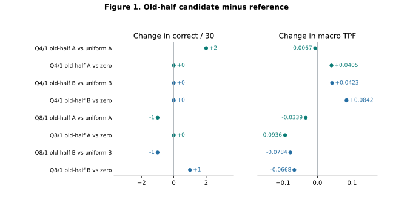

# LLaDA 2.1: old-half candidate selection

Each salt uses the same frozen 30 requests; salts are never pooled. `placebo_a/b` are the earlier uniform draws. Ranked edit4 is context only. Direct strict edits and gate/victim checks belong to the separate event audit.

A budget passes only if **both** salts beat zero on correct count, match or beat zero on macro TPF, and match or beat their own uniform salt on both. The rule uses unrounded point estimates.

| Budget | Salt A | Salt B | Budget result |
|---|---|---|---|
| Q4/1 | FAIL | FAIL | **FAIL** |
| Q8/1 | FAIL | FAIL | **FAIL** |

| Budget | Arm | Correct / 30 | Macro TPF | Physical efficiency | N | F | Q | Physical Q |
|---|---|---:|---:|---:|---:|---:|---:|---:|
| Q4 | zero | 25 | 3.3375 | 19.97% | 14,508 | 5,993 | 72,667 | 72,667 |
| Q4 | ranked | 26 | 3.4241 | 19.87% | 13,942 | 5,591 | 70,171 | 70,171 |
| Q4 | placebo_a | 23 | 3.3848 | 19.76% | 14,385 | 5,729 | 72,783 | 72,783 |
| Q4 | oldhalf_a | 25 | 3.3781 | 19.04% | 14,551 | 6,354 | 76,407 | 76,407 |
| Q4 | placebo_b | 25 | 3.3794 | 19.64% | 13,160 | 5,406 | 67,022 | 67,022 |
| Q4 | oldhalf_b | 25 | 3.4217 | 20.04% | 13,816 | 5,500 | 68,942 | 68,942 |
| Q8 | zero | 26 | 4.2011 | 19.27% | 12,816 | 3,650 | 66,515 | 66,515 |
| Q8 | ranked | 22 | 4.0753 | 18.13% | 15,639 | 5,185 | 86,265 | 86,265 |
| Q8 | placebo_a | 27 | 4.1414 | 18.26% | 14,538 | 4,639 | 79,612 | 79,612 |
| Q8 | oldhalf_a | 26 | 4.1075 | 18.73% | 13,287 | 3,942 | 70,953 | 70,953 |
| Q8 | placebo_b | 28 | 4.2126 | 18.52% | 13,428 | 4,031 | 72,488 | 72,488 |
| Q8 | oldhalf_b | 27 | 4.1343 | 18.33% | 13,516 | 4,119 | 73,742 | 73,742 |

Macro TPF = mean request N/F; physical efficiency = total N / total physical Q.



[Point estimates](exchange-age-summary.csv) · [Matched wins/losses, work deltas and decisions](exchange-age-paired.csv)

```bash
python -m tools.exchange_placebo_report --age-measured "$AGE_MEASURED" --measured "$UNIFORM_MEASURED" --ranked "$RANKED" --out "$AGE_OUT"
```
