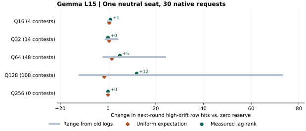

# DiffusionGemma：只用历史计算过的行，能否预测下一轮 KV 高漂移？

**原生同前态下，Q64 和 Q128 有信号，但 Q32 没有超过随机，未通过预设的跨预算条件。** 这是对「换哪一行」的诊断，不是对实际稀疏输出质量、严格 T2T 或 TPF 的实测改善。不建议把这个规则设为各预算共用的默认策略。

| 名义 Q | 有普通旧回填的状态 | 有至少两候选的机会 | 真正换行 | 零预留命中 | 随机选位总命中期望 | 按上轮漂移总命中 | 新增 / 丢失 | 旧日志能确定的总命中范围 |
|---:|---:|---:|---:|---:|---:|---:|---:|---:|
| 16 | 30 | 4 | 4 | 5 | 5.50 | 6 | 1 / 0 | 5–6 |
| 32 | 54 | 14 | 13 | 30 | 30.46 | 30 | 1 / 1 | 29–34 |
| 64 | 92 | 48 | 48 | 148 | 149.60 | 153 | 7 / 2 | 146–172 |
| 128 | 159 | 108 | 105 | 863 | 861.42 | 875 | 23 / 11 | 851–936 |
| 256 | 325 | 0 | 0 | 4,182 | 4,182.00 | 4,182 | 0 / 0 | 4,182 |

**测试的规则。** 固定 30 题，保持同一原生生成路径。对每个预算，必须保留上轮新接受/严格编辑的全部行和原来要算的 MASK，只能动最后一个普通旧回填。比较的旧行必须同时出现在 `t−2`、`t−1` 两次同块、同预算的零预留 Q 布局中，至少两个候选才选择。查这些行的**上一轮**第 15 层 KV 相对变化，取 `max(相对RMS(dK), 相对RMS(dV))` 最大的行。随机对照在相同机会、相同候选中均匀选，允许选回原行。当前轮高漂移标签只在选完后计分；没有使用任何轮的 logits。

总命中包括没有动过的席位。更直接地看**那一个可换席位**：Q64 的 48 次机会，按上轮漂移命中 7 次，零预留 2 次，随机期望 3.60；Q128 的 108 次机会分别为 24、12、10.42。Q32 的 14 次机会分别为 1、1、1.46。Q16 只有 4 次机会；Q256 已全算、没有换位空间。统计单位是行次，同一题内各步不是独立样本。

**为什么要补采？** 历史档案只记上一轮非 fresh 旧池的全局高漂移名单，很多这轮可比的行在上一轮还属于 MASK 或 fresh。原始档案在 Q16/32/64/128 的 4/14/48/108 次机会里，没有一次能唯一确定上一轮局部最大者。不知道谁最大并不等于漂移为零。重新执行既有的原生 30 题，在不加 forward、不消耗采样随机数的前提下记录标量，逐题核对生成结果、工作量、完整 token 轨迹和原 L15 诊断一致。431 帧、53 个块首帧、378 个同块转移；其中 325 个状态有合格旧池、共 40,350 候选行次及 4,182 个当前高漂移标签。新的精确命中全部落在旧日志的可辨认范围内；范围不是置信区间。

**可部署边界。** 回放中的 KV 来自原生全宽前态，然后用各预算过去的真实可见范围约束读哪些行；它不等同于实际稀疏执行中的 resident KV。上轮在线若未计算一行，就不能免费拿到它的变化；即便同一行连续被算，两种执行的上下文也可能不同。原生 30 题仅有的 10 次严格 T2T 均在硬刷新中，本表的高漂移标签不是另外发现了严格编辑。此次未按这个排序器另跑最终质量，不能据此宣称提高质量、TPF 或墙钟吞吐率。

[冻结协议与跨预算判据](PROTOCOL.md) · [精确结果](exact.csv) · [旧档分组覆盖](coverage.csv) · [旧档界限及均匀对照](summary.csv) · [绘图代码](plot.py) · [原生高漂移定义](../README.md) · [两模型完整预算矩阵](../../../hard/README.md)。

从仓库根目录复算：先用 `python -m tools.native_kv_drift --lag-joint` 加原生入口原有的模型、样本、参考和新输出目录参数，保留旧档。然后 `python -m tools.drift_persistence --raw HISTORICAL --exact-raw RECAPTURE --out PRIVATE_DIR`（不加载模型，验证通过后写 `exact.csv`）。不传 `--exact-raw` 可从旧档单独重算界限。归档中的 `plot.py` 只需同目录的 CSV；原始记录、行级漂移标量和权重仅留在集群。
