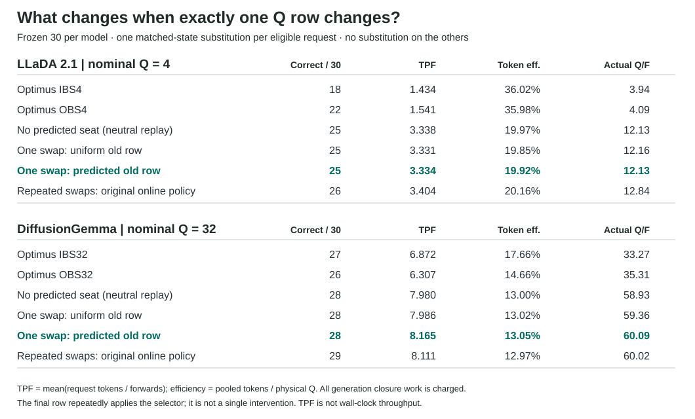

# 同一前置状态下，单换一个物理 Q

[预注册规则](PREREG.md)。每题执行零预留策略，只在**第一次**能合法换一个席位时改变一次选位，随后恢复零预留。三路分别是保留原席位、换预测旧位、换均匀随机旧位。随机允许碰到预测候选，未发生干预的题不剔除。评价基于固定 30 题的完整请求，不是只挑中途有机会的轮次。这里的零预留是无额外预留，不等于从不查询旧行。

## LLaDA 2.1，名义 Q4

| 策略 | 对题/30 | TPF | Token efficiency | 实际 Q/F | 全程 F | 物理 Q |
|---|---:|---:|---:|---:|---:|---:|
| 不换位 | 25 | 3.338 | 19.97% | 12.13 | 5,993 | 72,667 |
| 只换一次：预测旧位 | 25 | 3.334 | 19.92% | 12.13 | 5,965 | 72,363 |
| 只换一次：随机旧位 | 25 | 3.331 | 19.85% | 12.16 | 5,970 | 72,615 |
| 持续使用几何空位策略（历史对照） | 26 | 3.404 | 20.16% | 12.84 | 5,021 | 64,472 |

28/30 题在共同路径上出现可换的席位，全部是旧回填席位，没有挤占 MASK；其余 2 题不干预且三路一致。定向换位与零预留相比只有 1 题在当步改变了已接受内容，另 5 题后续才出现这种差异；最终 2 题输出 token 序列改变，0 赢 0 输。随机换位 3 题最终序列改变，判分也没有翻转。定向换入的旧位当步 0/28 个严格编辑；随机 1/28、原零预留 victim 1/28。定向/随机 K 刷新中位数为 0.079/0.088，V 为 0.258/0.254，未见 Gemma 那样的一致幅度差。

[评分](llada21-online-summary.csv) · [逐题](llada21-causal-requests.csv) · [分层](llada21-causal-summary.csv) · [分阶段工作变化](llada21-causal-phases.csv) · [第 15 层物理行](llada21-row-refresh.csv)。不换位分支逐题复现此前 `hard_noedit` 的输出、F/Q 以及所有原有事件字段；两个模型均通过。图中 IBS/OBS 是历史实测，比较的是同名义窗口而不是同物理 Q/F。

## DiffusionGemma，名义 Q32

| 策略 | 对题/30 | TPF | Token efficiency | 实际 Q/F | 全程 F | 物理 Q |
|---|---:|---:|---:|---:|---:|---:|
| 不换位 | 28 | 7.980 | 13.00% | 58.93 | 1,389 | 81,858 |
| 只换一次：预测旧位 | 28 | 8.165 | 13.05% | 60.09 | 1,321 | 79,380 |
| 只换一次：随机旧位 | 28 | 7.986 | 13.02% | 59.36 | 1,350 | 80,132 |
| 连续使用原触发预测策略（历史对照） | 29 | 8.111 | 12.97% | 60.02 | 见[分账](../gemma-work-envelope.csv) | 79,404 |

三路在 26 道有机会的题上通过干预前的指纹、干预步的 RNG 和物理行校验；4 道无机会的题完整一致。26 次中 17 次替换旧回填、9 次挤占 MASK。与零预留相比，定向换位当步改变了 12 题的已接受状态，另 8 题后续才出现这种差异；最终 14 题的输出 token 序列改变，判分一题变对、一题变错，净增 0。挤占 MASK 的 9 题全部改变最终序列，替换回填的 17 题只有 5 题改变最终序列。两层次不是随机分配的，不能从这种差异推断「应当多挤占 MASK」。

定向换入的 26 个旧行和随机换入的 26 个旧行当步均 **0 次严格 T2T、0 次撤销**。同一前置状态下，第 15 层记录的实际刷新幅度中位数，定向行为 `dK=0.503, dV=0.688`，随机行为 `0.188, 0.299`；跳过行的缓存没有被写入。预测器挑出了缓存变化较大的行，但计算这一行也改变了参与采样与接受的集合，不能据此把最终差异归因于 KV 单独作用。TPF 的改善来自完整请求，不能解释成单步 CUDA 加速。

[完整评分](gemma-online-summary.csv) · [逐题配对与第一次分叉](gemma-causal-requests.csv) · [分层](gemma-causal-summary.csv) · [每阶段工作差值](gemma-causal-phases.csv) · [实际 K、V 刷新](gemma-row-refresh.csv)。

## 复算

先用 `tools.run_t2t` 跑 `hard_once_base`、`hard_once_rank`、`hard_once_random`，配置分别用 LLaDA `4:0:4`、Gemma `32:0:32`。用 `python -m tools.t2t_results --samples FROZEN --run RUN --out OUT` 产生评分，再用 `python -m tools.causal_seat_report --run RUN --out OUT` 检查同状态及分叉，`python -m tools.seat_drift --run RUN --control PREVIOUS_NOEDIT_RUN --out OUT` 检查零预留精确复现及第 15 层刷新。输出包含候选相撞和无交换的请求。不保存模型权重、原始模型输出、缓存张量到 Git。
