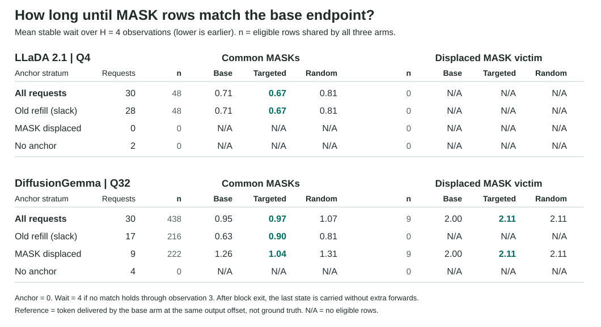

# 一次旧位换入，对其他 MASK 有没有帮助？

在每个模型原有的 30 道题、种子和采样策略上，只在第一次有合法机会时换一个 Q。三条分支是保留原席位（base）、换无 logits 预测的旧位（rank）、换随机旧位（random）。新观察器只在 forward 后读取已接受的 ID，没有额外模型计算。[预注册](PROTOCOL.md) · [原三组的质量、TPF、效率、绝对工作量及 IBS/OBS 对照](../README.md)。

**如何读下表。** 在同一前态记录三路共同选入的 MASK，另列被换出的 MASK。参照 token 是零预留分支最终交付的同偏移 ID，**不是标准答案**。`t0` 为换位当轮，`t3` 为第四次观察；提前离开该块沿用最后状态，不添加实际 forward。稳定等待取 0 到 4，越小表示越早达到参照且保持到 `t3`；4 也包含整个窗口都没达到。分支交付了别的 ID 不等于答错。逐题等权统计只在有可比较位置的题上计算，整题质量和 TPF 仍使用全部 30 题。

## DiffusionGemma，Q32

| 共同 MASK（有可比参照的 438 个位置，24 题） | 不换 | 定向换 | 随机换 |
|---|---:|---:|---:|
| 当轮达到参照的行 | 213 | 219 | 217 |
| `t3` 达到参照的行 | 420 | 396 | 387 |
| 稳定等待（位置等权） | 0.952 | 0.973 | 1.066 |
| 最终返回了与参照不同的 ID | 0 | 35 | 42 |
| 全部 30 题的正确 / TPF / 物理 token efficiency | 28 · 7.980 · 13.00% | 28 · 8.165 · 13.05% | 28 · 7.986 · 13.02% |

26 次换位中，17 次换走普通旧位、9 次换走 MASK；另外 4 题没有换位。跟踪了 482 个共同 MASK，其中 44 个超出基线最终交付范围，不能把它们算成未命中。另有 9 个被换出的 MASK 均有参照。

| 换走的是什么 | 共同 MASK 可比位置 / 题 | 基线稳定等待 | 定向 | 随机 | 定向减基线，逐题等权 |
|---|---:|---:|---:|---:|---:|
| 普通旧位 | 216 / 15 | 0.634 | 0.903 | 0.815 | +0.236 |
| MASK | 222 / 9 | 1.261 | 1.041 | 1.311 | −0.190 |

被换出的 9 个 MASK 自身，基线稳定等待 2.000，定向和随机均为 2.111；基线当轮只接纳其中 1 个，换位两组均为 0。合并所有可比题，定向相对基线的共同 MASK 稳定等待按题平均 **+0.076**：8 题更早、7 题更晚、9 题持平。两层次不是随机分组，不可据此断言应更多替换 MASK。定向在本种子的宏 TPF 提高，不代表共同 MASK 普遍提前达到相同最终 ID。

[逐题](gemma-beneficiary-requests.csv) · [成对差值](gemma-beneficiary-paired.csv) · [分母、层次、终点与等待](gemma-beneficiary-summary.csv) · [逐字段复现检查](gemma-historical-reproduction.csv)。Gemma 中间观察的是已接受的采样 ID，而最终交付基于原生 draft，二者不强行等同。

## LLaDA 2.1，Q4

28 题有换位、2 题没换位，**28 次换走的都是普通旧回填，没有换走 MASK**。跟踪的 48 个共同 MASK 均有可比交付偏移，不能从本组估计挤占 MASK 的代价。

| 共同 MASK / 整个请求 | 不换 | 定向换 | 随机换 |
|---|---:|---:|---:|
| 当轮达到参照的行 / 48 | 32 | 32 | 33 |
| `t3` 达到参照的行 / 48 | 45 | 46 | 41 |
| 稳定等待（位置等权） | 0.708 | 0.667 | 0.813 |
| 最终不同于参照的行 | 0 | 2 | 4 |
| 全部 30 题的正确 / TPF / 物理 token efficiency | 25 · 3.338 · 19.97% | 25 · 3.334 · 19.92% | 25 · 3.331 · 19.85% |

定向换位总共仅减少 2 个“位置 × 等待轮次”；28 道可比题中，3 题更早、2 题更晚、23 题持平。虽然共同 MASK 略早达到基线交付 ID，质量不变，TPF 没有提高。不要把这里**只换一次的几何策略**当成每步预留 embedding 旧位的线上实验。

[逐题](llada21-beneficiary-requests.csv) · [配对](llada21-beneficiary-paired.csv) · [完整分母](llada21-beneficiary-summary.csv) · [历史复现](llada21-historical-reproduction.csv)。



## 复算

重跑 `hard_once_base/rank/random`，使用注册时各自的预算。先用 `tools.t2t_results` 判分（须完整 30 题），然后：

```sh
python -m tools.causal_seat_report --run NEW --historical ORIGINAL --out TABLES
# For LLaDA also pass --native-reference NATIVE32_REQUESTS to recover exact prompt offsets.
python -m tools.beneficiary_rows --run NEW --out TABLES
# Once both models' summary CSVs are present:
python -m tools.render_seat_study --beneficiary --out TABLES
```
