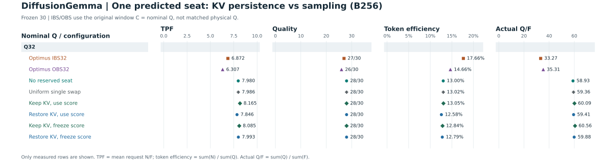

# DiffusionGemma Q32：一个旧位的 KV 刷新会不会影响后续解码？

**会。在相同的已执行位置和当步采样状态下，只切换候选行新 KV 是否保留，后续输出与 forward 数都会改变；但四组答对的是完全相同的 28 道题。** 这里检验的是这一个位置的缓存能否影响后续，不是已证明应该牺牲 MASK 来刷新它。



## 实验与校验

[事先确定的协议](PROTOCOL.md)。在每题第一次有合法候选的选位轮，四组从完全相同的状态出发，用同一个无 logits 的预测旧位替换同一行，只干预一次。26 题发生替换（17 个普通旧位、9 个 MASK），其余 4 题保留在分母中。之后所有组恢复零预留策略。物理 Q 在干预轮相同；后续自由解码，工作量可以不同。每组执行时都包含上一步所有新解码与改写行，不限额截断。

**KV 开关**在当步计算完成后生效：保留候选行所有层的 K 和 V，或原样恢复其旧缓存。**采样开关**决定候选的新 raw logits 是否交给原生处理器；关闭时仍用先前 raw logits，该行的接受状态、草稿、画布和自条件状态均冻结。打开/关闭都计算相同的物理行，不凭空省去一次 forward。候选行在本次 forward 内对其他行的影响在四组都存在；关闭两项不等于历史零预留。

两个 GPU 分组各自先逐题复现原生全宽输出和实算工作量 30/30。全开组随后逐题复现历史单次定向换位的输出、逐步记录和工作量 30/30。所有合法干预的前态、物理席位、当步其他行 KV、候选新 KV 及 RNG 均经校验；固定采样开关时仅 KV 持久化不同，当步非 KV 状态一致。计分仍用冻结的三个数据集各 10 题，不剔除长题。

## 完整请求结果

| 候选 KV（当步后） | 候选采样 | 答对/30 | TPF | Token efficiency | 实际 Q/F | 总 F | 物理 Q |
|---|---|---:|---:|---:|---:|---:|---:|
| 保留 | 使用新分数 | 28 | 8.165 | 13.05% | 60.09 | 1,321 | 79,380 |
| 回滚 | 使用新分数 | 28 | 7.846 | 12.58% | 59.41 | 1,401 | 83,238 |
| 保留 | 冻结 | 28 | 8.085 | 12.84% | 60.56 | 1,331 | 80,607 |
| 回滚 | 冻结 | 28 | 7.993 | 12.79% | 59.88 | 1,367 | 81,858 |
| 历史零预留（不换位） | 原生 | 28 | 7.980 | 13.00% | 58.93 | 1,389 | 81,858 |

用新分数时，仅保留 KV 让最终序列改变 **12 题**，TPF 差 **+0.319**，少 80 F、3,858 Q。冻结采样时，同一对照仍有 **10 题**改变最终序列，TPF 差 **+0.093**，少 36 F、1,251 Q。分层配对重采样所得 TPF 差的 95% 百分位区间分别为 **[+0.030, +0.609]**、**[−0.208, +0.399]**（10,000 次，每集每次 10 题，固定随机种子）。这批题反复用于设计，区间不涵盖选策略和换种子的影响。

反过来，固定 KV 是否保留、仅切换候选采样：保留 KV 时 2 题改变最终序列，TPF +0.080；回滚 KV 时 4 题改变，TPF −0.146。四个成对比较都没有一题翻转判分。两种保留 KV 的分支里，26 个候选中 24 个直到全宽验证才被重新计算，另 2 个在后续稀疏选位轮重算。不能从一次干预推算每轮刷新都能提高 TPF，也不能把 TPF 当成墙钟提速。

## 数据与复算

[四组分数据集](gemma-online-summary.csv) · [四种配对差值与区间](gemma-kv-factorial-summary.csv) · [逐题分叉及首次重查](gemma-kv-factorial-requests.csv) · [配对的阶段工作量](gemma-kv-factorial-phases.csv) · [历史 IBS/OBS 与随机换位对照](../README.md)。运行 `tools.run_t2t` 的四个 `--arm` 均以 `32:0:32:` 开头，接 `hard_once_kk`、`hard_once_dk`、`hard_once_kd` 或 `hard_once_dd`；两字符依次为 KV、采样的保留/回滚。先用 `tools.t2t_results` 合并两份不重复的 `--run` 判分，再运行：

```bash
python -m tools.kv_factorial_report --run RUN_A --run RUN_B --history HISTORICAL_ONE_SEAT --scores OUT/gemma-online-requests.csv --out OUT
python -m tools.render_seat_study --factorial
```
