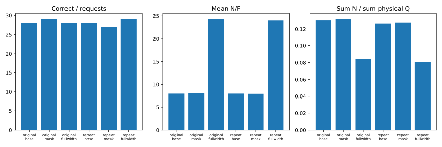

# Gemma Q32：只在首个合法候选会挤走 MASK 时换位

**结论：不设为默认策略。** 原种子组完整复现此前的事后重建，但同题换种子后，正确数和 TPF 的差值都反向。19 次实际换入的旧行，没有一次在干预当轮发生严格 T2T 或撤销接受。该实验说明一次换位能改变后续生成，不能证明取得收益的机制是改写旧 token 或 KV 刷新。

## 两组直接执行

每组均为同样 30 题，三数据集各 10 题。先固定[规则和种子映射](PREREG.md)，再在 n164 实测。两臂的必刷、MASK、普通回填和溢出规则相同。每请求只看首个合法候选；若受影响的是旧回填而不是 MASK，永久放弃本请求。不是“后面再找一个 MASK”，也不是每一轮都执行的 `hard_trigger`。新种子为原 seed 加 1000003；单列为重复实验，不当作另外 30 道独立的题。

| 每组 30 题 | 策略 | 对题 | TPF | Token efficiency | 输出 N | 生成 F | 物理 Q |
|---|---|---:|---:|---:|---:|---:|---:|
| 原种子 | 原生全宽参考 B256 | 28 | 24.284 | 8.42% | 9,789 | 454 | 116,224 |
| 原种子 | Q32 零预留 | 28 | 7.980 | 13.00% | 10,645 | 1,389 | 81,858 |
| 原种子 | Q32 条件换位 | 29 | 8.130 | 13.15% | 10,533 | 1,347 | 80,129 |
| 新种子 | 原生全宽参考 B256 | 29 | 23.998 | 8.10% | 10,469 | 505 | 129,280 |
| 新种子 | Q32 零预留 | 28 | 7.977 | 12.60% | 10,321 | 1,348 | 81,892 |
| 新种子 | Q32 条件换位 | 27 | 7.927 | 12.72% | 10,565 | 1,405 | 83,063 |

TPF 是逐题 `N/F` 的均值，效率是 `ΣN/Σ物理Q`。不计独立 prompt prefill；bootstrap、稀疏解码、全宽验证、块间重编码全部计费。诊断读已经存在的状态、没有添加模型 forward；哈希和拷贝有运行开销，不报告墙钟加速。无失败或截断。原种子历史基线 IBS32 为 27/30、6.872、17.66%，OBS32 为 26/30、6.307、14.66%；未在新种子重测 IBS/OBS，不跨种子作配对比较。



## 什么位置被换掉

| 步前事实（每题至多一次） | 原种子 | 新种子 |
|---|---:|---:|
| 首个合法候选的 victim 为 MASK：执行换位 | 9 | 10 |
| 首个合法候选的 victim 为旧回填：不换位 | 17 | 15 |
| 无合法候选 | 4 | 5 |
| 被换掉的 MASK 在实际对照臂当轮从未接受变成接受 | 1/9 | 4/10 |
| 换入旧行在干预当轮严格 T2T | 0/9 | 0/10 |
| 条件换位相对对照，逐题赢 / 输 | 1 / 0 | 0 / 1 |

原种子唯一净赢 `HumanEval/74`，其 victim 在对照臂当轮未被接受；相同输出长度 270 token，F 从 54 到 36。新种子唯一净输 `HumanEval/163`，其 victim 在对照臂当轮会被接受；N 从 306 到 472，F 从 43 到 68，Q 从 2,844 到 3,744。这个配对定位了分叉，不把后续的输赢单独归因于 victim、candidate 或 KV。Gemma 的 MASK 是布尔接受状态；重新加噪使 token ID 改变不等于解码。

原种子 30/30 与历史 `rank` 或 `base` 整请求输出及工作量一致。两组都用各自同种子的真实原生输出校验全宽；锚点的步前状态、交换的行和物理执行都做了配对检查。可审计文件：[汇总](seat-repeat-summary.csv)、[逐题指标](seat-repeat-requests.csv)、[配对输赢及 victim](seat-repeat-paired.csv)、[首次换位](seat-repeat-anchor-audit.csv)、[校验明细](seat-repeat-checks.csv)、[实际 Q 分账](physical-split.csv)。

## 复算

生成参考用 `python -m bdlm_serving.runtime.gemma_native_reference`。在线沿用 `python -m tools.run_t2t`，传两次 `--arm`：`32:0:32:hard_once_base` 和 `32:0:32:hard_once_mask`。重复组附 `--seed-offset 1000003`，`--reference` 指向同种子的原生目录；原种子组不偏移。不要混用另一组的参考或判分缓存。

```bash
cd /data1/project_data/gx-erqw-20261123/runtime/t2t-experiments
R=../t2t-native-1125
CUDA_VISIBLE_DEVICES='' PYTHONPATH=.:../fixed-baseline-deps ../venv/bin/python -m tools.seat_repeat_report \
  --samples ../../archive/fixed-baselines-20261124/samples.json \
  --original "$R/one-seat-v2-gemma" --bridge "$R/seat-bridge-original-v1" \
  --repeat "$R/seat-repeat-sparse-v1" --native-reference "$R/seat-repeat-native-v1" \
  --out experiments/t2t/placement/one-seat/repeat --plot
```
