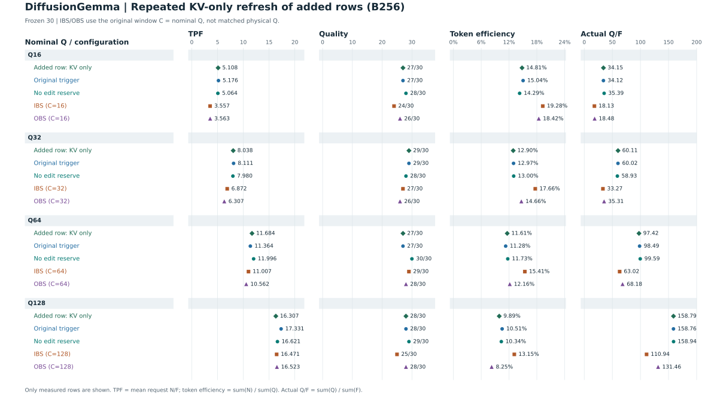

# DiffusionGemma：预测旧位只刷新 KV，是否比原触发策略更好？

**没有提高质量。** 四个预算、每组相同 30 题，在只冻结新增旧位采样与允许其采样的两种触发策略之间，逐题 0 赢 0 输。Q32 下，两者都比零预留净多对 1 题、TPF 略高；允许采样的原触发策略 TPF 更高。不要因为[单席 KV 持久化实验](../placement/one-seat/kv-factorial/README.md)有作用，就把“所有新增旧位都禁止采样”设成默认。

## 按名义 Q 对比

每个格子为 **答对/30 · TPF · token efficiency**。TPF 为逐题 N/F 均值，效率为 ΣN/Σ实算 Q。实际 F、Q 包括全宽初始化、验证与生成块重编码，不含单独的 prompt prefill。没有强制削减上轮写入必刷的行。

| 名义 Q | 零预留 | 原触发：允许采样 | 新触发：仅刷新增行 KV | 新触发实际 Q/F | 新触发物理总 Q |
|---:|---|---|---|---:|---:|
| 16 | 28 · 5.064 · 14.29% | 27 · 5.176 · 15.04% | 27 · 5.108 · 14.81% | 34.15 | 75,004 |
| 32 | 28 · 7.980 · 13.00% | 29 · 8.111 · 12.97% | 29 · 8.038 · 12.90% | 60.11 | 79,767 |
| 64 | 30 · 11.996 · 11.73% | 27 · 11.364 · 11.28% | 27 · 11.684 · 11.61% | 97.42 | 93,617 |
| 128 | 29 · 16.621 · 10.34% | 28 · 17.331 · 10.51% | 28 · 16.307 · 9.89% | 158.79 | 103,687 |

Q256 覆盖整个原生 B256，零预留的 Q 已经包含全部可用位置；因此没有独立的“新增旧位”条件，没有把原生成绩重复标成新策略实测。全宽对照是 28/30、TPF 24.284、效率 8.42%。

## 实际有多少行只刷 KV？

| Q | 每轮预留上限 | 总预留旧行 | 其中只刷 KV | 发生只刷的轮数 | 少算 MASK 行数¹ | 必刷超额 Q |
|---:|---:|---:|---:|---:|---:|---:|
| 16 | 2 | 121 | 117 | 72 | 25 | 2,188 |
| 32 | 4 | 427 | 390 | 121 | 17 | 2,135 |
| 64 | 8 | 1,381 | 1,223 | 172 | 5 | 1,393 |
| 128 | 16 | 3,424 | 2,480 | 200 | 8 | 775 |

¹ 和**同状态**零预留的 MASK 选择相比。并非每个新加的旧行都挤占一个 MASK，多数替换普通旧回填行。冻结的只限于超出同状态零预留集合、由预测器引入的旧行，其余实算行原样参与采样。冻结这一行自己的采样，不会屏蔽它在 attention 中对其他行的 K、V。

相对原触发，KV-only 在 Q16/Q32/Q64/Q128 的 TPF 差为 −0.068 / −0.073 / +0.320 / −1.025。Q64 虽优于原触发，其质量和 TPF 均低于零预留。Q32 相对零预留是两题变对、一题变错，TPF 差 +0.058（分层配对重采样 95% 区间 −0.375 至 +0.408）。同一题单和种子多次用于设计，不是外部验证或墙钟测速。

[执行协议](PROTOCOL.md) · [完整评分](gemma-online-summary.csv) · [逐题](gemma-online-requests.csv) · [各阶段 F/Q](gemma-online-phases.csv) · [相对原触发](trigger-paired-cost.csv) · [相对零预留](noedit-paired-cost.csv) · [十档预算判定](../budget-verdicts.csv)。用 `tools.run_t2t` 的 `--arm Q:0:MASK:hard_trigger_refresh` 执行，MASK 为 Q 减去预留上限。同一 GPU 分组先通过全宽原生资格校验 30/30，随后再跑四档。复评分用 `tools.t2t_results`；`tools.selection_effect` 支持重复 `--run`，选择 `--reference hard_trigger` 和 `--reference hard_noedit` 可分别复算两份对照。重画：`python -m tools.render_hard_study --study refresh --model gemma`。
