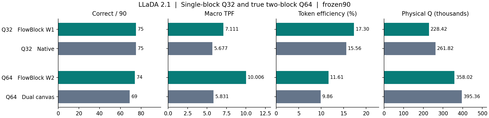

# 固定预算的单请求执行与负载切换

所有新增配置复用冻结 90 题的输入、种子、输出上限与评分规则。原 30 和新增 60 分开归档。TPF 是逐请求 `N/F` 的宏平均；效率是 `sum(N)/sum(physical_Q)`。只有纯提示 prefill 不记生成成本。原生满块与稀疏同宽不是同一执行模式。

| 模型 | 正式预算 | 单物理块 | 最高双块档 |
|---|---|---|---|
| LLaDA2.1 | 4、8、16、32、64 | B32 | Q64 = 2×32 |
| DiffusionGemma | 32、64、128、256、512 | B256 | Q512 = 2×256 |

**先优化档内执行，再谈切换。** 逐档列质量、宏 TPF、效率、实际 Q/F 与相应对照；优先保留质量和 TPF 不劣而成本更低的方案。若没有同时获益，保留不互相支配的选项和配对区间，不硬选一个全局冠军。90 题均用于探索，不是独立留出。LLaDA Q24 的部分结果不评分，不再做 Q6/12/24 或 Gemma Q48/96/192。

外层每轮给出 Q，请求不自行挑周期、不强制下一档、不因高档到来清空 KV。单块可调用 `bind_request(model, initial, lookup, prefix=...)`，同一请求保持同一个 backend 和缓存；上轮 M2T/严格 T2T 必刷，其次分配 MASK，按策略填当前块连续已解码前缀。未选且已初始化的 KV 保持可见。自研必刷可超过名义预算，验证等阶段另计实算 Q。单块接口明确拒绝双块档，不能把 Q512 静默做成 Q256。双块回到单块时，后块应暂停并保留状态，前块提交前不可越界提交；这是待验证条件，不是已完成的无损切换。

验证切换时把固定端点、同档→同档、升档、降档和短暂抖动分开，记录切换当轮及随后两轮实际 Q、必刷超额、推进与额外 forward，以及整题质量/TPF；同一外部序列在同一 decoder forward 计时。历史 HHLL/LLHH 中，自研按**选位轮**取 offer，受限 Optimus 按**全部 decoder forward** 取 cap；同名周期是路径敏感性结果，不足以宣称同负载轨迹或同计算量。推荐某步骤升降档只是给外层的信息，不是执行器的默认行为。

GPU0 固定档新增 Gemma Q64（K16，用已解码但非前缀的旧行换前缀，右端/随机）和 LLaDA Q4/K2、Q8/K4、Q16/K4、Q32/K8（只填空位，右端/随机）。Gemma Q512 另排 `active_w2`：保持 W2 开块和采样规则，投影宽度取实际活跃块数；先逐题复现 packed W2 的全部 90 项。W2 旧轨迹中 1,245/1,408 次 decoder 只有一块活跃，163 次两块活跃。旧轨迹多算的填充行是 318,720，不是新方法必然节省的 Q。这些试验在完成 90/90 前不评分。

## 同一预算内的结果

| 固定预算与执行器 | 原30 | 新60 | 全90 | 宏 TPF | token efficiency | 总物理 Q |
|---|---:|---:|---:|---:|---:|---:|
| LLaDA 32，原生 | 26 | 49 | 75 | 5.677 | 15.56% | 261,824 |
| LLaDA 32，FlowBlock W1 | 26 | 49 | 75 | 7.111 | 17.30% | 228,416 |
| LLaDA 64，自研真双块 | 24 | 45 | 69 | 5.831 | 9.86% | 395,363 |
| LLaDA 64，FlowBlock W2 | 23 | 51 | 74 | 10.006 | 11.61% | 358,016 |
| Gemma 64，零前缀 | 29 | 54 | 83 | 12.897 | 12.71% | 250,795 |
| Gemma 64，右端 K16 替换旧行 | 29 | 55 | 84 | 12.924 | 12.75% | 253,843 |
| Gemma 64，随机 K16 替换旧行 | 30 | 54 | 84 | 13.003 | 12.84% | 253,897 |
| LLaDA 16，零前缀 | 27 | 49 | 76 | 4.888 | 18.02% | 222,550 |
| LLaDA 16，空位补右端 K4 | 26 | 50 | 76 | 4.928 | 17.96% | 220,652 |
| LLaDA 16，空位补随机 K4 | 27 | 49 | 76 | 4.920 | 17.92% | 221,700 |

[LLaDA Q16 的 K4 对照](controls/llada21-q16-registered-k4-right.csv)：右端 K4 救 3 丢 3，TPF 差 +0.041，配对 95% 区间 [−0.099,+0.181]。这是固定档内选位试验，不涉及跨块掩码开关。

[随机 K4](controls/llada21-q16-registered-k4-random.csv) 相对零前缀也救 3 丢 3，原30救1丢1、新60救2丢2。TPF 差 +0.032，配对 95% 区间 [−0.073,+0.138]。这两个注入策略在本档都没有稳定抬高正确数。

### LLaDA Q8：推进与真实计算成本

冻结 90 题配对评分：[原版 IBS](controls/llada21-q8-original-ibs.csv) 和 [原版 OBS](controls/llada21-q8-original-obs.csv)。Optimus 的 8 是固定窗口而非模型投影硬限额。自研的 8 是选位预算，前一轮写入重算、bootstrap、verify 与 commit 均按真实计算记账。

| 执行器 | 原30 | 新60 | 全90 | 宏 TPF | token efficiency | 解码 N | 总 F | 物理 Q |
|---|---:|---:|---:|---:|---:|---:|---:|---:|
| 原版 IBS8 | 23 | 46 | 69 | 2.341 | 28.22% | 46,108 | 21,974 | 163,367 |
| 原版 OBS8 | 21 | 48 | 69 | 2.409 | 26.84% | 50,524 | 23,263 | 188,263 |
| 自研 Q8，零前缀 | 25 | 49 | 74 | 4.405 | 19.61% | 41,784 | 11,701 | 213,127 |

相对 IBS，自研救8丢3；分数差的配对 95% 区间为 −2.00 至 +13.56 个百分点，TPF 差 +2.063 [+1.820,+2.306]。相对 OBS，自研救10丢5，分数差区间 −3.05 至 +14.37 个百分点，TPF 差 +1.996 [+1.764,+2.227]。自研分别多用了 49,760、24,864 个 Q，不能称作等计算下取胜。原版标签和实际硬限额标签不可合并。

### 验证通过后复用提交 KV

[单块实现](../../../bdlm_serving/methods/t2t/verified_commit.py)保留逻辑 commit、EOS 检查和缓存版本推进。只有刚做完满块验证、未改写任何 token、前缀版本和 KV 仍匹配、当前 token 与验证输入相同时，才把该次验证产出的逐层 KV 作为提交缓存；任一条件不满足仍实算 commit。稀疏前向的 KV 不得据此晋升。

在 n164 上使用 LLaDA2.1 真权重、CPU BF16/SDPA、冻结提示 `gsm8k/167`，Q8、短上限38，两次逻辑 commit 的 20 层 K/V 均逐位相等，且每一步 canvas 和 RNG 相等。模型投影钩子读数是 **13→11 F、247→183 物理 Q**，不含纯提示 prefill。[原始读数](controls/llada21-cpu-q8-promote-case0.json) · [可复现探针](verify_promotion.py)。此项没有任务质量分，也不是 GPU 吞吐测试。

在**未优化**的 Q8 冻结 90 题轨迹中，bootstrap / 选位 / verify / commit 各用了 44,704 / 59,879 / 63,840 / 44,704 个 Q。1,397 个 commit 中有 1,391 个紧跟同块零改写的完整 verify，这只是潜在可复用次数。[GPU 对照](promotion90.py)按 Q8、16、4、32 分档验收，逐题记录真实投影、逻辑提交、输出及非重复 forward 的位置和编辑是否相同；如果输出变化仍纳入评测。完成前不把轨迹估算写成实测收益。

### LLaDA 32↔64 的外部逐轮供档

[原型](llada_top_transition.py)保留在途请求、已提交前缀和驻留尾块。Q64 可把开尾块和头块推进放进同一个 forward；Q32 只采样头块，同时真实 gather 尾块上一轮改写的位置来更新 KV，不采样尾块。没有写入的尾块行不重算。有必须刷新的行时允许超过名义 Q32，超额另记；晋升后的尾块不能直接提交，须在新前缀下重新验证。

`gsm8k/167` 的另一项 CPU BF16 实权重探针（同一输入，生成上限 38）：外层循环提供 `[32,64,32,32,64]`，实际前八次生成投影为 `[32,64,15,32,32,32,32,32]`，共 8 F、271 物理 Q。第一次降回 32，20 层均投影 **6 个头块采样行 + 9 个尾块只刷新行**，随后逻辑提交头块、在新前缀下重新验证尾块。[逐轮读数](controls/llada21-cpu-top-case0.json)。本例未发生 T2T，严格编辑和恢复为 MASK 的覆盖来自 [CPU 构造测试](../../../tests/test_llada_top_transition.py)，不是实权重质量分；也不是上一节 Q8 提交复用的对照。

[LLaDA 配对结果](controls/llada21-native32-vs-flow-w1.csv)：两种执行器各自独对 3 题，不能从总分相等推断输出等价。归档的 W1 编辑计数为 0，原生为 2,376；W1 是性能基准，不应据此删除自研的编辑语义。Gemma 的[右端](controls/gemma64-backfill-right.csv)和[随机](controls/gemma64-backfill-random.csv)只替换非前缀已解码旧行，不占 MASK。两组相对零前缀的 TPF 差 95% 配对区间分别为 [−0.297,+0.351]、[−0.225,+0.438]。随机策略是候选，不是已证实的最优策略；效率略高并不表示整题物理 Q 更低。

[LLaDA 真双块对 FlowBlock W2](controls/llada21-dual64-vs-flow-w2.csv)：自研在配对的 90 题中救 5 丢 10；正确率差的 95% 区间为 −13.71 至 +3.38 个百分点，宏 TPF 差为 −4.175 [−4.744,−3.606]。两者在 GSM8K/HumanEval/MATH500 分别为 28/16/25 和 27/23/24（每组 30）。自研 7,960 次 forward 中 4,740 次选位、1,310 次 commit、981 次 bootstrap、929 次 reencode；物理 Q 分别为 280,163、41,920、43,552、29,728。W2 为 5,594 次 forward。自研出现 5,900 次严格编辑，W2 的记录是 0；比较能诊断端到端落差，不能把质量差都归因于编辑或把任一阶段直接扣除。当前自研 Q64 不推荐。

## Gemma 双块切换原型

现在可以给 `generate(..., "external_w2", plan, next_budget=lookup)` 传入逐 decoder forward 的 256 或 512 预算。`lookup(WaveTick)` 可以读到轮次、头块序号、已驻留块数、各块必刷数和开新块资格。外层不必提供下一轮预算。纯 prefill 不计；头块提交后 encoder 重编码 256 行另计一次 F，不消耗 decoder offer。

- 低档下头块推进。尾块若有上轮新解码或连续接受且 ID 改变的位置，本轮实投影两块、尾块不采样。整轮记 512，不把整块溢出的 256 行冒充 256 个必刷位。随后的低档在尾块无新写入时只实算 256；尾块 canvas、接受掩码和采样年龄保留。没有未提交尾块 decoder KV 被写入长期 encoder 缓存；仅为刷新而算的尾块 logits 不作为后续决策证据。该原型是**允许可见超额的预算**，不能用于每轮硬限制 256 的服务。
- 头块提交且请求未结束时先编码其最终 tokens，再让已驻留尾块晋升。晋升丢弃旧 self-conditioning 和停止历史，保留 token、接受掩码及年龄；为它预留至少一次新上下文的原生验证，不接受投机阶段的 `done` 直接提交。高档恢复时仍用原来的尾块，没有驻留尾块且开块条件不满足时，即使给 512 也只算 256。
- GPU 五臂：固定 256 重现 W1；固定 512 的兼容模式重现 `active_w2`；启用晋升验证的固定 512；带该验证的 `HHLL` 和 `LLHH`。先在前两臂逐题核输出、真实 decoder/encoder 调用和原始调度轨迹。这是后继队列，未有 90 题新结果前不宣称无损切换。CPU 对抗例验证了有编辑负债的降档、连续低档、低档期间提交头块、提前宣告 `done` 的旧尾块不能绕过重新验证。

## 跨物理块的注意力是否有效

这是两个不同的问题：**同一次 forward 中，后块的 token 能否改变前块 logits**；以及**保留这个约束能否改善最终答案或 TPF**。后者需要同一双块执行器，仅切换前块 Q 对后块 K 的可见性。固定预算、开块阈值、同块双向可见、后块能读前块、commit/刷新、计算记账、样本及种子都不变。原 30 和新 60 分开；没有遇到双活跃块的题也在全 90 中评分。W1 对 W2 不是该开关的对照。

**LLaDA 2.1 实权重探针。** B32×2、CPU BF16/SDPA、正式 venv（Torch 2.9.0），在同形状的真实投影上，改单个后块 token，前块所有 logits 的最大差为 **0，top-1 变化 0/32**。打开被遮住的象限后，相同干预使前块最大差达 **8.461，top-1 变化 1/32**。保持掩码时，改前块 token 仍改变后块 logits（最大差 7.563）；块内双向正控最大差 10.281。这里测的是固定两块内容的机制，不是 90 题质量。额外独立检查：把同一 Q64 拆成前块提交、后块重编码后，两块各 32 个 top-1 都不变，但 logits 最大差分别为 1.75、3.00；因此该环境未通过「不同形状也须逐位复现」的更强条件。不要误把它与固定形状的掩码泄漏混为一谈。[读数](controls/mask-probe-llada21.json) · [脚本](mask_probe_llada.py)。

**LLaDA 实际降档时的反例。** 取 `gsm8k/167` 的真实请求，在外部依次给 32、64、32 后的第三次 forward 上，从同一份 token、KV 和请求状态做配对重放。可见 KV 有 96 行，20 层各只投影 15 行：前块 58–63 六行参与采样，后块 64–72 九行只刷新、不采样。只把后块位置 64 的输入 token `527` 换为 `528`。重放原输入逐位一致；走开关分支但仍写回原遮挡值，也逐位复现相应的原结果。以下均为 n164 CPU BF16，同一稀疏行形状；“首差”在每层的注意力和 MLP 输出上观察，层从 0 编号。

| 后块干预，读取前块 | 前块最大 logit 差 | 前块 top-1 改变 | 前块首差 |
|---|---:|---:|---|
| 掩码关、标准 MoE | 7.84375 | 0/6 | 第 0 层注意力 |
| 掩码开、标准 MoE | 0.375 | 0/6 | 第 4 层 MLP |
| 掩码开、仅将 MoE 按前后块分别计算 | 0 | 0/6 | 未观察到 |

所以，固定稠密双块探针中的零差异不能推广到请求的全部执行状态。这里掩码挡住了直接注意力路径，但在 CPU 稀疏投影下，两块合算 MoE 仍可能改变前块数值。本例未改变前块 top-1，不代表所有样本的置信度判定、编辑或最终答案都不变。**不据此修改线上 experts 布局**。GPU4 的正式 A/B 将在评分请求之后复用已加载模型，单独记录这一诊断；其额外调用不计入请求。原始[降档读数](controls/mask-llada21-parked-case0.json)；复现入口 `verify_promotion --parked-mask`，使用 `gsm8k/167`、长度 38、12 CPU 线程。

**Gemma 实权重探针。** 在 n164 CPU、BF16、SDPA、grouped_mm、B256×2，固定相同的 encoder KV 和随机初始化 canvas，在同一次 denoise 的输入中只改边界的一枚 token。读出完整词表的 logits，不采样。冻结样本 0、seed 17000，48 行真实提示；每一配置原输入的逐位复跑一致。

| 双块注意力 | experts 怎样计算 | 改后块首 token：前块最大 logit 差 | 前块 top-1 改变 | 最早不同的前块输出（层索引从 0 开始） |
|---|---|---:|---:|---|
| 块间因果 | 两块合算，现有实现 | 7.4955 | 21/256 | 12 / experts |
| 双向 | 两块合算 | 12.3214 | 80/256 | 0 / attention |
| 块间因果 | 按块分开算 experts，注意力仍合算 | 0 | 0/256 | 无 |
| 双向 | 按块分开算 experts | 13.6925 | 84/256 | 0 / attention |

在“块间因果、分开算 experts”的对照中，改前块最后一个 token 仍会改变后块（最大差 7.4892），也会改变前块更早的位置（12.3944）。这排除了把两块完全隔离、或者误用了逐 token 三角掩码。**本样本上的注意力隔离生效，但 CPU 双块合算的完整模型不保证逐位独立。** 逐层对照定位到了 experts 路径，没有鉴别是具体哪种分组内核或舍入。分开算 experts 是诊断开关，尚未表明对真实 GPU、质量或吞吐有益。原始读数见 [`controls/mask-probe-gemma-packed.json`](controls/mask-probe-gemma-packed.json)、[`controls/mask-probe-gemma-per_canvas.json`](controls/mask-probe-gemma-per_canvas.json)；[可复现脚本](mask_probe_gemma.py)支持独立 CPU 或复用已加载模型。

冻结集另一个提示（index 50，seed 17050，提示 85 行）独立做了同样检查：块间因果 + 合算时改动后块使前块 **24/256** 个 top-1 改变，最大 logit 差 13.4554，首次差异在索引 5 的 experts；分块算 experts 时为 **0/256，最大差 0**。两种布局的相同输入重跑均逐位一致。[合算](controls/mask-probe-gemma-packed-50.json) · [分块](controls/mask-probe-gemma-per_canvas-50.json)。历史 packed W2 在 90 题中有 72 题实际遇到双活跃块，总计 163/1,408 个 decoder forward；不能把此计数移植为新的 `active_w2` 实测值。

**为什么比较 logits 而不只比较生成文本。** Gemma 真实 `_denoising_step` 既调用 `multinomial`，又为 renoise 生成整块随机数。在固定 logits 的 CPU 对照里，三个种子下，暂停尾块采样都改变了下一轮头块的 proposal 和 canvas；诊断性地消费并丢弃同形状的尾块采样，可逐位复现头块和随机数状态，不需要额外模型 forward。这不是部署建议，更不是对真实生成等价性的证明。见 [`test_gemma_sampler_clock.py`](../../../tests/test_gemma_sampler_clock.py)。

**已有的任务级证据。** LLaDA 2.1 在同一组 30 题上的历史 Optimus OBS 开关对照（固定窗口，非硬限额）。以下各列均为**关→开**；效率从[归档数表](../../optimus-masked-obs/summary.csv)的 `N` 和 `physical_Q` 重算，与本报告口径一致。

| 窗口 | 正确数/30 | 救回/丢失 | 宏 TPF | token efficiency（物理 Q） |
|---:|---:|---:|---:|---:|
| 4 | 22→23 | 2/1 | 1.541→1.519 | 35.98%→32.08% |
| 8 | 21→21 | 3/3 | 2.337→2.328 | 26.84%→25.23% |
| 16 | 24→22 | 1/3 | 3.395→3.276 | 17.56%→15.15% |
| 32 | 21→25 | 5/1 | 4.179→4.430 | 9.17%→9.56% |

窗口 32 的三项指标同向改善，窗口 16 则同时下降；掩码不是普遍增益。窗口 32 开掩码后的 9.56% 是 `13379/139919`；[历史图表](../../optimus-masked-obs/README.md)的 9.63% 是 `13379/138921`，分母是请求行 `Q`。这组对照不能代替当前自研 Q64 或 Gemma Q512 的 90 题结果。

按样本配对、按题集分层重算，窗口 32 在 GSM8K / MATH500 / HumanEval 各多对 1 / 2 / 1 题。全 30 题正确率差 +13.33 个百分点（配对 95% 区间 −3.03 至 +29.16）；宏 TPF 差 +0.251（−0.266 至 +0.768）。四档的质量和 TPF 差区间均包含 0。历史 CSV 没有逐步触发记录，不能据此划分遇到或未遇到双块的样本。见[四档配对数表](controls/llada21-obs30-mask-paired.csv)和[复算脚本](historical_mask_pairs.py)。

作为排队前的检查，在归档的 LLaDA Q64 带掩码轨迹逐步按绝对位置重建，90/90 题都出现前块生成位置的 Q 与后块 K 同时存在的机会，合计 5,118/7,960 个生成 forward。这个数字是**原轨迹上可干预的次数**，不是关掩码后的实际开边数。新评分脚本会对比两臂首次干预前的事件和干预当轮的投影行，并按实际 hook 给出触发数。

**当前 90 题开关对照已在 n164 登记，尚未出分。** GPU4 接在 `prefix90-llada-cap4` 后测 LLaDA Q64，GPU0 接在 `prefix90-wave-switch` 后测 Gemma Q512 `active_w2`；两者均须完整重现原有带掩码结果。后者还在真实 GPU 重跑上面的方向探针，作为独立的诊断，不混入 90 题的 F/Q。GPU 统计保留原本 experts 布局，干预只覆盖块间可见性。两条队列在前置作业和归还检查通过后才运行；[统一评分](mask_pair_report.py)以「开减关」输出质量、宏 TPF、效率、N/F/Q、配对区间与实际触发请求数。不能用机制探针代替端到端收益。

## 降档后的第一轮

[块内切换明细](controls/inside-block-switch-cost.csv)按两个起始相位分别保留三个 cohort，只比较同一物理块内相邻的两次供档。合并相位时计数单位是轮，两次回放不是两组独立的 90 道题。LLaDA 16→8 时 172/2,498 轮超出名义 8（多 512 行），保持 8 时 1/2,661 轮超出（多 1 行）。Gemma 256→128 时是 8/523（多 163 行），保持 128 时是 0/576。它们是既有轨迹的描述，不包含跨块启动，也不是每次切换的因果延时。建议向外层暴露下一轮必刷数：降档照常执行并计实算，不重置缓存，不私自把后续轮次升回去。

## 已完成的 LLaDA 切档

| 策略 | 原30 | 新60 | 全90 | 宏 TPF | token efficiency | N | F | 物理 Q |
|---|---:|---:|---:|---:|---:|---:|---:|---:|
| 固定 Q8 | 25 | 49 | 74 | 4.405 | 19.61% | 41,784 | 11,701 | 213,127 |
| Q8、8、16、16 循环 | 26 | 49 | 75 | 4.559 | 18.46% | 40,959 | 11,037 | 221,900 |
| Q16、16、8、8 循环 | 28 | 49 | 77 | 4.623 | 18.80% | 39,747 | 10,306 | 211,392 |
| 固定 Q16 | 27 | 49 | 76 | 4.888 | 18.02% | 40,098 | 10,010 | 222,550 |

低档先行与固定 Q8 相比救回 2 题、丢失 1 题，宏 TPF 增量 +0.154（配对 95% 区间 +0.035 到 +0.274），总 Q 多 8,773。相较固定 Q16 仅少 650 Q，少答对 1 题，TPF 低 0.329。

高档先行与固定 Q8 相比救回 4 题、丢失 1 题，TPF 提升 +0.219（配对 95% 区间 +0.067 到 +0.371），总 Q 少 1,735；效率仍低 0.80 个百分点。相较固定 Q16 多答对 1 题、总 Q 少 11,158，但 TPF 下降 0.264（区间 −0.388 到 −0.141）。四种方法在新60均答对49题；不要把高档先行归纳为显著增质或普遍优于所有固定档。[数值图](llada21-8-16.png) · [完整指标](llada21-8-16.csv) · [高低两个相位的配对分数](switches/llada21-slottrace_8_8_16_16-vs-slottrace_16_16_8_8.csv)。

## 外部基线的实际更新大小

[LLaDA 原 30 题的 OBS / IBS 审计](controls/llada21-original30-cap-audit.csv)逐次对齐模型调用记录、选中位置与投影行数。原版 IBS/OBS Q8 分别有 480/423 个生成 forward 超过 8 行；OBS Q32 也有 213/5,024 轮超过上限，最大 35。IBS Q32 在这批请求中没有超额。**普通窗口运行不等于启用了硬限额**。同档对照要在投影前约束整次 decoder 的实际行数，并报告实际总 Q；原版、硬限额、固定物理块的 FlowBlock W1/W2 分开。

Gemma 原版 90 题中，IBS32/OBS32 各有 66/68 题至少一次超出 32 行，IBS64/OBS64 为 57/66 题；各档最高为 33/65 行。[补测脚本与预检](gemma_fixed_caps.py)复用同一 90 题和原版记录。新增四臂在投影前按整次 decoder 限额，两块共享 cap；纯 prompt prefill 单列，后续每次 encoder 重编码 256 行仍计成本。这些数是原版档位触及上限的频率，不能据此推断硬限额后的正确数。GPU0 的四臂排在跨块掩码配对之后。

## Gemma 已完成对照

GPU4 后继注册 LLaDA 硬限额 IBS/OBS：固定 4、8、16、32，以及两种 8↔16 相位；先验证 IBS32 不需裁剪时逐题重现原版 90 题。每次模型调用前截断实际位置，两物理块共享 offer；有尚未进入 KV 的新写行时优先重算，保留原版阈值和失败样本。另登记 LLaDA 的原生32 / 稀疏16 前缀对照。注册不等于取得成绩。

[门控图](gemma-maskgate.png)和[三组样本的数表](gemma-maskgate.csv)：H=原生 Q256，L=稀疏 Q128，`HHLL` 全接收为 86/90、22.357 TPF、9.49%、346,119 Q。只在 `MASK≤64` 接收 H 后为 84/90、19.574、11.19%、286,607 Q。同相位[硬限额 IBS/OBS 和 FlowBlock 对照](controls/gemma-external-gate_tail_high.csv)中，IBS 为 80/90、18.898、11.01%、289,152 Q；质量和 TPF 的配对区间均跨零。先低档的同一门控为 85/90、18.754、10.10%、325,515 Q，并不比它自己的全接收相位省 Q。

[低档空位注入前缀图](gemma-high-prefix.png)和[三组样本的数表](gemma-high-prefix.csv)：原生 H 不变，L 只在真正空位最多补 32 个当前物理块连续已解码前缀中的随机位置。`HHLL` 得到 30+57=87/90、22.568、9.57%、339,288 Q；相比同相位零前缀救回 1 题、无丢失，TPF 差 +0.211（区间 −0.134 到 +0.556），少 6,831 Q。实际 57 个请求的 134 轮补了 3,807 行，不能将它当作每个低档轮必算 32 个前缀。反向 `LLHH` 的正确数从 84 降至 83；这个相位对照不支持“加前缀总是更好”。
