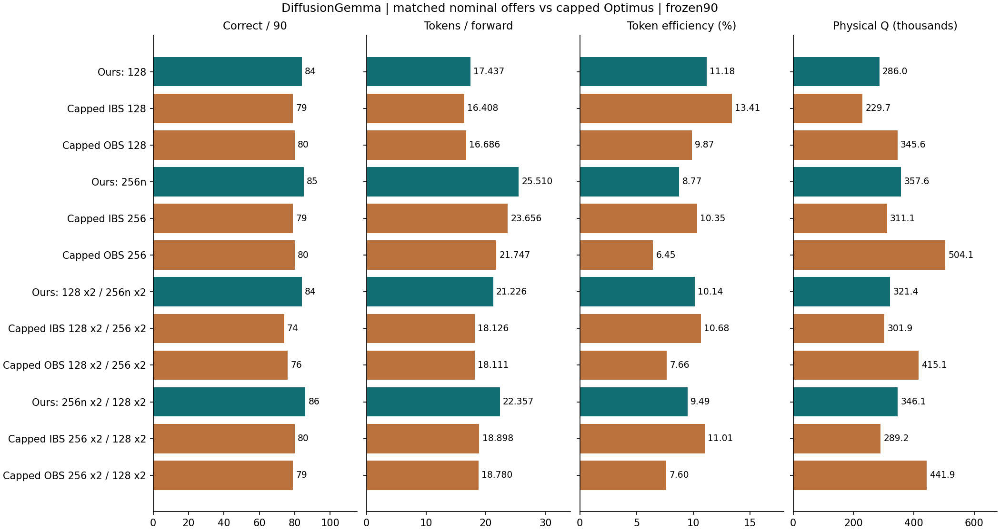
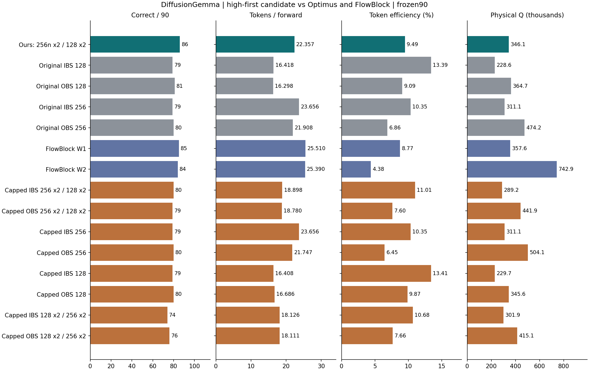
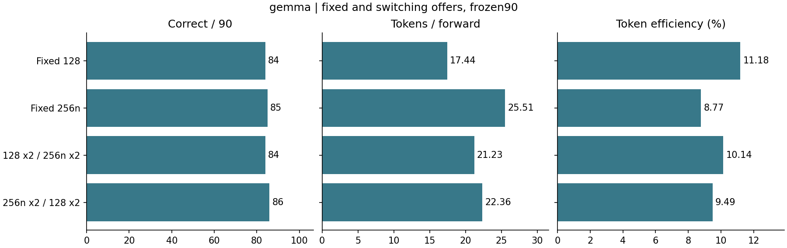
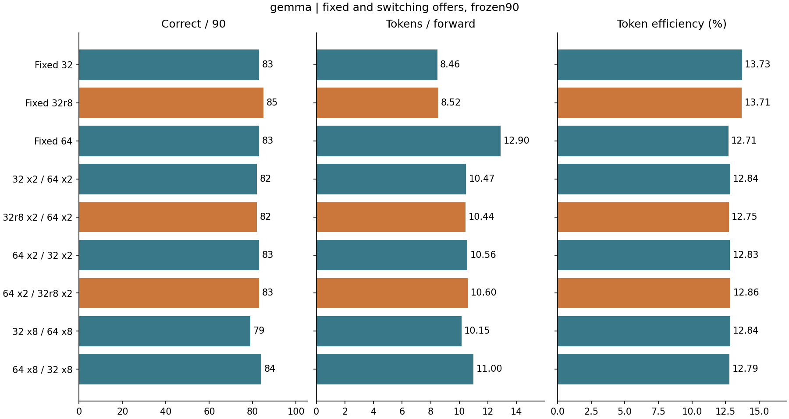

# 单请求 Serving 槽位：固定曲线与运行中切档

[北京时间 11 月 26 日 20:05 起的 24 小时设计周期](PLAN_24H.md)

目标是让服务端按负载给同一个请求调整预算。**只有实测质量、推进速度及物理成本都合适的档位，才适合进入后续调度器。** 每轮先刷新上轮新解码或严格编辑的行，哪怕超出名义预算；余下行优先尚未解码的位置，严格物理块内的旧前缀可选择性重算。没选中的已初始化 KV 仍可见。不给不同配置换题，不把提交、验证、重编码算免费，不把相同名义 Q 当作相同物理成本。

## 固定曲线

### Gemma：同一 256 高档，用原生整块还是稀疏执行？

在相同90题、相同种子与相同供档顺序上，只改变高档的实现：`256n` 用原生整块更新，可在当前轮完成画布；`256` 是 K0 稀疏策略的名义上限，实际可能少于256，选位轮还会调用原生采样器，但不能直接结束画布。两者的**行数、状态更新和结束条件**都可能不同，不是纯粹的停止条件消融。

| 供档顺序 | 高档实现 | 正确 /90 | 宏 TPF | token efficiency | 总 F | 物理 Q | verify 次数 | 高档直接结束的块 |
|---|---|---:|---:|---:|---:|---:|---:|---:|
| 固定高 | 原生 | 85 | 25.510 | 8.77% | 1397 | 357632 | 2 | 169 |
| 固定高 | 稀疏 | 85 | 21.490 | 9.22% | 1702 | 356311 | 198 | 0 |
| 低低高高 | 原生 | 84 | 21.226 | 10.14% | 1620 | 321377 | 107 | 90 |
| 低低高高 | 稀疏 | 84 | 18.406 | 10.02% | 1852 | 320987 | 201 | 0 |
| 高高低低 | 原生 | 86 | 22.357 | 9.49% | 1685 | 346119 | 94 | 91 |
| 高高低低 | 稀疏 | 86 | 19.251 | 9.60% | 1772 | 325684 | 207 | 0 |

每组的正确总数相同，但不是逐题等价。原生换稀疏后，固定高、低档先、高档先分别救3丢3、救4丢4、救1丢1；高档先的两种实现都是原30对29、新60对57，换题仅发生在新增60。高档先的原生/稀疏分别出现49/80次严格 T2T，不应将更多编辑次数等同于更高质量。固定高档，两条路径的总Q几乎一致，原生少305次 forward；高档先，稀疏总Q少20435，但多87次 forward。选择哪种路径取决于要优化的成本。

[分组三指标与实际工作](gemma-sparse-vs-native-high.csv) · [数值图](gemma-sparse-vs-native-high.png) · [可审计的分阶段工作、M2T、T2T和结束权限](switches/gemma-high-phases.csv) · [各策略的逐题配对汇总](switches/)。重建：`python -m experiments.t2t.serving_slots.switch_report --run "$SPARSE_RUN" --cases "$FROZEN90" --out "$PRIVATE_SCORES" --reference-switch-run "$NATIVE_RUN"`，然后用 `trace_plot.py` 的 `--work`、`--pairs` 和 `--out` 参数重画。

### LLaDA：原生 B32 和稀疏 Q32 不同

| 固定执行 | 原30 / 新60 / 全90正确 | 宏 TPF | token efficiency |
|---|---:|---:|---:|
| 稀疏 Q16，K0 | 27 / 49 / 76 | 4.888 | 18.02% |
| 稀疏 Q32，K0 | 27 / 47 / 74 | 5.261 | 17.05% |
| 原生 B32 | 26 / 49 / 75 | 5.677 | 15.56% |

原生 B32 的 8182 次 forward 共计261824个物理 Q；对稀疏 Q16 [配对报告](controls/llada21-native32-vs-q16.csv)，对稀疏 Q32 [配对报告](controls/llada21-native32-vs-q32.csv)。整数 `32` 继续表示稀疏；供档 `32n` 显式要求整块。对于部分填充的首块，整块更新含不可改写的提示位置；稀疏只选可编辑位置。预热、验证和最后 commit 均不消耗选位时钟，但实际计算全记账。固定 `32n` 必须逐题复现 `fullwidth` 的输出 ID、去除供档记录后的全事件和计数；再验证 `16↔32n` 两种相位。上述表是固定端点，不是混合策略成绩。

### Gemma 高档：与 Optimus、FlowBlock 的实测对照

**受限 Optimus 最终结果。** 8 种设置 × 同一90题全部完成，每轮先限制真实 decoder 投影行数，再计算；核对 OBS 的两个块合计不超过 offer，720 条轨迹无超限。下面是同供档顺序的结果，每格依次为 **答对数 / 宏 TPF / token efficiency**。256 档在我们一侧走原生整块路径，128 档走稀疏 K0。最后三列是三种方法各自90题实际消耗的总Q；包括生成阶段的跨块重编码。

| 名义供档顺序，重复 | 我们 | 受限 IBS | 受限 OBS | 我们总 Q | IBS 总 Q | OBS 总 Q |
|---|---|---|---|---:|---:|---:|
| 128 | 84 / 17.437 / 11.18% | 79 / 16.408 / 13.41% | 80 / 16.686 / 9.87% | 285967 | 229731 | 345601 |
| 256 | 85 / 25.510 / 8.77% | 79 / 23.656 / 10.35% | 80 / 21.747 / 6.45% | 357632 | 311129 | 504064 |
| 256,256,128,128 | 86 / 22.357 / 9.49% | 80 / 18.898 / 11.01% | 79 / 18.780 / 7.60% | 346119 | 289152 | 441856 |
| 128,128,256,256 | 84 / 21.226 / 10.14% | 74 / 18.126 / 10.68% | 76 / 18.111 / 7.66% | 321377 | 301928 | 415104 |



高档先行对受限 OBS 救7丢0，总Q少21.7%，51/90题实际更省Q；对受限 IBS 救7丢1，总Q多19.7%，只在21/90题上更省Q。前者质量差95%配对区间为 +0.87 至 +15.77 个百分点，后者为 −0.75 至 +14.99 个百分点，未作多重比较校正。自己的低档必刷仍可超过128，并不声称自己的每轮宽度也受相同硬上限或获得等算力胜利。

**如果按全程实际 Q 匹配，而不是按档名匹配呢？** [10 个基线 × 3 个样本分组的逐题配对汇总](controls/gemma-nearest-physical-Q.csv)。对 8 个受限 Optimus 和 2 个 FlowBlock 基线，分别在 `128`、`256n`、高档先行混合、低档先行混合四个已完成方案中，选择全90总物理Q绝对差最小的一个。只用 Q 选，不看答对数或 TPF；两个子集不重新选。差距很大时仍保留结果，不称作等成本。下列是两个最接近、且不是同一实现的对照（两行的预算顺序不相同）。

| 对照 → 我们 | 全90实际Q（对照 / 我们） | 正确（对照 / 我们） | 宏TPF（对照 / 我们） | 效率（对照 / 我们） | 救 / 丢 |
|---|---|---|---|---|---|
| 受限 OBS 固定128 → 高档先行混合 | 345601 / 346119（+0.15%） | 80 / 86 | 16.686 / 22.357 | 9.87% / 9.49% | 6 / 0 |
| 受限 IBS 高档先行 → 固定稀疏128 | 289152 / 285967（−1.10%） | 80 / 84 | 18.898 / 17.437 | 11.01% / 11.18% | 7 / 3 |

总量相近不等于逐题分配相同：相对 OBS 固定128，混合有15题更省、3题相等、72题用更多 Q。相对 IBS 高档先行，固定稀疏128有44题更省、46题用更多 Q。两组质量差的分层配对95%区间均跨零；这些是此固定样本上的描述性取舍，不是等延迟胜出。复现：`python -m experiments.t2t.serving_slots.external_report --nearest --data "$D" --capped "$CAPPED" --out "$PRIVATE_SCORES"`。

**高档消融（计分前约定）。** 对同一控制器固定四轮周期，增加 `256n,128,128,128` 和 `128,256n,128,128`，分别只保留第一个或第二个高档。不能推进或补发被换掉的高档。固定128和固定原生256先逐题复现，再在全部90题比较。目标是查清能否用接近受限 IBS 的实际 Q（289152），同时达到其 TPF（18.898）和质量（80/90）；超过 IBS 总Q的配置如实标注。另报相对未减档的 86/90、TPF 22.357、346119 Q 的取舍。不按头30题结果提前停、不把事后选中的配置称为独立验证。

[原始 Optimus 对比同档硬限额的直接配对](controls/gemma-original-vs-capped-fixed.csv)：IBS256 90/90 逐事件复现。OBS256 受限后相对原版救1丢1、正确总数仍是80；F 从1852升至1969，Q从474160升至504064。固定 IBS128 救0丢0；固定 OBS128 救1丢2。所有固定臂均核对原始轨迹的首次超额轮及其以前的逐轮状态，未触发的请求要求输出ID及物理工作一致。候选图还保留原版 Optimus 和 FlowBlock；同档图只比较有对应供档顺序的策略。



[配对表：原30、新60、全90、质量差区间及实际工作](controls/gemma-mixed-vs-external.csv)。下表是相同90题及种子，从该基线改用「两轮原生256、两轮稀疏128」的救回/丢失。纯 prompt 不计，其余 forward 及物理 Q 全计；TPF 为逐题 `N/F` 的均值，效率为总 `N/Q`。

| 对照 | 正确 | TPF | token efficiency | F | 物理 Q | 换用混合策略救回 / 丢失 |
|---|---:|---:|---:|---:|---:|---:|
| 混合 256n,256n,128,128 | 86 | 22.357 | 9.49% | 1685 | 346119 | — |
| Optimus IBS128，原版 | 79 | 16.418 | 13.39% | 2042 | 228563 | 8 / 1 |
| Optimus OBS128，原版 | 81 | 16.298 | 9.09% | 2772 | 364699 | 6 / 1 |
| Optimus IBS256，原版 | 79 | 23.656 | 10.35% | 1563 | 311129 | 7 / 0 |
| Optimus OBS256，原版 | 80 | 21.908 | 6.86% | 1852 | 474160 | 7 / 1 |
| FlowBlock W1（原生256） | 85 | 25.510 | 8.77% | 1397 | 357632 | 1 / 0 |
| FlowBlock W2（双块512） | 84 | 25.390 | 4.38% | 1494 | 742912 | 3 / 1 |

OBS256 是目前较好的对照：混合少用27.0%总Q，TPF 点估略高；IBS256 则比混合少用Q、TPF更高，但少对7题。Flow W1 少1题、少288次 forward，只比混合多用3.2%总Q。单次90题的结果不是普遍胜出，也不表示每个请求都省计算；Q是行数，不能换算为等量GPU时间。

**物理限额对照单列，不替换上述原版结果。** 原版 IBS128/OBS128/IBS256/OBS256 的实测 decoder 峰值为129/129/256/257。混合自身619个低档选位轮有23轮必刷超额，合计1410行，峰值256。其 `bootstrap/verify/reencode` 等不消耗选位 offer 但照常计费。两边都给出实测工作，不把「相同名义档位」描述为「相同每轮物理上限」。

**限真实 Q 和限新解码 token 不是一回事。** 下表是从原版固定档的逐次模型调用重算的，不是模拟裁剪后的分数。每个超额轮恰好多算一行；四个配置的新解码数从未超出相应窗口。OBS256 有 43 题至少一次超额，不能把少掉的48行直接从原总Q里扣掉来估算新策略的工作：较早的决策会改变后续路径。IBS256 没有触发限额，应作为完整轨迹等价的阳性检查。

| 原版 | 超额题数 / 90 | 超额 decoder 轮 / 全部 | 峰值实际Q | 峰值新解码数 | decoder 总Q | 跨块 encoder 总Q |
|---|---:|---:|---:|---:|---:|---:|
| IBS128 | 42 | 50 / 1965 | 129 | 128 | 208851 | 19712 |
| OBS128 | 48 | 65 / 2685 | 129 | 127 | 342427 | 22272 |
| IBS256 | 0 | 0 / 1481 | 256 | 256 | 290137 | 20992 |
| OBS256 | 43 | 48 / 1767 | 257 | 255 | 452400 | 21760 |

新 Gemma Optimus 对照以 `--suite frozen90 --modes ibs obs --capped-plans 256,256,128,128 256 128 128,128,256,256 --uncapped90 "$D"` 启用；checkpoint、samples、output 参数同原 runner。每次 decoder 的 Q/K/V 投影前限制真实行数，双块 OBS 共用一份限额（范围为 B+最高档）。上轮 admission 未刷完不提前移入已缓存前缀。原生选位没有触发限额时不改它；固定臂未触发的请求校验原版 ID、事件、旧 trace 和 F/Q 全等。Optimus Gemma 本适配器只对选中的未解码位置提交 token；重算 KV 不计新 token。encoder 跨块 256 行照常计入总账，但不占 decoder offer。每次 decoder 消耗一次 offer，无跨题/跨块重置（只在新请求重置）。新臂须完整90题、审计通过后才报告分数。

重建：`python -m experiments.t2t.serving_slots.external_report --data "$D" --out "$PRIVATE_SCORES"`；受限臂齐全后加 `--capped "$CAP_RUN"`。物理审计另核验每次所选位置与真实 decoder 宽度、候选/裁掉行数、admit 与已刷位置关系，不用名义 Q×F 代替实际工作。

另有[同供档顺序的对照](controls/gemma-matched-offers-vs-external.csv)：加 `--matched`，固定128对稀疏128、固定256对原生256，两种切档相位分别和本方法的同相位配对。没有真实可切换的512档，因此不把 W2 放进同档表；它仍保留在候选的外部对照。原版固定128下，K0 对 IBS 救7丢2、对 OBS 救6丢3；实际 Q 分别为 285967（K0）、228563（IBS）、364699（OBS）。固定256下，原生对 W1 的 N/F/Q、总分与逐题正确性均完全一致。不同方法各自消耗 offer 的时钟不同；同供档顺序不保证同物理成本。受限运行也可加 `--cap-policy POLICY`，只纳入已完整通过的该臂，另存带策略名的表，不冒充全矩阵。

[单一 K0 策略的原30、新60、全90](fixed-k0.csv)，可用 `python -m experiments.t2t.serving_slots.fixed_slots` 重建。每个预算均为同一零注入算法，不从已观察的多个前缀选法中挑赢家拼成曲线。`macro_tpf=mean(N/F)`，`pooled_token_efficiency=sum(N)/sum(physical_Q)`，`q_per_f=sum(physical_Q)/sum(F)`，纯 prompt prefill 除外。Gemma 主槽 32/64/128/256，16 保留作低预算诊断；LLaDA 主槽 4/8/16/32，真正 Q64 要两个块。Gemma 512 同理，暂不列有效配置。

同一道题可比较不同完整策略，但 Optimus 含不同的采样/提交策略。按相同名义槽位比较 IBS/OBS；FlowBlock W1/W2 是一/两块的参考，不是每个小 Q 的等成本基线。和外部对照同时列总体与逐请求成本，未经校准不作等成本结论。相邻档的升档效果按固定题、固定种子做配对，报告救回、丢失、TPF 差区间，不要求通过筛题构造单调性。[LLaDA 真双块历史实测](../dual64/README.md)不能与单块 Q64 别名混用。

[相邻档的逐题配对差、救回/丢失、95% 区间和成本](adjacent-k0.csv)。`python -m experiments.t2t.serving_slots.fixed_slots --data "$D"` 从固定策略的请求记录重算并核对已发布数字。全90中，7个相邻档的 TPF 差区间下界都大于0；只有 Gemma 诊断档16→32的质量差区间也完全大于0（救回11、丢失1，+11.11个百分点，区间[+3.34,+19.77]，未做多重比较校正）。Gemma 主档32→64救2丢2，质量不变；LLaDA 16→32救2丢4。大槽位的价值当前主要体现在每轮推进，而非普遍提高质量。LLaDA Q4右端只补1个前缀时原30/新增60/全90为25/46/71，零组为26/48/74；TPF 3.609 对 3.600，效率20.04% 对20.17%，不推荐该项作为低档默认。[配对数值](../prefix_window/llada21-q4-slack-k1-right.csv)。

## 首个切档实验

**首个完成的外部对照：Gemma C32 IBS。** 原30/新增60/全90正确为 27/51/78，TPF 6.743，效率14.95%，全程输出39,001个非特殊 token、7,849次生成 forward、260,916个物理 Q。K0 为27/56/83，TPF 8.463，效率13.73%；右端 K8 只补空位为29/56/85，TPF 8.522，效率13.71%，输出32,911、4,002次 forward、240,106个物理 Q。后者相对 IBS 救回10题、丢失3题；相对 K0 多对的2题全在原30。虽然前缀策略用的总物理 Q 少，每个 forward 更宽，且输出长度不同；这不是更低时延或同采样器的因果结论。[逐组配对 K0](controls/gemma-ibs_32-zero.csv) · [逐组配对 K8](controls/gemma-ibs_32-slack.csv)。

两种模型均复用同一原生稀疏执行器、现有 KV 与采样状态，只在可选位轮改变预算。用**外部给定序列**模拟负载；不以题型、最终答案、未来 logits 或当前得分调档。首轮将额外前缀 K 固定为零，使切档效果与调前缀比例区分开。

| 模型 | 低档 A | 高档 B | 每个请求使用的模式 |
|---|---:|---:|---|
| LLaDA 2.1 | 8 | 16 | 固定 A、固定 B、循环 AABB、循环 BBAA |
| DiffusionGemma | 32 | 64 | 同上 |

1. 完整原生全宽资格检查；两个恒定序列都须对90题逐题复现**此前固定 K0 的整个请求记录**（包括输出 token、每轮选位、物理行和提交事件，只排除新增调档标签），才能开始混合序列。`--slot-control Q=DIR` 显式指定已资格验证的参照。
2. 每次实际稀疏选位消耗一个序列元素；初始化、全宽验证、提交、重编码独立计费，不消耗它。序列索引属于请求，跨物理块保留；不因切档清空缓存或 RNG。日志同时留 `slot_tick`、`slot_offer`、`fresh_rows`、选中位置与实际 Q。AABB 和 BBAA 名义构成相同，但分叉、提前结束和必刷溢出可以带来不同总成本。
3. 对两个固定端点分别报告完整90题的配对结果，不挑最好的一种相位；报告任一方向实际切过档的请求数、必刷溢出、N/F/物理Q、TPF、效率。检验“升档必增质量”与“高低档组合能给出较好成本权衡”是不同问题。若端点无法复现或出现丢失必刷行，先修实现，不解读分数。

Gemma 运行参数例（在原有 frozen90 runner 的参数后追加）：

```bash
--slot-control "32=$D/gemma-q32" --slot-control "64=$D/gemma-grid-k1" \
--arm 32:0:32:slottrace_32 --arm 64:0:64:slottrace_64 \
--arm 32:0:32:slottrace_32_32_64_64 --arm 64:0:64:slottrace_64_64_32_32
```

[严格物理块内的前缀比例实验](../prefix_window/gemma-ratio-decisions.md) · [等宽换位的实测结果](../prefix_window/DONORS.md) · [Optimus 90题复现与评分命令](../prefix_window/README.md)

### Gemma Q32 与 Q64 的切档结果

两个固定端点都通过90题逐题完整记录复现。A=32、B=64。四组都不额外注入前缀，以分离预算顺序的影响。原30和新增60分开评分。

| 外部供档 | 原30 / 新60 / 全90正确 | TPF | token efficiency | 总 F | 总物理 Q | 物理 Q/F | 至少切一次的请求 |
|---|---:|---:|---:|---:|---:|---:|---:|
| 固定 A | 27 / 56 / 83 | 8.463 | 13.73% | 4,023 | 240,190 | 59.70 | 0 |
| AABB 循环 | 28 / 54 / 82 | 10.472 | 12.84% | 3,265 | 254,468 | 77.94 | 90 |
| BBAA 循环 | 28 / 55 / 83 | 10.559 | 12.83% | 3,362 | 260,838 | 77.58 | 89 |
| 固定 B | 29 / 54 / 83 | 12.897 | 12.71% | 2,562 | 250,795 | 97.89 | 0 |

BBAA 对 AABB 救1、丢0；配对质量差的95%区间为[-7.86,+10.24]个百分点，TPF差为+0.087、区间[-0.335,+0.508]。不能据此推荐先高后低。两种混合时序每轮成本和TPF都在端点之间，但其请求总工作量都**高于固定64**，因为推进轮数、输出长度均发生了变化。两种时序中，bootstrap/verify/reencode 等非选位环节分别花费122,368和122,624个 Q，占各自总量约48%和47%。后续调度不能仅按名义预算估算最终成本。这些时序是外部负载的可重复替身，并非线上负载实验。[所有配对表及逐阶段工作量](switches/)

## 调度器如何供档

在已有原生 decoder 的 batch-one 推理入口传入 `next_budget(info)`。`info` 只含请求内选位序号、物理块起点/宽度、待解码数、必刷数；请求标识和负载信息由调用方闭包持有。回调返回整数 Q（K0），或者 `BudgetOffer(q, prefix=K, selector="right"|"random"|"oldest")`（只补空位，不换走 MASK）。`None` 明确退回执行器构造时的固定 Q、K0；错误值或异常不会被静默改写。这里只接受单块宽度内的 Q。不能把双块请求交给单块执行器并当成大档已执行。

```python
from bdlm_serving.methods.t2t.slot_trace import BudgetOffer

# llada_kernel = LLaDASparseKernel(model, 8, 0, 8, policy="hard_prefix_zero")
# lookup 是服务端传入的非阻塞查询；未分配时返回 None，不查询模型 logits。
state = llada_kernel.create(ids, cfg, cap, seed, mask_id, eos_ids,
                            next_budget=lambda info: lookup(request_id, info))
while state.phase != "done":
    llada_kernel.step(state)
output = llada_kernel.output(state)

# Gemma 的 context 仅覆盖一个请求；同一模型实例不可并发安装 hook。
def offer_gemma(info):
    q = lookup(request_id, info)
    return BudgetOffer(32, 8, "right") if q == 32 else q

with sparse_gemma(model, 32, 0, 32, policy="hard_prefix_zero",
                  selection_seed=seed, next_budget=offer_gemma) as ledger:
    output = model.generate(**inputs, max_new_tokens=cap)
```

两种后端均让预录实验通过同一个回调入口；必刷超过外部给的预算时按实收费。单独运行或交错推进 LLaDA 请求时，各自保留调档游标和缓存。强制初始化、验证及重编码不回调、不免单。Gemma 即使拟进行选位，若当前全接受且无必刷行，也直接验证，不消费新预算。Gemma 的显式整块档 `BudgetOffer(256, native_full=True)` 在可选位轮消费一次预算；它执行全部 256 行，使用原生 sampler/stopper，刷新可供下轮降档的整块 KV。单纯传整数 `256` 仍然是原先的稀疏 K0 策略。接口的 CPU 集成测试不等于真实模型切档的质量验证。

## Gemma 已完成的 90 题对照


[原30、新60、全90的数值（包含实际 N/F/Q）](gemma-optimus.csv) · [重画脚本](controls_plot.py)。Q32 的 Slack 为 K8 右端，Q128 为 K32 可复现随机。固定档零加回是独立对照。IBS/OBS 沿用原 Optimus 策略；虽然名义档位相同，采样、终止、实际 Q/F 和输出长度可能不同。这是执行方法对比，不是前缀的单因素收益。

固定90题的结果，单元格依次为**答对数 / TPF / token efficiency**。效率用实际物理行计算；TPF 是逐题的 tokens/forward 均值，不是毫秒或 tokens/s。

| 名义 Q | Optimus IBS | Optimus OBS | 稀疏 K0 | 原生整块 = FlowBlock W1 |
|---:|---|---|---|---|
| 32 | 78 / 6.743 / 14.95% | 74 / 6.399 / 14.20% | 83 / 8.463 / 13.73% | 不同预算 |
| 64 | 80 / 11.116 / 15.92% | 79 / 10.436 / 11.79% | 83 / 12.897 / 12.71% | 不同预算 |
| 128 | 79 / 16.418 / 13.39% | 81 / 16.298 / 9.09% | 84 / 17.437 / 11.18% | 不同预算 |
| 256 | 79 / 23.656 / 10.35% | 80 / 21.908 / 6.86% | 85 / 21.490 / 9.22% | 85 / 25.510 / 8.77% |

K0 在前三档的质量和 TPF 点估计均超过两种 Optimus，但各档的 token efficiency 均低于 IBS。到了 Q256，K0 对两种 Optimus 在质量上占优，在 TPF 上均落后。固定原生端点的 TPF 高于它们，但不能把它的固定结果填进动态切换一栏。

**整块切档实验（已完成）：** 固定 `128`、固定 `256n` 的90条轨迹先逐条复现，之后比较 `128_128_256n_256n` 和反相位。固定 `256n` 对照已有 `fullwidth` 原始记录，不与稀疏 `256` 混同。验证输出 ID、逐轮位置、原生动作及停止、观察到的物理前向、N/F/Q；仅归一化表示同一实际整块操作的阶段名，并核验新增审计字段。混合路径的必刷不得遗漏，允许按实际溢出；纯 prompt 外的所有前向均收费。



| 每两次选位轮的预算顺序 | 原30 | 新60 | 全90 | TPF | 效率 | 物理Q | F | 实际发生切档的题数 |
|---|---:|---:|---:|---:|---:|---:|---:|---:|
| 固定稀疏 128 | 28 | 56 | 84 | 17.437 | 11.18% | 285967 | 1943 | 0 |
| 固定原生 256 | 28 | 57 | 85 | 25.510 | 8.77% | 357632 | 1397 | 0 |
| 128 → 原生256，循环 | 29 | 55 | 84 | 21.226 | 10.14% | 321377 | 1620 | 89 |
| 原生256 → 128，循环 | 29 | 57 | 86 | 22.357 | 9.49% | 346119 | 1685 | 87 |

[全部数值及各阶段实算 Q](gemma-native256-128.csv)。高档先行相对固定128救2丢0，相对固定原生256救1丢0，后者少用11513个Q（3.22%），多288次前向，TPF差的95%配对区间为 [−4.461,−1.845]。这是不同取舍，不是同时胜出；86/90也不是独立验证集上的最优保证。低档先行与固定128救4丢4，相对固定256救3丢4。在128作为低档时，**整块原生档可以原地升降且端点可复现**。本组不是只改变前缀：原生档同时改变整块重算与原生停止行为。下一组保持名义 Q 及顺序完全相同，将高档改为稀疏 `256`，两种相位预先固定，和当前同相位配对；不把两种差别归因于单一位置或单一停止规则。

三模型复核（GLM-5.4、DeepSeek-flash、GPT-6.2-sol）共同强调区分物理工作、质量和服务时延。采用跨档 KV 写回检查、两方向、逐题端点校验、保留短请求和完整成本。不采用“切档必然重做初始化”、更改原生停止规则、将 TPF 称作时延的归因；未测服务流量前不声称改善排队 p95。

## 复现切档评分和 FlowBlock 对照

[Gemma FlowBlock W1、W2 与固定 Q256 的实测配对](controls/gemma-wave-vs-fixed.csv)。在同一90题，W1（逐题输出和工作与原生一致）/ W2 / Q256 K0 分别答对 **85 / 84 / 85**，TPF **25.510 / 25.390 / 21.490**，物理效率 **8.77% / 4.38% / 9.22%**；总 Q 为 **357632 / 742912 / 356311**。W2 的实际平均活跃块只有 1.116 个，却物理计算两个块。Q256 K0 对 W1 救3丢3，TPF 差 −4.020，配对95%区间[−5.375,−2.665]；几乎未省总物理 Q，forward 却从1397增至1702。固定 Q256 优先采用原生全块路径；与稀疏128的动态切换资格和代价见上表。

**下一组预注册：** 在 Gemma 的相同两轮切档序列中，只在 Q32 轮使用右端 K8 补空位，Q64 仍为 K0；与同相位 K0 配对。另测两个方向各连续停留8个选位轮的 K0 序列，与对应停留2轮的 K0 比较。所有切换瞬间和短请求均保留。此实验回答前缀干预/驻留长度，不代表实测线上负载或时延收益。运行器支持 `32:0:24:slottrace_32r8_32r8_64_64`，`r/u/o` 表示右侧、均匀随机或最久未刷新；必须先复现各固定端点，`--slot-control 32r8=DIR` 指向同 K、同选择器的原始已合格目录。

[先32后64：同相位 K0 对右端 K8](switches/gemma-slottrace_32_32_64_64-vs-slottrace_32r8_32r8_64_64.csv)。先完成的90题配对中，两组均为原30答对28、新60答对54、全90答对82；救0丢0。K0 → K8 的 TPF 为 10.472 → 10.436，差值95%区间 [−0.107,+0.033]；效率 12.84% → 12.75%，物理 Q 254,468 → 255,735，F 3,265 → 3,291。K8 累计真正补入了577行，121,856个物理 Q 耗在非选位轮。此相位没有复现固定 Q32 时的 +2 题；不能从它单独推断反相位的效果。

[先64后32：同相位 K0 对右端 K8](switches/gemma-slottrace_64_64_32_32-vs-slottrace_64_64_32r8_32r8.csv)。两组均为原30答对28、新60答对55、全90答对83，仍是救0丢0。TPF 10.559 → 10.603，差值95%区间 [−0.077,+0.165]；效率 12.83% → 12.86%，总 Q 260,838 → 259,632，F 3,362 → 3,342。真实补入643行，120,832个 Q 在非选位轮。两种切换顺序都没有观察到加回前缀带来的逐题质量收益，TPF 差值方向不一致。就此测试，动态 Q32/64 仍以 K0 为默认，不把固定 Q32 的收益外推到混合执行。

`python -m experiments.t2t.serving_slots.switch_report --run "$RUN" --cases "$FROZEN90" --out "$PRIVATE_SCORES"` 对已完成的两个端点、两个切换相位做六组配对。每题独立核对选位的时钟和方向、真实 Q、必刷溢出，以及必刷/MASK/普通回填/额外前缀四项的加和；非选位轮及重编码单列。`--out` 包含逐题输出链接与评分，请放在集群私有目录，只发布汇总 CSV。

对剂量/驻留时间实验，加 `--reference-switch-run "$GEMMA_K0_32_64_RUN"`，按同一相位作对照。显式整块档使用相同报告器，独立列出 `native_rows`，不把调度器主动选择的整块与强制验证混在一起。后续运行可给 `tools/run_t2t.py` 加 `--time-requests`：每臂先以固定第0题预热一次（该题仍参与正式90题），两侧同步 CUDA，记录 batch-one 单请求后端墙钟时间。计入提示处理、生成、现有 trace 与输出整理；LLaDA 含读取 prompt 参照；不含排队、模型加载、预热、最终校验/写盘和评分。单臂一个重复顺序，不能据此推断稳定的尾延迟或服务容量；私有 `timing` 文件不参与逐题语义资格比较。

`python -m bdlm_serving diffusiongemma-wave --checkpoint "$DG_CHECKPOINT" --samples "$FROZEN90" --output "$NEW_RUN" --suite frozen90 --flow-only --block-size 256 --flowblock-windows 1 2 --reference30-root "$ORIGINAL_WAVE" --native-reference "$NATIVE90"` 复用同一 wave 生成器。每个 W 独立逐字段复现其历史30（含工作、输出、种子）之后才进入新增60。W1 还对全部90逐题校验原生输出及前向；W2 每次 decoder 按实际打包的 512 行计费，即使只有一个块处于活跃状态。这是大窗口基线，不是已实现了可切换的 512 档。

LLaDA 基线扩展共10臂：`python -m experiments.t2t.serving_slots.llada_reference --samples "$FROZEN90" --reference "$HISTORICAL_RUN" --check-only` 检查公开原30成绩、原始工作账、身份和种子。300条归档记录通过此检查。原始 LLaDA 实际 batch 为 1；IBS4、OBS32 各有一次生成失败，均计错且保留已执行的 F/Q。去掉 `--check-only` 并指定 `--checkpoint`、新 `--output` 和可重复的 `--policy` 可在同一生成器逐臂扩展：原30重新生成，对齐原始输出 ID、停止状态、失败记录、逐前向位置及物理 F/Q 后才允许该臂进入新增60。原30校验不等于已取得90题结果。

**真双块 Q64 的独立准入。** 30题的既有 `rolling_pair` 端点是24/30、TPF 5.609、效率9.17%、143513个物理Q。相同历史实验中，单块满宽 `hard_noedit` 为26/30、5.728、15.55%、82400个Q；该单块方法也不是 K0。新增的 `dual64_noedit` 标签只指真实的两个B32。`python -m tools.run_dual_t2t --suite frozen90 --model llada21 --checkpoint "$MODEL" --samples "$FROZEN90" --reference "$NATIVE90_LLADA" --reference-pair30 "$DUAL30" --output "$NEW_RUN"`。先用原30复现完整输出、所有动作及工作账，再进入新增60。原两种预留策略在原30的输出、选位和阶段完全相同，所以只扩一个端点。此项不代表已实现请求内32↔64切换，混合实验必须独立验证必刷、RNG、两块可见性、左提交与右重编码边界。尤其不可把未刷的右块新写入在降档时直接丢弃。

[真双块90题与单块的跨预算对照](controls/llada21-true64.csv)，用 `python -m experiments.t2t.serving_slots.fixed_slots --true64 "$D"` 重建。历史30逐题复现后，Q64 全90为 **24+45=69、TPF 5.831、效率9.86%、7960 F、395363 Q**；原生 B32 为 **26+49=75、5.677、15.56%、8182 F、261824 Q**。相对 B32 救5丢11，少222次 forward，却多用51.0%总Q，TPF差的配对95%区间为 [−0.108,+0.415]；稀疏 Q16 则比双块多答对7题。这个真实双块端点不适合作为质量优先的默认高档，不能用单块 Q64 别名替代这一结论。

## 同档位多停留几轮有没有帮助？



[三组样本、全部9条轨迹及实算 N/F/Q](gemma-dose-dwell.csv)。在同一相位，唯一改变的是每档连续停留的选位轮数，都是 K0。表中的“救/丢”是驻留8轮相对2轮，同一题由错变对/由对变错。

| 首档 | 每档驻留 | 原30 | 新60 | 全90 | TPF | 效率 | F | 物理Q | 实际换档 |
|---|---:|---:|---:|---:|---:|---:|---:|---:|---:|
| 32 | 2 | 28 | 54 | 82 | 10.472 | 12.84% | 3265 | 254468 | 1324 |
| 32 | 8 | 27 | 52 | 79 | 10.155 | 12.84% | 3357 | 256176 | 312 |
| 64 | 2 | 28 | 55 | 83 | 10.559 | 12.83% | 3362 | 260838 | 1374 |
| 64 | 8 | 30 | 54 | 84 | 10.998 | 12.79% | 3165 | 254332 | 285 |

先32延长驻留救1丢4，TPF差的配对95%区间为 [−0.723,+0.087]；先64救3丢2，区间为 [+0.053,+0.826]。后者全90多答对1题，新60却少1题；而固定64只用250795个Q。不能把“少切换”定为统一优化：驻留也改变各题早期收到的档位，不是一次切换的纯开销测试。重画命令（在本目录运行）：`python trace_plot.py --work switches/gemma-dose-dwell-work.csv --pairs switches --out gemma-dose-dwell`。

## 外部负载实验：冻结口径

两个模型分别以 (32,64) 和 (8,16) 为低高档。用独立生产线程定时入队90题，每6题一组，组内间距为时间单位的1/8，组起点间隔为8单位；时间单位是预定6题在高档的同步耗时中位数。次序由固定哈希决定。固定高、忙时低、忙时高、固定低依次跑同一个到达计划。每个选位轮看等待队列，不计服务中的本题：深度≥2判忙，0判闲，等于1继承前态。缓存和选位时钟是逐请求的，压力状态则是逐臂共享的。GPU单请求、batch=1；到达计划外生，各策略实际排队深度并不强求相等。两种映射都测，不假定较大Q必然较慢。

`python -m experiments.t2t.serving_slots.fifo --model gemma --samples "$FROZEN90" --checkpoint "$MODEL" --reference "$NATIVE" --controls "$FIXED_SLOTS" --output "$NEW_RUN"`；评分用 `python -m experiments.t2t.serving_slots.fifo_report --run "$NEW_RUN" --cases "$FROZEN90" --out "$PRIVATE_SCORES"`。固定策略须逐题复现原固定端点；每个 offer 核对入队时间、队列深度和真实前向。每臂预热且不删正式题，计时区间排除写盘与打分；分别报告原30/新60/全90的质量、物理工作、等待、服务和响应。全90另报实现吞吐以及注入误差，p95入队延迟、组内间距绝对误差均须不超过单位的1/80，到达总跨度相对误差不超过1%，未过则不解读服务收益。这是同一合成到达计划上的单次实验，不能外推生产流量或稳定p95。

Gemma 的[首个通过时钟校验的 FIFO 对照](fifo/README.md)及[分组数据](fifo/Gemma.csv)：四臂全90均答对83题，但不是同一批题答对。固定64与忙时升64的平均响应为5.837与5.867秒；忙时降32虽少用4.09%总Q，平均响应却为10.078秒。在此到达计划下优先固定64，不以省Q代替时延证据。
