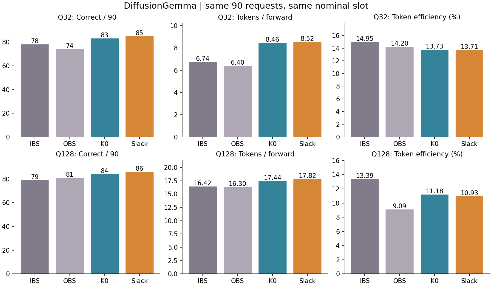

# 单请求 Serving 槽位：固定曲线与运行中切档

[北京时间 11 月 26 日 20:05 起的 24 小时设计周期](PLAN_24H.md)

目标是让服务端按负载给同一个请求调整预算。**只有实测质量、推进速度及物理成本都合适的档位，才适合进入后续调度器。** 每轮先刷新上轮新解码或严格编辑的行，哪怕超出名义预算；余下行优先尚未解码的位置，严格物理块内的旧前缀可选择性重算。没选中的已初始化 KV 仍可见。不给不同配置换题，不把提交、验证、重编码算免费，不把相同名义 Q 当作相同物理成本。

## 固定曲线

[单一 K0 策略的原30、新60、全90](fixed-k0.csv)，可用 `python -m experiments.t2t.serving_slots.fixed_slots` 重建。每个预算均为同一零注入算法，不从已观察的多个前缀选法中挑赢家拼成曲线。`macro_tpf=mean(N/F)`，`pooled_token_efficiency=sum(N)/sum(physical_Q)`，`q_per_f=sum(physical_Q)/sum(F)`，纯 prompt prefill 除外。Gemma 主槽 32/64/128/256，16 保留作低预算诊断；LLaDA 主槽 4/8/16/32，真正 Q64 要两个块。Gemma 512 同理，暂不列有效配置。

同一道题可比较不同完整策略，但 Optimus 含不同的采样/提交策略。按相同名义槽位比较 IBS/OBS；FlowBlock W1/W2 是一/两块的参考，不是每个小 Q 的等成本基线。和外部对照同时列总体与逐请求成本，未经校准不作等成本结论。相邻档的升档效果按固定题、固定种子做配对，报告救回、丢失、TPF 差区间，不要求通过筛题构造单调性。[LLaDA 真双块历史实测](../dual64/README.md)不能与单块 Q64 别名混用。

[相邻档的逐题配对差、救回/丢失、95% 区间和成本](adjacent-k0.csv)。`python -m experiments.t2t.serving_slots.fixed_slots --data "$D"` 从固定策略的请求记录重算并核对已发布数字。全90中，7个相邻档的 TPF 差区间下界都大于0；只有 Gemma 诊断档16→32的质量差区间也完全大于0（救回11、丢失1，+11.11个百分点，区间[+3.34,+19.77]，未做多重比较校正）。Gemma 主档32→64救2丢2，质量不变；LLaDA 16→32救2丢4。大槽位的价值当前主要体现在每轮推进，而非普遍提高质量。LLaDA Q4右端只补1个前缀时原30/新增60/全90为25/46/71，零组为26/48/74；TPF 3.609 对 3.600，效率20.04% 对20.17%，不推荐该项作为低档默认。[配对数值](../prefix_window/llada21-q4-slack-k1-right.csv)。

## 首个切档实验

**首个完成的外部对照：Gemma C32 IBS。** 原30/新增60/全90正确为 27/51/78，TPF 6.743，效率14.95%，全程输出39,001个非特殊 token、7,849次生成 forward、260,916个物理 Q。K0 为27/56/83，TPF 8.463，效率13.73%；右端 K8 只补空位为29/56/85，TPF 8.522，效率13.71%，输出32,911、4,002次 forward、240,106个物理 Q。后者相对 IBS 救回10题、丢失3题；相对 K0 多对的2题全在原30。虽然前缀策略用的总物理 Q 少，每个 forward 更宽，且输出长度不同；这不是更低时延或同采样器的因果结论。[逐组配对 K0](controls/gemma-ibs_32-zero.csv) · [逐组配对 K8](controls/gemma-ibs_32-slack.csv)。

两种模型均复用同一原生稀疏执行器、现有 KV 与采样状态，只在可选位轮改变预算。用**外部给定序列**模拟负载；不以题型、最终答案、未来 logits 或当前得分调档。首轮将额外前缀 K 固定为零，使切档效果与调前缀比例区分开。

| 模型 | 低档 A | 高档 B | 每个请求使用的模式 |
|---|---:|---:|---|
| LLaDA 2.1 | 8 | 16 | 固定 A、固定 B、循环 AABB、循环 BBAA |
| DiffusionGemma | 32 | 64 | 同上 |

1. 完整原生全宽资格检查；两个恒定序列都须对90题逐题复现**此前固定 K0 的整个请求记录**（包括输出 token、每轮选位、物理行和提交事件，只排除新增调档标签），才能开始混合序列。`--slot-control Q=DIR` 显式指定已资格验证的参照。
2. 每次实际稀疏选位消耗一个序列元素；初始化、全宽验证、提交、重编码独立计费，不消耗它。序列索引属于请求，跨物理块保留；不因切档清空缓存或 RNG。日志同时留 `slot_tick`、`slot_offer`、`fresh_rows`、选中位置与实际 Q。AABB 和 BBAA 名义构成相同，但分叉、提前结束和必刷溢出可以带来不同总成本。
3. 对两个固定端点分别报告完整90题的配对结果，不挑最好的一种相位；报告任一方向实际切过档的请求数、必刷溢出、N/F/物理Q、TPF、效率。检验“升档必增质量”与“高低档组合能给出较好成本权衡”是不同问题。若端点无法复现或出现丢失必刷行，先修实现，不解读分数。

Gemma 运行参数例（在原有 frozen90 runner 的参数后追加）：

```bash
--slot-control "32=$D/gemma-q32" --slot-control "64=$D/gemma-grid-k1" \
--arm 32:0:32:slottrace_32 --arm 64:0:64:slottrace_64 \
--arm 32:0:32:slottrace_32_32_64_64 --arm 64:0:64:slottrace_64_64_32_32
```

[严格物理块内的前缀比例实验](../prefix_window/gemma-ratio-decisions.md) · [等宽换位的实测结果](../prefix_window/DONORS.md) · [Optimus 90题复现与评分命令](../prefix_window/README.md)

### Gemma Q32 与 Q64 的切档结果

两个固定端点都通过90题逐题完整记录复现。A=32、B=64。四组都不额外注入前缀，以分离预算顺序的影响。原30和新增60分开评分。

| 外部供档 | 原30 / 新60 / 全90正确 | TPF | token efficiency | 总 F | 总物理 Q | 物理 Q/F | 至少切一次的请求 |
|---|---:|---:|---:|---:|---:|---:|---:|
| 固定 A | 27 / 56 / 83 | 8.463 | 13.73% | 4,023 | 240,190 | 59.70 | 0 |
| AABB 循环 | 28 / 54 / 82 | 10.472 | 12.84% | 3,265 | 254,468 | 77.94 | 90 |
| BBAA 循环 | 28 / 55 / 83 | 10.559 | 12.83% | 3,362 | 260,838 | 77.58 | 89 |
| 固定 B | 29 / 54 / 83 | 12.897 | 12.71% | 2,562 | 250,795 | 97.89 | 0 |

BBAA 对 AABB 救1、丢0；配对质量差的95%区间为[-7.86,+10.24]个百分点，TPF差为+0.087、区间[-0.335,+0.508]。不能据此推荐先高后低。两种混合时序每轮成本和TPF都在端点之间，但其请求总工作量都**高于固定64**，因为推进轮数、输出长度均发生了变化。两种时序中，bootstrap/verify/reencode 等非选位环节分别花费122,368和122,624个 Q，占各自总量约48%和47%。后续调度不能仅按名义预算估算最终成本。这些时序是外部负载的可重复替身，并非线上负载实验。[所有配对表及逐阶段工作量](switches/)

## 调度器如何供档

在已有原生 decoder 的 batch-one 推理入口传入 `next_budget(info)`。`info` 只含请求内选位序号、物理块起点/宽度、待解码数、必刷数；请求标识和负载信息由调用方闭包持有。回调返回整数 Q（K0），或者 `BudgetOffer(q, prefix=K, selector="right"|"random"|"oldest")`（只补空位，不换走 MASK）。`None` 明确退回执行器构造时的固定 Q、K0；错误值或异常不会被静默改写。这里只接受单块宽度内的 Q。不能把双块请求交给单块执行器并当成大档已执行。

```python
from bdlm_serving.methods.t2t.slot_trace import BudgetOffer

# llada_kernel = LLaDASparseKernel(model, 8, 0, 8, policy="hard_prefix_zero")
# lookup 是服务端传入的非阻塞查询；未分配时返回 None，不查询模型 logits。
state = llada_kernel.create(ids, cfg, cap, seed, mask_id, eos_ids,
                            next_budget=lambda info: lookup(request_id, info))
while state.phase != "done":
    llada_kernel.step(state)
output = llada_kernel.output(state)

# Gemma 的 context 仅覆盖一个请求；同一模型实例不可并发安装 hook。
def offer_gemma(info):
    q = lookup(request_id, info)
    return BudgetOffer(32, 8, "right") if q == 32 else q

with sparse_gemma(model, 32, 0, 32, policy="hard_prefix_zero",
                  selection_seed=seed, next_budget=offer_gemma) as ledger:
    output = model.generate(**inputs, max_new_tokens=cap)
```

两种后端均让预录实验通过同一个回调入口；必刷超过外部给的预算时按实收费。单独运行或交错推进 LLaDA 请求时，各自保留调档游标和缓存。全宽步骤不回调、不免单。Gemma 即使拟进行选位，若当前全接受且无必刷行，也直接验证，不消费新预算。接口的 CPU 集成测试不等于真实模型切档的质量验证。

## Gemma 已完成的 90 题对照



[原30、新60、全90的数值（包含实际 N/F/Q）](gemma-optimus.csv) · [重画脚本](controls_plot.py)。Q32 的 Slack 为 K8 右端，Q128 为 K32 可复现随机。固定档零加回是独立对照。IBS/OBS 沿用原 Optimus 策略；虽然名义档位相同，采样、终止、实际 Q/F 和输出长度可能不同。这是执行方法对比，不是前缀的单因素收益。

## 复现切档评分和 FlowBlock 对照

`python -m experiments.t2t.serving_slots.switch_report --run "$RUN" --cases "$FROZEN90" --out "$PRIVATE_SCORES"` 对已完成的两个端点、两个切换相位做六组配对。每题独立核对选位的时钟和方向、真实 Q、必刷溢出，以及必刷/MASK/普通回填/额外前缀四项的加和；非选位轮及重编码单列。`--out` 包含逐题输出链接与评分，请放在集群私有目录，只发布汇总 CSV。

`python -m bdlm_serving diffusiongemma-wave --checkpoint "$DG_CHECKPOINT" --samples "$FROZEN90" --output "$NEW_RUN" --suite frozen90 --flow-only --block-size 256 --flowblock-windows 1 2 --reference30-root "$ORIGINAL_WAVE" --native-reference "$NATIVE90"` 复用同一 wave 生成器。每个 W 独立逐字段复现其历史30（含工作、输出、种子）之后才进入新增60。W1 还对全部90逐题校验原生输出及前向；W2 每次 decoder 按实际打包的 512 行计费，即使只有一个块处于活跃状态。这是大窗口基线，不是已实现了可切换的 512 档。
