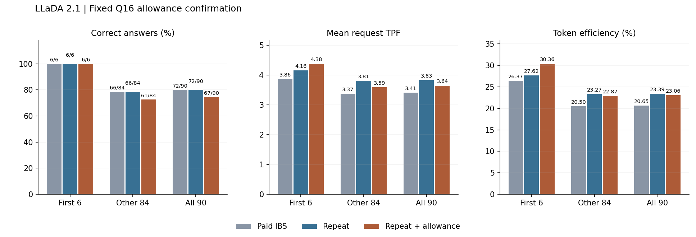

# 固定预算下的额外采纳：阶段结果

版本：`paid-agreement-admission-20261128`。研究对象是**单请求的采纳规则**：哪些真实算过、原生采样器没有接受的 MASK，可以提前写入。这里没有更换 Q 选位器，也没有测试混合预算。归档不等于选为默认算法。

## 已确认的结果

连续两轮选中同一个 MASK、都提议同一个普通 token、两轮概率都大于 0.5，且两次原生采样都拒绝时，在第二轮额外采纳。写入后仍要付费更新 KV。**“不限额”仅指不另外限制这类采纳的数量，不是取消物理 Q 预算。** [四个固定档的 90 题对照、原生和历史基线图](four-slot-checkpoint.md)保持原样。

本轮只改一项：给每轮**额外采纳**加上累计不确定度限额 0.5。LLaDA 2.1 固定 Q16，同一张 H800、同一套 90 题，结果如下：

| 方法 | 正确数 | TPF | Token efficiency | 实际 forward | 实际 decoder Q |
|---|---:|---:|---:|---:|---:|
| 计入必需 KV 写回成本的 Optimus IBS | 72/90 | 3.406 | 20.65% | 15,407 | 205,841 |
| 连续两轮提案一致，不限额 | 72/90 | 3.833 | 23.39% | 14,150 | 187,569 |
| 同一规则，加限额 0.5 | 67/90 | 3.644 | 23.06% | 13,661 | 182,229 |

TPF 是各请求 `N/F` 的均值；token efficiency 是 `ΣN/ΣQ`。`N` 为实际交付的非特殊 token 数，`F` 为实测生成 forward，`Q` 为真正选中并投影的 decoder 行数。不收敛的请求交付按零计，F、Q 如实保留。

**决定：不采用这个限额。** 相对不限额，6 题初筛在正确数不变时提高了 TPF，但其余 84 题从 66 降到 61 题正确，TPF 从 3.810 降到 3.591。全体少算 489 F、5,340 Q，也少交付 1,844 个 token，并新增两条不收敛请求。净少对的 5 题中，4 题来自 MATH500。此决定针对实测面板；正确率差的配对区间跨过零。[逐项对照与原 30 / 新 60 分层](allowance.md) · [账单摘要与区间](llada-q16-allowance-90-confirmation.json)。

## 不作全量结论的实验

另一项独立消融只允许在**本轮实测、仍未被采纳的首个 MASK 之前**做额外采纳。LLaDA Q8、Q16 和 Gemma Q64、Q128 均只测了同样的六题。LLaDA Q8 少对一题；Q16 虽提高 TPF，却用了更多 F 和 Q；Gemma 两档 TPF 均下降。Q128 的对照是保留原生 T2T 的 Live，其余三档的对照为不限额连续两票。**不合并这两种对照，不把六题当作 90 题成绩。** [四组数字、对照身份和数据](measured-hole.md)。

仍值得保留的正例是 **LLaDA Q16 不限额**：相对付费 IBS，总正确数持平，少用 1,257 F、18,272 Q，TPF 和 token efficiency 都提高。但同一规则在 **Gemma Q64** 从 83/90 降到 77/90；**Gemma Q128** 虽比同卡 IBS 多对一题，仍比同卡 Live 少对九题。四个档不足以推荐两模型通用的十档算法。

后续固定预算实验回到 Q 的分配：先付清上轮写回，再单独改变 MASK 和块内已付清前缀的选位比例；`2B` 下跨块选位另作消融。本页不将这些未验证的方向记作本版收益。
