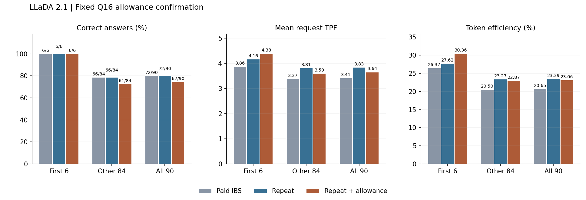

# How many additional proposals should one paid step accept?

Preregistered comparison on hard-budget paid IBS (six-case results below):
the archived [two-measurement rule](v1.md), and the same rule with one
allowance on its *additional* admissions. Do not change the original label
or the base sampler, physical Q selection, RNG draws, EOS, mandatory KV
writes, or Gemma encoder and self-conditioning.

For each originally rejected ordinary token proposed on the same MASK in
two consecutive measured decoder calls, retain the existing strict `>0.5`
threshold on both observations. Assign that row cost
`1 - min(p_previous, p_current)`. In order of increasing cost (ties go to
the lower absolute position), keep the longest prefix whose total cost is
at most `0.5`. Return chosen rows in the original sampler order. Unselected
positions have no vote. A missed physical tick, block change, native
acceptance or changed proposal invalidates the pair. The number `0.5` is a
sampling hyperparameter, not a calibrated probability guarantee or an extra
physical Q budget. A single qualified proposal always fits; this changes
only the case where multiple proposals compete.

- Model pairs: LLaDA 2.1 Q16 on H0, DiffusionGemma Q64 on A2. Same original
  fixed six (`7,13,25,33,55,71`), no task replacement or length filtering.
  Freeze one allowance for both models before observing treatment outcomes.
- On each board, find states where the allowance actually rejects a v1 extra.
  Do not infer effects from aggregate counts. If prior receipts lack a
  predecessor score, use a measured read-only observer, not an imputed score.
  If no state is exposed, stop after observation.
- Reproduce the same-board parent control and/or its archived probe using
  IDs, decisions, F and Q. At the first intervention, verify identical
  pre-state, physically measured rows, proposals and native acceptance;
  the only difference may be a subset of additional admissions. All
  following writes remain real and billed. Compare the two policies and
  include the separately named, same-board unmodified IBS point.
- Do not expand a candidate that is point-dominated in correctness and
  macro TPF by the original paid IBS or the uncapped repeat rule. To give
  a new 90-case run priority, require six-case correctness and TPF at
  least equal to paid IBS, with one strictly improved, and not both total
  F and Q higher. Report disagreement with stronger quality references
  separately. Do not declare quality superiority from six.

This measures whether limiting the combined uncertainty of extra writes
changes the quality/forward trade-off. It does not estimate a pure ranking
effect at equal admission count, or select a new prefix quota. The shared
[implementation](../../../../../bdlm_serving/methods/t2t/capped_agreement.py)
extends the frozen eligibility rule, and has no access to future observations.

## Measured six-case results, November 28

Same six IDs in each row; macro TPF is the mean of per-request `N/F`, not
the ratio of the total N and F below. TE is pooled `N/Q`.

| Model, fixed Q | Sampling rule | Correct | Macro TPF | TE | N | F | Actual decoder Q |
|---|---|---:|---:|---:|---:|---:|---:|
| LLaDA 2.1 Q16 | Paid IBS | 6/6 | 3.8624 | 26.37% | 1,379 | 399 | 5,229 |
| LLaDA 2.1 Q16 | Uncapped repeat | 6/6 | 4.1563 | 27.62% | 1,384 | 371 | 5,010 |
| LLaDA 2.1 Q16 | Repeat, allowance 0.5 | 6/6 | 4.3779 | 30.36% | 1,401 | 346 | 4,615 |
| DiffusionGemma Q64 | Paid IBS | 5/6 | 14.4550 | 24.18% | 1,256 | 88 | 5,194 |
| DiffusionGemma Q64 | Uncapped repeat | 5/6 | 14.1731 | 24.21% | 1,337 | 97 | 5,522 |
| DiffusionGemma Q64 | Repeat, allowance 0.5 | 5/6 | 13.6525 | 23.75% | 1,343 | 101 | 5,654 |

LLaDA qualifies for full confirmation; five requests had an actual decision
difference. [Six itemized receipts, first differences and source](../llada-ibs-certified-eos/q16-risk-h0-six.md).
Gemma does not qualify. The [same-A2 reconstruction](gemma-q64-allowance-first-differences.json)
found three actual first differences: #7 at tick 5, #13 at 11 and #25 at 7.
The class digest matched the shared implementation. Before each difference
the measured inputs matched; the sets diverged only at extra admissions.
#25 cost 4 more forwards and 138 more Q, while #7 saved 6 Q. #13 changed
output IDs with the same bill. These are whole-request comparisons, not
costs causally attributable to an individual token. The 26 rejected extras
out of 48 on the observer trajectory are counterfactual, not actual writes saved.

Full n164 result directories under `/data1/project_data/gx-erqw-20261123/results/`:
`llada-ibs-q16-risk-cap-h0-six-v1`, `gemma-q64-repeat-cut-20261128T215952`,
`gemma-q64-repeat-cut-fork-20261128T221219`. The Gemma paired-six SHA-256 is
`68bb3c8fff03d31a27158f45fe58bdfef2d60ac3a94f61d70e3665f3880ded77`.

## Full Q16 confirmation: do not use the allowance as a default

All 84 remaining requests ran on H0, disjoint from the six above. The
physical audit of all 84 passed. The independent join verified the two seals,
the frozen manifest and the earlier same-card controls in all five cohorts.
The original six are counted once, not 96 total. Failed runs stayed in the
scores at zero delivery with their F and Q charged.

| H0 LLaDA Q16, frozen 90 | Correct | Macro TPF | Pooled TE | Output N | F | Actual decoder Q |
|---|---:|---:|---:|---:|---:|---:|
| Paid IBS | 72/90 | 3.406 | 20.65% | 42,500 | 15,407 | 205,841 |
| Uncapped repeat | 72/90 | 3.833 | 23.39% | 43,870 | 14,150 | 187,569 |
| Repeat + allowance | 67/90 | 3.644 | 23.06% | 42,026 | 13,661 | 182,229 |

Uncapped vs allowance: the first six went from 4.156 to 4.378 TPF at 6/6,
but the other 84 went from 3.810 to 3.591 and **66 to 61 correct**. On the
original 30 the scores were 25 vs 24, on the added 60 they were 47 vs 43.
Across all 90, six were rescued and eleven lost, with two additional
nonconvergent requests (#45 and #50; #75 failed in all arms). Compared with
uncapped repeat, the allowance saved 489 F and 5,340 Q but delivered 1,844
fewer tokens. The descriptive stratified paired 95% interval for macro TPF
difference is [-0.357, -0.035]; for correctness it spans [-14.44, +3.33]
percentage points. No claim of a population-level accuracy difference.
Both controls outscored the allowance on the actual fixed panel.

[Joined data, intervals, cohorts and hashes](llada-q16-allowance-90-confirmation.json)
· [independent verification](../../../../../tools/audit_allowance_generalization.py)
· [replot](../../../../../tools/plot_allowance_confirmation.py).
Source directories on n164: `results/llada-ibs-q16-risk-cap-h0-six-v1` and
`results/llada-ibs-q16-risk-cap-frozen90-h0-v2`. The earlier `-v1` full-run
attempt produced no eligible receipt. Keep this confirmation separate from
the [four-offer uncapped snapshot](four-slot-checkpoint.md).

**LLaDA Q8 allowance, six only:** paid IBS / uncapped / capped each scored
6/6 on A1. Macro TPF was 2.639 / 2.782 / 2.718; pooled TE was 34.61% /
37.32% / 35.93%. The cap used 12 more F and 139 more Q than the uncapped
rule. No 90-case extension. [Sealed six-case totals](llada-q8-allowance-six.json);
n164 source: `results/llada-ibs-q8-paid-agreement-allowance-a1/attempt-20261128T141226Z`.
