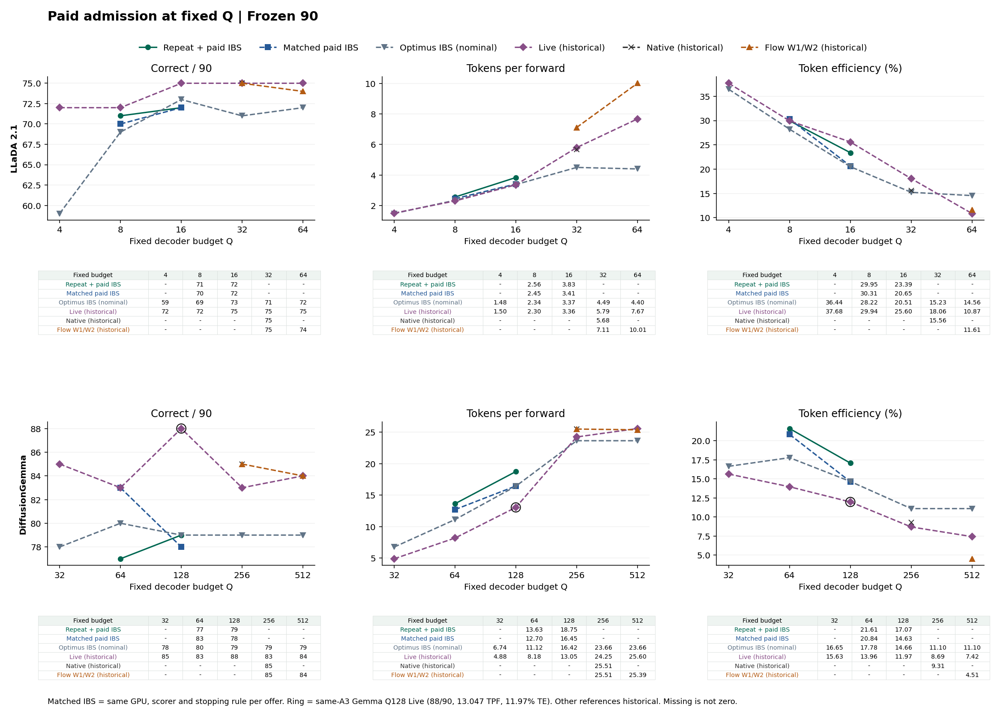

# 连续两轮提案一致：四个固定预算的 90 题归档

2026-11-28，标签 `paid-agreement-four-slot-20261128`。这是**同一采纳算法的四档实测**，不是挑选各档最佳方法拼成的结果，也不是十档通用默认值。旧标签 `paid-agreement-v1` 仍只含原三档。本页新增 LLaDA Q8；下方六题改动不计入四档成绩。

## 请求如何运行

每条请求全程固定 decoder Q 预算。对照为显式支付写回成本的 Optimus IBS。候选沿用其选行、物理块、原生采样、终止和 KV 写回逻辑，只允许一种额外采纳：一个仍为 MASK 的位置在相邻两次真实 decoder forward 都被选中，原生采样器两次都拒绝，但提议同一个非特殊 token，且两次概率都严格大于 0.5，就在第二次写入该 token。没算的位置不投票；新写入的 token 仍须真实更新 KV。这改变的是**是否采纳**，不是 Q/KV 的选择或预算。[共享实现](../../../../../bdlm_serving/methods/t2t/paid_agreement.py)

## 固定预算结果

箭头均为**同设备、同题、同种子：付费 IBS → 额外采纳**。每档 90 题（GSM8K、MATH500、HumanEval 各 30）；失败不删。TPF 是逐请求 `N/F` 的均值；token efficiency 是 `ΣN/ΣQ`，不以物理块大小或标称预算替代 Q。N 为交付的非特殊 token 数，F 为生成阶段实际 forward 数（Gemma 含生成阶段 encoder），Q 为实际投影的 decoder 行数，不含 prefill。

| 模型、固定 Q | 正确数 / 90 | TPF | Token efficiency | 总 F | 总 Q | 原 30 正确数 | 新 60 正确数 |
|---|---:|---:|---:|---:|---:|---:|---:|
| [LLaDA 2.1 Q8](llada-q8/all90-summary.json) | 70 → 71 | 2.450 → 2.555 | 30.31% → 29.95% | 19,054 → 20,278 | 140,426 → 148,924 | 22 → 22 | 48 → 49 |
| [LLaDA 2.1 Q16](llada-q16-frozen90.json) | 72 → 72 | 3.406 → 3.833 | 20.65% → 23.39% | 15,407 → 14,150 | 205,841 → 187,569 | 23 → 25 | 49 → 47 |
| [DiffusionGemma Q64](gemma-q64-frozen90.json) | 83 → 77 | 12.704 → 13.635 | 20.84% → 21.61% | 2,930 → 2,997 | 161,762 → 164,152 | 29 → 29 | 54 → 48 |
| [DiffusionGemma Q128](gemma-q128-frozen90.json) | 78 → 79 | 16.451 → 18.747 | 14.63% → 17.07% | 2,234 → 1,991 | 225,115 → 200,177 | 27 → 28 | 51 → 51 |

LLaDA Q16 是最清楚的正例：总分不变，少 1,257 F，但有 6 题改对、6 题改错。Q8 的输出变长（42,570 → 44,609），F、Q 也增加，不能把更高 TPF 解释为省计算。Gemma Q64 的质量损失完全出现在新增 60 题；Q128 相对付费 IBS 少算、多对一题，但[同卡 Live](q128-same-card-live-point.json) 得到 **88/90、13.047 TPF、11.97% TE**，比候选多对 9 题。结论限于冻结题集，不宣称显著质量提升、延迟加速或随预算单调改善。其余档位未测这条规则，不插值。[对照来源、逐题分析及重画命令](README.md)

## 后续消融，单独看

- [限制每步额外采纳量](allowance.md)：同一组 6 题，LLaDA Q16 相对不限额版保持 6/6，F 从 371 降至 346；Gemma Q64 保持 5/6，F 从 97 升至 101。只有前者通过扩至 90 题的门槛。本归档不把筛选结果当全量成绩。
- [Gemma Live Q128，把一个刚写回后的前缀席位换给暖 MASK](../gemma-factors/q128-post-drain-mask/README.md)：5/6 题实际换位；从 6/6 到 5/6，省 17 F。保留负结果，不推广。
- [Gemma Live Q32，尝试重选上轮被拒的干净行](../gemma-factors/q32-lastmiss-a3/README.md)：3 题观察到 467 个被拒行次，无一满足干净条件；没跑处理组，不能记成质量或 TPF 持平。
