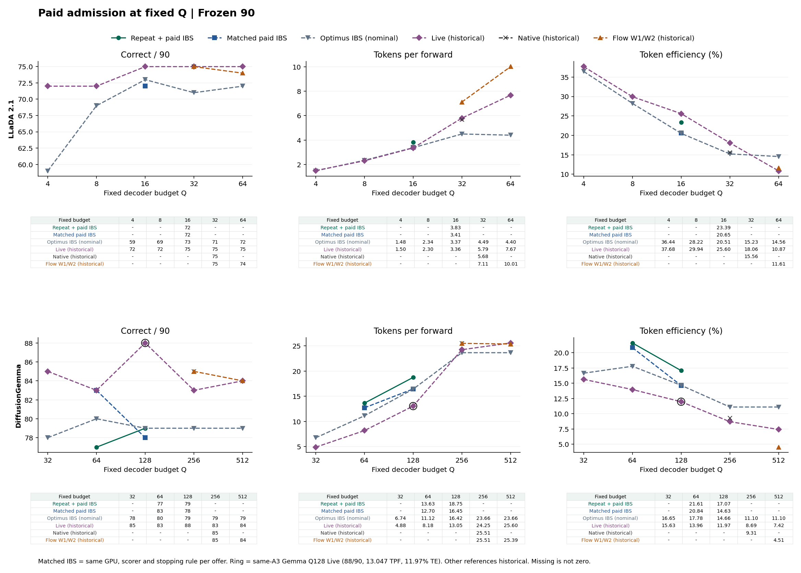

# Paid Agreement v1：固定预算单请求实验归档

**决策：作为阶段结果保留，不作为两模型的统一默认算法。** 2026-11-28 封存。三档的主证据来自提交 `04d21b2715e0c86f1f85e80288fd590c16f8ab7c`；标签 `paid-agreement-v1` 固定本说明、对应代码、数据和图。后续实验不回填此版本。

## 究竟改了什么

对照是显式计入 KV 写回成本的 Optimus IBS（表中简称 IBS）。候选只改**已选中 MASK 的采纳条件**，不改选 Q 的逻辑。对同一请求、同一物理块、同一未解位置，如果相邻两次真实 decoder forward 都计算了该位置、IBS 两次均未采纳、预测的普通 token ID 相同且两次 FP32 概率均严格大于 0.5，就在第二次额外采纳。跳过一轮或换块就不再使用该票；不读取未选位置的 logits。新写 token 的 KV 仍要实际重算并计费。[共同规则源码](../../../../../bdlm_serving/methods/t2t/paid_agreement.py)

## 三档正式结果

每个箭头是**同卡、同固定预算、同停止规则：IBS → v1**。使用同一批 90 题（GSM8K、MATH500、HumanEval 各 30），未收敛也保留。TPF 是各请求 `N/F` 的平均；token efficiency 是 `ΣN/ΣQ`。`N` 是最终交付的非特殊 token 数，`F` 是生成阶段实际 forward 数（Gemma 含生成阶段的 encoder），`Q` 是实际选中并投影的 decoder 行数。

| 模型、预算 | 正确数 / 90 | TPF | Token efficiency | 实际 F | 实际 decoder Q | 原 30 正确数 | 新增 60 正确数 |
|---|---:|---:|---:|---:|---:|---:|---:|
| [LLaDA 2.1 Q16](llada-q16-frozen90.json) | 72 → 72 | 3.406 → 3.833 | 20.65% → 23.39% | 15,407 → 14,150 | 205,841 → 187,569 | 23 → 25 | 49 → 47 |
| [DiffusionGemma Q64](gemma-q64-frozen90.json) | 83 → 77 | 12.704 → 13.635 | 20.84% → 21.61% | 2,930 → 2,997 | 161,762 → 164,152 | 29 → 29 | 54 → 48 |
| [DiffusionGemma Q128](gemma-q128-frozen90.json) | 78 → 79 | 16.451 → 18.747 | 14.63% → 17.07% | 2,234 → 1,991 | 225,115 → 200,177 | 27 → 28 | 51 → 51 |

- **LLaDA Q16**：少用 1,257 次 forward；总分持平，但 6 题改对、6 题改错，不是逐题等价。
- **Gemma Q64**：原 30 题看不到退化；新增 60 题中 1 题改对、7 题改错。第 72 题从 176 token、10 F、答对变为 2,046 token、320 F、答错。全体的 F、Q 都增加，不能把 TPF 上升解释为省算。
- **Gemma Q128**：相对 IBS 同时减少 F 与 Q，净多对 1 题（5 题改对、4 题改错），不足以证实质量提升。[同卡 A3 的 Live](q128-same-card-live-point.json) 为 **88/90、13.047 TPF、11.97% TE**；v1 更省计算，但少对 9 题。两者有多处算法差异，这不是采纳规则的单因素对照。



## 小样本和旁证不进主表

[等采纳数的选行对照](equal-dose.md)、[六题写回观测](payment-observer.md)、[Gemma Q128 一次性纠正](provisional-recheck/README.md)均单列。另有独立的 [Gemma Q64 同状态 KV 校准（A0，6 题）](https://github.com/BaideBear/BDLM_Serving/blob/24e276bae4d496ebfcc02188e9293939b3ed19ec/experiments/t2t/serving_slots/controls/paid-agreement/a0-freshkv/README.md)：该步均选满可见的 64 行，重算未改变 logits；不能用来解释部分刷新时的质量。额外诊断的 12 F、768 Q 不进主表。没有从这些结果外推其他固定档或混合预算。

## 如何复核

三份正式 JSON 都包含 `frozen90`、`original30`、`new60` 及原始回执摘要；[完整分析](README.md)列出配对及数据集分解。[汇总工具](../../../../../tools/agreement_fixed90_comparison.py)与[绘图工具](../../../../../tools/plot_paid_budget_points.py)随标签保存。在标签对应的仓库根目录运行以下命令可重画，无须模型或 GPU：

```bash
d=experiments/t2t/serving_slots/controls/paid-agreement
python3 tools/plot_paid_budget_points.py \
  "$d/llada-q16-frozen90.json" "$d/gemma-q64-frozen90.json" "$d/gemma-q128-frozen90.json" \
  --historical "$d/../fixed-request-comparison/metrics.csv" \
  --matched-live "$d/q128-same-card-live-point.json" --out /tmp/paid-agreement-v1.png
```
